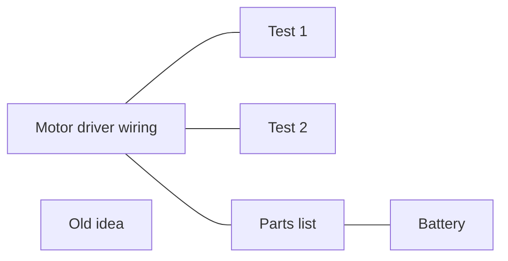

{:class="cover"}

---

By the end of this lesson you will be able to open the graph view, read it, and use it to spot notes that are not linked to anything.

Every `[[wikilink]]` you have written is a connection, and the **graph view** draws them all. Each note is a dot (a node), and each link is a line between two dots. After a few weeks of build-log notes it becomes a map of your project.



---

## Reading the graph

For the Rover vault, you might see a big cluster in the middle around `Motor driver wiring`, because lots of test notes link to it. That tells you something real: the motor driver is where most of your trouble, and your learning, is happening.

In that picture `Old idea` has no lines: it is an **orphan**, a note nothing links to and that links to nothing. Orphans are not wrong, but they are easy to forget, and the graph is the quickest way to spot them.

---

## Opening the graph

- Open the command palette (`Ctrl+P` or `Cmd+P`) and search for the graph command, or click the graph icon in the sidebar.
- The **global graph** shows the whole vault.
- The **local graph** shows only the note you are on and the notes directly linked to it. It is available from the open note's menu or the command palette, and is usually the more useful one for a big vault.

Use the mouse wheel to zoom, drag to pan, and click a node to open its note.

---

## Tuning the view

The graph has a settings panel where you can:

- **Filter** what is shown, for example by search term, tags, or whether orphans are included
- **Group** notes by a search and give each group a colour, such as all `#test` notes in red
- **Change display** options such as node size and link thickness

Do not worry about exact labels, as the names of these controls can differ between versions. Look for the settings icon on the graph pane.

---

## Try it Yourself

1. Open the global graph for your vault. Which note has the most lines?
2. Open the local graph for `Motor driver wiring`. Which notes are one link away?
3. Create a new note with no links, find it as an orphan in the graph, then link it to another note and watch it join.
4. Challenge: colour all notes with a tag differently using groups.

---

## Common Issues

- **Problem**: My graph is just a few dots.
- **Solution**: Write links between your notes with `[[ ]]`.
- **Why**: The graph only draws links. Tags and folders do not create lines by themselves.

- **Problem**: The graph is a messy hairball.
- **Solution**: Switch to the local graph, or filter the global one.
- **Why**: A large vault has too many nodes to read at once.

> **Teachers**: the graph view makes a good end-of-lesson check. Ask learners to point out one orphan note and say how they would link it.

---

## Check your understanding


? What does a line in the graph view represent?
- [ ] A shared tag
- [x] A link between two notes
- [ ] A folder
> The graph draws links between notes.

? What is an orphan note?
- [ ] A note you deleted
- [x] A note with no links to or from it
- [ ] A note in the trash
> Orphans have no connections, so they show as unlinked dots.

? What does the local graph show?
- [ ] Every note in the vault
- [x] The current note and the notes directly linked to it
- [ ] Only tags
> The local graph focuses on one note.

