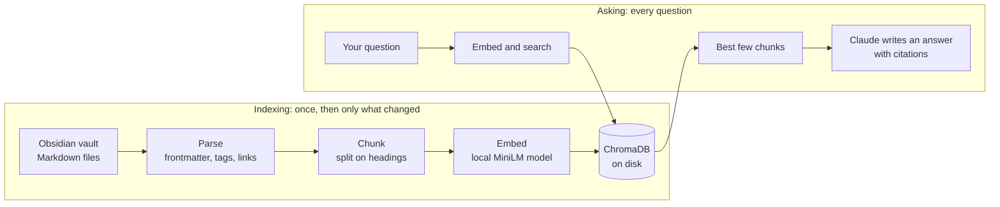

{:class="cover"}

---

Ahoy there makers! If you have been using Obsidian for a while you have probably hit the same wall I did. You know you wrote something down about that motor driver. You know it is in there somewhere. But search gives you forty hits for "motor" and none of them are the one you want.

Search looks for words. You want to search for *meaning*.

That is what we are going to build. By the end of this course you will have a tool called **Ask My Vault** - a Python command line app that reads your entire vault, understands what each note is actually about, and answers questions like *"what motor driver did I use on the SMARS build and why did I switch?"* with a proper answer and a list of the notes it got that answer from.

---

## Overview

The technique is called **RAG** - Retrieval Augmented Generation. It is two ideas glued together:

1. **Retrieval** - find the handful of paragraphs in your notes that are actually relevant to the question. We will use [ChromaDB](https://www.trychroma.com), a small vector database that runs as a Python library with no server to set up.
2. **Generation** - hand those paragraphs to a large language model and ask it to write an answer *using only those paragraphs*, with citations.

The important part is that second constraint. A model on its own will happily make things up about your robot. A model that has been handed your actual notes and told to cite them will tell you when your notes do not contain the answer - which is often the most useful thing it can say.

Everything except the final answer step runs entirely on your own machine. The embedding model is a small local one that ChromaDB downloads for you. Your notes never leave your laptop during indexing.

Here is the whole thing at a glance. The top half happens when you index, the bottom half happens every time you ask a question:



---

## Course Content

- What RAG is, and why plain keyword search is not enough
- Embeddings, vectors, and how "meaning" becomes numbers
- Setting up the project and the Ask My Vault package layout
- ChromaDB basics - collections, documents, metadata and queries
- Walking an Obsidian vault and skipping the folders you do not want
- Parsing YAML frontmatter, inline tags and wikilinks
- Chunking notes so retrieval finds the right paragraph, not the whole file
- Building the index, in batches, with useful metadata attached
- Incremental re-indexing so a rebuild takes a second, not ten minutes
- Querying the index and understanding what a distance score means
- Filtering by tag, folder and modified date
- Improving retrieval with oversampling, diversity and better chunk text
- Sending the retrieved context to Claude and getting an answer back
- Citations, grounding, and getting the model to admit it does not know
- Building the finished command line tool
- Keeping the index fresh automatically
- Evaluating whether your RAG is actually any good
- Troubleshooting the things that will definitely go wrong

---

## Key Results

After completing this course, you will:

- Understand how embeddings turn text into searchable meaning
- Be able to build and maintain a ChromaDB index from any folder of markdown
- Know how to chunk documents so retrieval actually works
- Be able to write a grounded prompt that cites its sources and refuses to guess
- Have a working `amv` command you can run against your own vault
- Know how to measure whether a change to your pipeline made it better or worse

---

## What you'll need

- **Python 3.10 or newer** - we use modern type hints like `list[str] | None`
- **An Obsidian vault** with at least twenty or thirty notes in it. A tiny vault makes for boring results
- **About 500MB of disk space** - the local embedding model is roughly 80MB, and Chroma's index grows with your vault
- **An Anthropic API key** for the answer generation step, from [console.anthropic.com](https://console.anthropic.com). The retrieval half of the course works with no key at all
- A terminal, and an editor you like

No GPU required. Everything here runs on a laptop CPU. A Raspberry Pi will work too, but indexing is slower there, so start it and go and make a cup of tea.

I built and checked the code in this course with Python 3.13, `chromadb` 1.5.9, `anthropic` 2.13.0 and PyYAML 6.0.4. ChromaDB and the Anthropic SDK change quickly, so if something behaves differently on your machine, check the version you have installed with `pip list` first.

> **Teachers**: This course suits confident Python learners aged about 14 and up, working alone or in pairs. Allow roughly 40 to 60 minutes per lesson, so plan it as a half-term project rather than a single session. Each learner (or pair) needs a computer with Python 3.10 or newer, permission to install packages with `pip`, about 500MB of free disk space, and internet access for the first run, when the embedding model downloads. Lessons 1 to 12 (everything up to and including improving retrieval) need no account and no payment, so they work well in a classroom. The answer step in lessons 13 to 15 needs an Anthropic API key, which means an account and a paid balance: that is a decision for you or the school, not a learner's own card. If you cannot provide keys, stop at lesson 12 and use `amv search`, which is already a useful tool. Learners should index a practice vault, not a private one, because retrieved excerpts leave the machine during the answer step.

---

## Prerequisites

You should be comfortable with basic Python - functions, classes, dictionaries and list comprehensions. If you are not there yet, start with:

- [Python for beginners](/learn/python/) - the fundamentals
- [Obsidian](/learn/obsidian/) - you need a vault to index, and a feel for tags, links and frontmatter

---

## How the course works

Each lesson builds one piece of the tool. Code appears in blocks like this:

```python
# Every code block in this course is complete and runnable
print("Hello, vault")
```

**Every code block tells you where it goes.** The first line is a comment naming the file, so you are never left guessing:

```python
# vault_rag/config.py
CHUNK_SIZE = 1200
```

When a block adds to a file you already started, the comment says where to put it - and when it replaces something from an earlier lesson, it says that too:

```python
# vault_rag/vault.py  (add below the Note class)
# vault_rag/vault.py  (replaces the load_note you wrote in lesson 5)
```

Some blocks are throwaway experiments rather than part of the tool. Those name a scratch file instead, which you can delete afterwards:

```python
# try_it.py - a scratch script in the project root
```

Blocks with no file comment are either shell commands or short fragments illustrating a point.

Where a lesson shows sample output, the structure is what to look for. Anything that depends on the embedding model, such as a distance or a percentage score, will differ a little on your machine. The counts of notes and chunks from the four-note practice vault in lesson 3 will match exactly.

Most lessons finish with a **Try it Yourself** section - small experiments that show you the behaviour rather than just telling you about it - and a **Common Issues** section for the things that trip people up.

Right then. Let's find out what RAG actually is.
