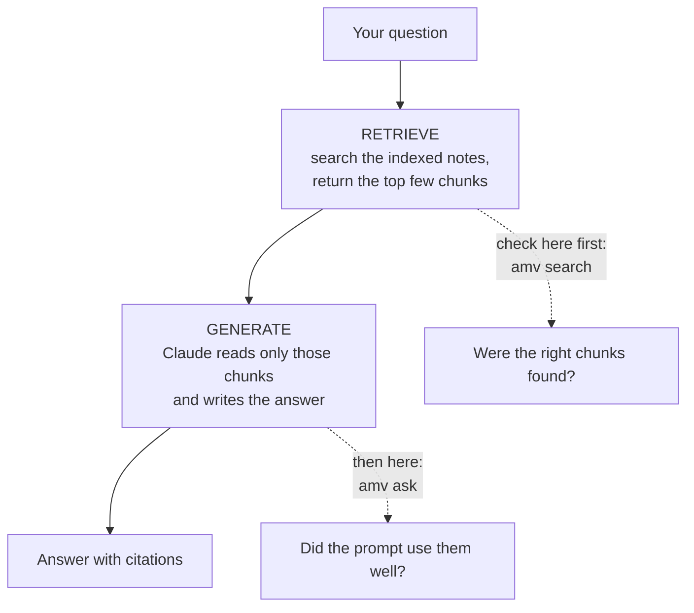

{:class="cover"}

---

By the end of this lesson you will be able to explain what retrieval augmented generation is, why it beats pasting a whole vault into a chatbot, and which stage of the pipeline each later lesson builds.

Let's start with the problem, because RAG only makes sense once you have felt the pain.

## The problem with searching your own notes

Say you have a note that says:

> The N20 motors stall on carpet. Swapped to the 100:1 gearbox version and it climbs fine now.

Six months later you type "torque" into Obsidian's search box. Nothing. You type "gear ratio". Nothing. The note is right there, it answers your question perfectly, and search cannot find it - because you never used those words.

Keyword search matches **strings**. You want to match **meaning**.

---

## Two ways to fix it, one of which is a trap

The obvious idea is: just paste the whole vault into a chatbot and ask.

That fails for three reasons:

| Problem | What actually happens |
|---|---|
| Size | A vault of a couple of thousand notes can run to a million tokens or more. Even a large context window fills up, and you pay for every token |
| Noise | Bury three relevant sentences in a million words of shopping lists and the model's accuracy drops |
| Cost and latency | You resend the entire vault on every single question |
{:class="table table-single"}

The better idea is: find the five paragraphs that matter, and send only those.

That is RAG.

---

## The two halves

**Retrieval augmented generation** is exactly what the name says - you *augment* the model's *generation* by *retrieving* relevant context first.

Two completely separate systems, and you can debug them separately. That turns out to matter enormously. When your RAG gives a bad answer there are only two possible causes:

- **The retriever handed over the wrong paragraphs.** The model never had a chance.
- **The retriever was fine and the model mangled it.** A prompt problem, not a search problem.

Being able to tell those apart in ten seconds is why we will build a `search` command alongside the `ask` command. One shows you exactly what was retrieved; the other shows you what was done with it.

---

## What gets built when

Here is the pipeline we are constructing, and which lesson builds each piece:

| Stage | What it does | Lesson |
|---|---|---|
| Read | Walk the vault, parse frontmatter and tags | 5, 6 |
| Chunk | Split notes into paragraph sized pieces | 7 |
| Embed | Turn each chunk into a list of numbers | 8 |
| Store | Save vectors plus metadata in ChromaDB | 8, 9 |
| Retrieve | Find the chunks nearest to the question | 10, 11, 12 |
| Generate | Ask Claude, grounded in those chunks | 13, 14 |
{:class="table table-single"}

The first five stages happen once, when you index. Only retrieve and generate happen when you ask a question - which is why asking is fast even on a huge vault.

---

## Why a vector database and not just a file

You could store every chunk's numbers in a JSON file and compare them all on every query. For a hundred notes that works fine. For ten thousand chunks it takes long enough to be annoying, and you would have to write the "find the closest" logic yourself.

ChromaDB gives you three things for free:

- **An approximate nearest neighbour index** so finding the closest chunks stays fast as the vault grows
- **A local embedding model** so you do not need an API key just to search
- **Metadata filtering** so you can say "only search notes tagged `robots`, modified this year"

And it is a `pip install`. No Docker, no server, no port to remember. For a personal tool that runs on your own laptop, that is exactly the right trade.

---

> **Teachers**: Learners will point this at their own notes, and personal notes can hold names, passwords and private thoughts. Indexing stays on the machine, but when a learner runs `amv ask`, the few excerpts retrieved for that question are sent to a hosted service. For a class, have everyone use the practice vault from lesson 3 (or a vault of non-sensitive notes), and agree before lesson 13 what is and is not fine to send.

## Try it Yourself

Before writing any code, get a feel for the problem in your own vault:

1. Open Obsidian and search for a concept you know you have written about - but deliberately use *different words* than you would have used when writing. How many of the right notes come back?
2. Now search using the exact phrase you think you wrote. Better? That gap between the two searches is the gap RAG closes.
3. Count your notes: `find ~/Obsidian -name "*.md" | wc -l`. Keep that number in mind - we will check indexing speed against it later.

---

## Common Issues

- **Problem**: "Can I not just use Obsidian's built-in AI plugins?"
- **Solution**: You can, and several are good. Build this anyway.
- **Why**: Every one of those plugins is this pipeline with the lid welded shut. When it returns a bad answer you cannot see why. Building it yourself means you can look at the retrieved chunks, change the chunk size, and fix it.

- **Problem**: "Does this send all my notes to an AI company?"
- **Solution**: No. Indexing is entirely local - the embedding model runs on your machine. Only the handful of retrieved chunks for a specific question are sent, and only when you run `ask`.
- **Why**: Embedding and generation are separate models. We use a local one for embedding and a hosted one for writing the answer. If you want a fully offline tool, lesson 19 points at how to swap the generation step for a local model too.

---

## Check your understanding


? What does the retrieval half of RAG do?
- [x] Finds the few chunks of your notes that are most relevant to the question
- [ ] Writes the final answer in fluent English
- [ ] Retrains a model on your vault
- [ ] Deletes duplicate notes
> Retrieval searches the index and returns the top few chunks. Writing the answer is the generation half.

? Why is pasting the whole vault into a chatbot a trap?
- [x] It is too big, buries the useful text in noise, and you pay to resend it on every question
- [ ] Chatbots cannot read Markdown
- [ ] It makes Obsidian delete your notes
> The lesson lists size, noise, and cost and latency as the three problems.

? Your RAG gives a wrong answer. Why is it useful that retrieval and generation are separate systems?
- [x] You can look at what was retrieved and tell in seconds which half is at fault
- [ ] It means the model can never be wrong
- [ ] It makes indexing faster
> That is why the course builds both a `search` command and an `ask` command.

? Which stages happen only when you index, not when you ask a question?
- [x] Read, chunk, embed and store
- [ ] Retrieve and generate
- [ ] Only the generate stage
> The first five stages run at index time. Only retrieve and generate run for each question, which is why asking is fast.

