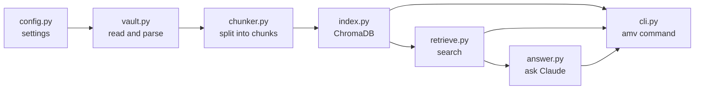

{:class="cover"}

---

By the end of this lesson you will be able to create a virtual environment, install the three dependencies, lay out the `vault_rag` package and build a four-note practice vault to test against.

Time to build something. In this lesson we set up the project skeleton that every later lesson fills in.

## The virtual environment

ChromaDB pulls in a fair number of dependencies, so keep it out of your system Python:

```bash
mkdir ask-my-vault
cd ask-my-vault
python3 -m venv .venv
source .venv/bin/activate      # Windows: .venv\Scripts\activate
```

Your prompt should now show `(.venv)`. If it does not, the activate step did not take.

---

## Dependencies

Three packages, and that is the lot:

```
# requirements.txt
chromadb>=1.5.0
anthropic>=1.0.0
pyyaml>=6.0
```

(I checked every example in this course against `chromadb` 1.5.9, `anthropic` 2.13.0 and PyYAML 6.0.4. The `>=` lines mean you will get those or newer.)

Save that as `requirements.txt` and install it:

```bash
pip install -r requirements.txt
```

What each one is for:

| Package | Job |
|---|---|
| `chromadb` | The vector database, plus the local embedding model |
| `anthropic` | Talking to Claude for the answer generation step |
| `pyyaml` | Parsing the YAML frontmatter at the top of your notes |
{:class="table table-single"}

The install takes a minute or two - `chromadb` brings along a Rust extension and an ONNX runtime. Check it landed:

```bash
python -c "import chromadb; print(chromadb.__version__)"
```

---

## The package layout

We are building a real tool, not a script, so it gets a proper package. Create this structure:

```
ask-my-vault/
├── .venv/
├── requirements.txt
└── vault_rag/
    ├── __init__.py      # version, and nothing else
    ├── config.py        # every setting in one place
    ├── vault.py         # read and parse notes
    ├── chunker.py       # split notes into chunks
    ├── index.py         # build the ChromaDB index
    ├── retrieve.py      # search the index
    ├── answer.py        # ask Claude
    └── cli.py           # the command line interface
```

One file per stage of the pipeline. When retrieval misbehaves you know exactly which file to open.

```bash
mkdir vault_rag
touch vault_rag/{__init__,config,vault,chunker,index,retrieve,answer,cli}.py
```

---

## Two files to write now

`__init__.py` is tiny:

```python
# vault_rag/__init__.py
"""Ask My Vault - a retrieval augmented generation tool for Obsidian."""

__version__ = "1.0.0"
```

`config.py` is the one that matters. Every tunable value in the whole project lives here, so that when you want to experiment with chunk sizes you change one number in one place:

```python
# vault_rag/config.py
"""All the knobs in one place."""

import os
from pathlib import Path

# Where your Obsidian vault lives
VAULT_PATH = Path(os.environ.get("VAULT_PATH", "~/Obsidian/MyVault")).expanduser()

# Where the Chroma database is stored
DB_PATH = Path(os.environ.get("VAULT_DB_PATH", "~/.ask-my-vault/chroma")).expanduser()

COLLECTION_NAME = "vault_notes"

# Chunking, in characters
CHUNK_SIZE = 1200
CHUNK_OVERLAP = 200
MIN_CHUNK_SIZE = 60

# Retrieval
TOP_K = 6
MAX_CHUNKS_PER_NOTE = 2

# Generation
ANSWER_MODEL = "claude-opus-5"
MAX_ANSWER_TOKENS = 2000

# Folders we never want to index
SKIP_DIRS = {".obsidian", ".trash", ".git", ".smart-env", "node_modules", "templates"}
```

A few notes on the choices there:

- **`os.environ.get` with a default** means you can point the tool at a different vault without editing code - handy when you want to test against a scratch vault.
- **`.expanduser()`** turns `~/Obsidian` into a real absolute path. Chroma will not expand the tilde for you, and the error you get if you forget is genuinely baffling.
- **The database lives outside the vault**, in `~/.ask-my-vault/`. Put it *inside* the vault and Obsidian will try to sync a binary database across your devices, which ends badly.
- **`templates` is in `SKIP_DIRS`** because template notes are full of placeholder text that pollutes retrieval with junk.

---

Here is how the files will fit together. Each module only talks to the ones before it, so the arrows show the order we will build them in:



## Point it at your vault

Rather than editing `config.py`, set the environment variable:

```bash
export VAULT_PATH="$HOME/Documents/Obsidian/MyVault"
```

Add it to your `~/.zshrc` or `~/.bashrc` so it survives a new terminal. Check it worked:

```bash
python -c "from vault_rag.config import VAULT_PATH; print(VAULT_PATH, VAULT_PATH.is_dir())"
```

You want to see your vault path followed by `True`.

---

## A safety net before you point at real notes

We are going to be reading files and writing a database. Reading is harmless, but while you are learning it is more pleasant to work against a small vault where you know exactly what should come back.

Make one. Run this from the project root (the folder that contains `vault_rag`):

```bash
mkdir -p testvault/electronics testvault/robots testvault/kitchen
cat > "testvault/electronics/Pico W.md" <<'EOF'
---
title: Raspberry Pi Pico W
tags: [pico, micropython, wifi]
---

# Raspberry Pi Pico W

The Pico W adds a CYW43439 wireless chip for 2.4GHz Wi-Fi, on top of the
RP2040 microcontroller from the original Pico.

## Onboard LED

The onboard LED is wired to the wireless chip, not to GPIO 25 like the
original Pico. Use `machine.Pin("LED")` and it works on both boards.

## Power

Deep sleep saves power when Wi-Fi is switched off and the board only wakes on
a timer. Leaving the radio on is what drains the battery.
EOF
cat > testvault/robots/SMARS.md <<'EOF'
---
title: SMARS Robot
tags: [robots, 3dprinting]
---

# SMARS

My SMARS uses two N20 geared motors and a Pico for the brain. Printed in PETG.

## Motor wiring

The DRV8833 takes four GPIO pins - two per motor. I used GP6, GP7 for the
left motor and GP8, GP9 for the right motor.

## Motor driver

The DRV8833 ran hot after ten minutes of driving, so I swapped it for a
TB6612FNG. The robot has run cool since.
EOF
cat > testvault/kitchen/Sourdough.md <<'EOF'
---
tags: [baking]
---

# Sourdough

The starter needs feeding every 12 hours in warm weather, and every 24 hours
if it lives in the fridge.
EOF
cat > testvault/Daily.md <<'EOF'
# Daily

## 2026-08-20

Ordered more PETG. Tested the [[SMARS]] on carpet - the N20 motors stall
when the wheels have no grip. Try the 100:1 gearbox next. #robots
EOF
```

Four notes, and you know precisely what is in them. The later lessons use this vault for every sample output, so when your results look odd you can compare them with the ones in the lesson. The files with spaces in their names (`Pico W.md`) are deliberate: real vaults are full of them.

---

> **Teachers**: Installing `chromadb` needs `pip` access to the internet and downloads a long list of packages, which some school networks block or throttle. On locked-down machines, a virtual environment in the learner's own folder avoids needing administrator rights. If thirty learners install at once on one connection it will be slow, so stagger the installs or use a local package mirror if your school has one. Python 3.10 or newer is required; check with `python3 --version` before the lesson.

## Try it Yourself

1. Run `pip list | wc -l` after installing. ChromaDB is not a small dependency - worth knowing what you signed up for.
2. Add a `PROJECT_ROOT` to `config.py` using `Path(__file__).parent.parent` and print it. Useful later for finding data files relative to the package.
3. Set `VAULT_PATH` to a folder that does not exist and print `VAULT_PATH.is_dir()`. It returns `False` rather than raising - we will turn that into a proper error message in lesson 5.

---

## Common Issues

- **Problem**: `pip install chromadb` fails to build a wheel.
- **Solution**: Upgrade pip first with `pip install --upgrade pip`, then retry.
- **Why**: Chroma ships pre-built wheels for common platforms. An old pip does not know how to select them and falls back to compiling from source, which needs a Rust toolchain you probably do not have.

- **Problem**: `ModuleNotFoundError: No module named 'vault_rag'` when running your code.
- **Solution**: Run from the project root - the directory *containing* `vault_rag`, not from inside it. Use `python -m vault_rag.cli`, not `python vault_rag/cli.py`.
- **Why**: Relative imports like `from .config import ...` only resolve when Python is treating `vault_rag` as a package. The `-m` flag does that; running the file directly does not.

- **Problem**: `VAULT_PATH` prints as `~/Obsidian/MyVault` with a literal tilde.
- **Solution**: You dropped the `.expanduser()`.
- **Why**: The shell expands `~`, but a string in Python is just a string. `Path("~/x").is_dir()` is always `False`.

- **Problem**: `python3 -m venv .venv` fails with a message about `ensurepip` not being available.
- **Solution**: On Debian, Ubuntu and Raspberry Pi OS, install the venv package with `sudo apt install python3-venv`, then try again.
- **Why**: Those distributions ship Python without the module that creates virtual environments, to keep the base install small.

---

## Check your understanding


? Why does the database live in `~/.ask-my-vault/` rather than inside the vault?
- [ ] Chroma refuses to write inside a folder of Markdown
- [x] Sync tools would copy a binary database between devices and corrupt it
- [ ] It makes searches faster
> The lesson warns that Obsidian sync would try to sync a binary database across your devices.

? Why do you run `python -m vault_rag.cli` rather than `python vault_rag/cli.py`?
- [x] Relative imports only work when Python treats `vault_rag` as a package
- [ ] The first form uses less memory
- [ ] Python 3 forbids running files directly
> `-m` runs the module as part of the package, so `from .config import ...` resolves.

? What does `.expanduser()` do to `~/Obsidian/MyVault`?
- [ ] Creates the folder
- [x] Turns the `~` into your real home directory path
- [ ] Checks the folder is not empty
> A Python string is just a string: `Path("~/x").is_dir()` is always False until you expand the tilde.

? Why do the sample outputs in later lessons use a four-note practice vault?
- [x] You know exactly what is in it, so odd results are easy to spot
- [ ] Chroma needs at least four notes
- [ ] Real vaults cannot be indexed
> A small vault you control makes it obvious when retrieval returns something unexpected.

