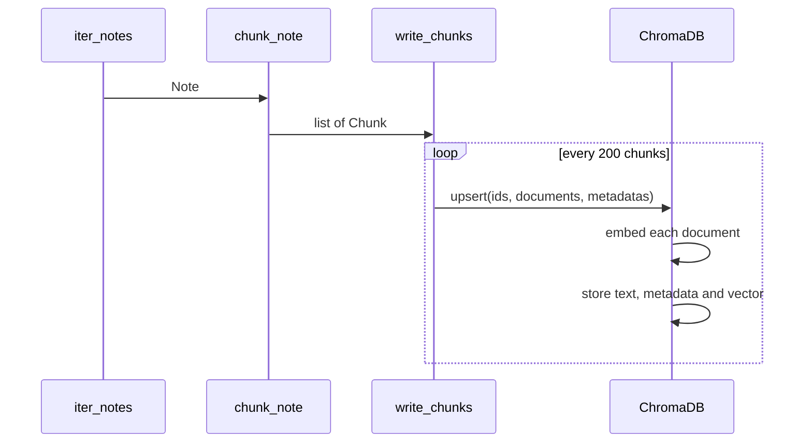

{:class="cover"}

---

By the end of this lesson you will be able to open a persistent cosine collection, write chunks to it in batches with clean metadata, and check the result with a stats function.

We can read notes, and we can chunk them. Now let's get those chunks into ChromaDB.



## Opening the collection

```python
# vault_rag/index.py
"""Build and maintain the ChromaDB index of the vault."""

from dataclasses import dataclass
from pathlib import Path

import chromadb
from chromadb.config import Settings

from .chunker import chunk_note
from .config import COLLECTION_NAME, DB_PATH, VAULT_PATH
from .vault import iter_notes

BATCH_SIZE = 200


def get_collection(db_path: Path = DB_PATH, name: str = COLLECTION_NAME):
    """Open (or create) the persistent collection."""
    db_path = Path(db_path).expanduser()
    db_path.mkdir(parents=True, exist_ok=True)

    client = chromadb.PersistentClient(
        path=str(db_path),
        settings=Settings(anonymized_telemetry=False),
    )
    return client.get_or_create_collection(
        name=name,
        configuration={"hnsw": {"space": "cosine"}},
    )
```

`Settings(anonymized_telemetry=False)` turns off Chroma's usage reporting. It sends no note content, but this is a tool for reading your private notes and the fewer things phoning home the better.

Every other module calls this one function to get at the database. When you later decide to run Chroma as a server instead of embedded, this is the only function that changes.

---

## Writing chunks in batches

```python
# vault_rag/index.py  (add below get_collection)
def write_chunks(collection, chunks) -> int:
    """Upsert chunks in batches so we never blow the max batch size."""
    for start in range(0, len(chunks), BATCH_SIZE):
        batch = chunks[start:start + BATCH_SIZE]
        collection.upsert(
            ids=[c.id for c in batch],
            documents=[c.text for c in batch],
            metadatas=[c.metadata for c in batch],
        )
    return len(chunks)
```

Chroma has a hard cap on how many items one call can accept - `client.get_max_batch_size()` reports it, typically 5,461. You will not hit that with a single note, but you would if you tried to write an entire vault in one go.

There is a better reason to batch than the cap, though. Embedding 200 chunks at a time gives the model a decent workload without hogging memory, and if something crashes halfway through you have not lost the whole run.

Note the three parallel lists. Chroma matches them by position, so `ids[3]`, `documents[3]` and `metadatas[3]` must describe the same chunk. Building all three from the same list comprehension over `batch` keeps them in lockstep - resist the urge to build them separately.

---

## What metadata to store, and why

Look back at the metadata dict from `chunk_note`. Each field has a job:

| Field | Used for |
|---|---|
| `path` | Deleting a note's chunks; showing the citation |
| `title` | Human readable citation |
| `heading` | The raw heading trail, kept for debugging |
| `section` | The cleaned breadcrumb we display |
| `folder` | Filtering with `--folder` |
| `tags` | Filtering with `--tag` |
| `links` | Future work - following the graph |
| `mtime` | Filtering by "modified since" |
| `note_hash` | Deciding whether a note needs re-indexing |
| `chunk_index` | Reassembling a note in order |
{:class="table table-single"}

Two rules Chroma enforces that will bite you:

**Values must be strings, numbers, booleans or non-empty lists.** No nested dicts, no `datetime` objects. If your frontmatter has a `created` date, convert it with `str()` or `.timestamp()` before it goes anywhere near here.

**A `None` value is silently dropped.** The key simply vanishes, and if every value in the dict was `None` the whole entry reads back as `None`. An empty list is louder: it raises a `ValueError`. That is why `chunk_note` uses `note.tags or ["untagged"]` rather than letting an untagged note write an empty list. It costs nothing and saves you an afternoon.

---

## The indexing run

```python
# vault_rag/index.py  (add below write_chunks)
@dataclass
class IndexStats:
    """What the last indexing run actually did."""

    added: int = 0
    updated: int = 0
    unchanged: int = 0
    removed: int = 0
    chunks: int = 0

    def summary(self) -> str:
        return (
            f"{self.added} new, {self.updated} changed, "
            f"{self.unchanged} unchanged, {self.removed} removed "
            f"({self.chunks} chunks written)"
        )
```

Then the simplest possible version of the run - index everything, every time:

```python
# vault_rag/index.py  (add below IndexStats)
def index_vault(vault_path: Path = VAULT_PATH, db_path: Path = DB_PATH,
                verbose: bool = True) -> IndexStats:
    """Index the whole vault. (We make this incremental in the next lesson.)"""
    collection = get_collection(db_path)
    stats = IndexStats()

    for note in iter_notes(vault_path):
        chunks = chunk_note(note)
        stats.chunks += write_chunks(collection, chunks)
        stats.added += 1
        if verbose:
            print(f"  indexed {note.relative_path} ({len(chunks)} chunks)")

    return stats
```

Run it:

```python
# try_it.py - a scratch script in the project root
from vault_rag.index import index_vault

stats = index_vault("testvault", "testdb")
print(stats.summary())
```

```
  indexed Daily.md (1 chunks)
  indexed electronics/Pico W.md (3 chunks)
  indexed kitchen/Sourdough.md (1 chunks)
  indexed robots/SMARS.md (3 chunks)
4 new, 0 changed, 0 unchanged, 0 removed (8 chunks written)
```

That is a working index. You can query it right now.

---

## Checking your work

```python
# vault_rag/index.py  (add below index_vault)
def collection_stats(db_path: Path = DB_PATH) -> dict:
    """Quick health check on the index."""
    collection = get_collection(db_path)
    stored = collection.get(include=["metadatas"])
    notes = {m["path"] for m in stored["metadatas"] if m}
    return {
        "chunks": collection.count(),
        "notes": len(notes),
        "path": str(Path(db_path).expanduser()),
    }
```

`collection.get()` with no arguments returns everything, so this is genuinely reading every row. Fine for tens of thousands of chunks; if your vault is enormous you would want to track the count separately.

The `if m` guard is there because of the `None` metadata trap. If any chunk ended up with no metadata at all, this counts around it instead of raising `TypeError` - and the gap between `notes` and the number of notes you expected tells you something went wrong.

---

## How long this takes

The overwhelming majority of the time is spent embedding, not writing to disk. Time your own machine with a few lines:

```python
# time_it.py - a scratch script in the project root
import time

from vault_rag.index import index_vault

start = time.time()
stats = index_vault("testvault", "timedb", verbose=False)
elapsed = time.time() - start
print(f"{stats.chunks} chunks in {elapsed:.1f}s = {stats.chunks / elapsed:.0f} chunks per second")
```

Point it at your real vault (and a scratch database such as `timedb`) to get your own chunks per second, then multiply by the number of chunks lesson 7 told you to expect. The figure scales with your CPU and with how long your chunks are, so mine would not mean much on your machine. A Raspberry Pi will be slower than a laptop, which is still perfectly fine for an index you build once and then update a little at a time.

The first run is slower than that because the embedding model has to download. Do not benchmark the first run.

---

## Try it Yourself

1. Index your test vault, then run `collection_stats`. Do the note and chunk counts match what lesson 7 predicted?
2. Look at the database on disk: `du -sh testdb`. Compare it to the size of your notes - the index is usually a few times bigger, because 384 floats per chunk adds up.
3. Index the same vault twice without changing anything. Chunk count stays the same because `upsert` overwrites by id - proof that our ids are deterministic.
4. Now change `CHUNK_SIZE` to 400 and index again *without* deleting the database. Chunk count goes **up** but old chunks stick around, because the new run generates ids like `::7` and `::8` that did not exist before. This is exactly the orphaned-chunk problem the next lesson solves.

---

## Common Issues

- **Problem**: `ValueError: Expected metadata value to be a str, int, float, bool, SparseVector, list, or None, got 2026-03-14 which is a date`
- **Solution**: Something in your frontmatter is a date or a nested dict. Wrap it in `str()`.
- **Why**: PyYAML helpfully converts `created: 2026-03-14` into a `datetime.date` object. Chroma cannot store that.

- **Problem**: Indexing runs, but `collection.count()` is 0.
- **Solution**: Check you are opening the same `db_path` in both places. A relative path resolves against the current working directory, so running from a different folder gives you a different, empty database.
- **Why**: `PersistentClient` creates the directory if it is missing rather than complaining, so a typo produces a silent empty database instead of an error.

- **Problem**: Memory use climbs steadily through a large indexing run.
- **Solution**: Confirm `iter_notes` is still a generator and you have not wrapped it in `list()`.
- **Why**: A generator processes one note at a time. Materialise it and you hold every note's full text in memory at once.

- **Problem**: The run dies partway through on one specific note.
- **Solution**: Wrap the body of the loop in `try` / `except Exception` and print the path before re-raising.
- **Why**: The traceback tells you what broke but not *which note* broke it, and in a 2,000 note vault that is not a helpful place to start.

---

## Check your understanding


? Why does `write_chunks` upsert in batches of 200?
- [ ] Chroma can only store 200 documents in total
- [x] One call has a hard maximum size, and batching keeps memory sensible and loses less work if something crashes
- [ ] Batches make the embeddings more accurate
> `client.get_max_batch_size()` reports the cap, and small batches also protect your progress.

? `ids`, `documents` and `metadatas` are three parallel lists. What must be true of them?
- [x] Position 3 in each list must describe the same chunk
- [ ] They must be sorted alphabetically
- [ ] They must all be the same type
> Chroma matches them by position, so build them all from the same loop over the batch.

? Which metadata value will make `upsert` raise an error?
- [ ] A string
- [ ] A number
- [x] A `datetime.date` object from YAML frontmatter
> Chroma cannot store dates, so convert with `str()` or `.timestamp()` first.

? Why does the index store the path relative to the vault rather than the absolute path?
- [x] Move the vault to another machine and the index still makes sense
- [ ] Absolute paths are not allowed in metadata
- [ ] Relative paths are shorter to embed
> The relative path is also what the citation shows.

