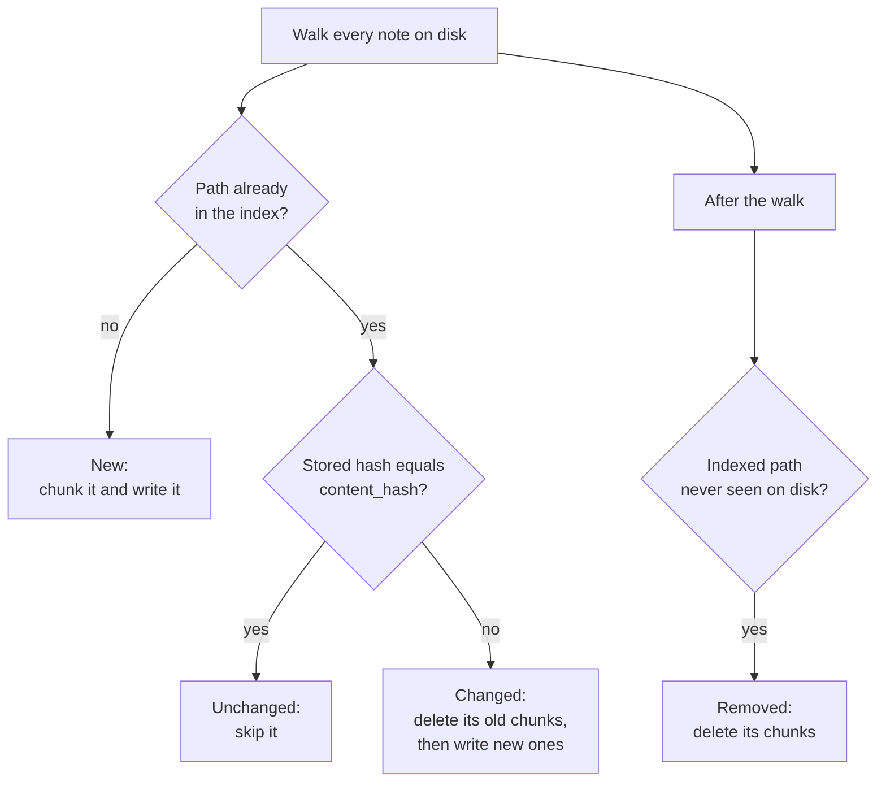

{:class="cover"}

---

By the end of this lesson you will be able to re-index only the notes that changed, replace a changed note's chunks cleanly, and remove chunks for notes that were deleted.

The indexer we have works, but it re-embeds every note on every run. On a big vault that is thirty seconds of your life you get back, every time, for no reason - you probably edited three notes since yesterday.

Worse, it leaves rubbish behind. Shorten a note from five chunks to two and chunks three, four and five stay in the index forever, still findable, still quoting text you deleted.

Both problems have the same fix: know what changed.

---

## Three states a note can be in

| State | How we detect it | What to do |
|---|---|---|
| New | Its path is not in the index | Chunk it and write it |
| Changed | Its path is in the index but the hash differs | Delete old chunks, write new ones |
| Unchanged | Path and hash both match | Skip entirely |
{:class="table table-single"}

Plus a fourth case that lives outside the loop: a note in the index whose file no longer exists on disk. Delete its chunks.

We already have the fingerprint - `Note.content_hash` from lesson 5, stored as `note_hash` on every chunk in lesson 7. Everything we need is in the index already.

---



## Reading back what we know

```python
# vault_rag/index.py  (add below write_chunks)
def indexed_note_hashes(collection) -> dict[str, str]:
    """Map every indexed note path to the hash it was indexed at."""
    stored = collection.get(include=["metadatas"])
    hashes: dict[str, str] = {}
    for metadata in stored["metadatas"]:
        if metadata:
            hashes[metadata["path"]] = metadata.get("note_hash", "")
    return hashes
```

One `get()` call reads the whole index. Every chunk from the same note carries the same `note_hash`, so the dict just gets written several times with the same value - harmless, and far cheaper than querying per note.

Note we ask for `include=["metadatas"]` only. Without it Chroma also hands back every document's full text, which on a large vault is a lot of string copying for data we throw away.

---

## Why hash the content and not the mtime

The obvious alternative is to compare file modification times. It is tempting because it needs no reading of the file at all.

It is also wrong in both directions:

- **Syncing tools rewrite mtimes.** Obsidian Sync, Dropbox, iCloud and `git checkout` all touch files they have not changed. Every sync would trigger a full re-index.
- **Editors can preserve mtimes.** Rarer, but a script that rewrites a note and restores its timestamp would leave you with a stale index and no clue why.

Hashing the content costs a file read, which you were doing anyway to get the body. The result is correct by construction: same text, same hash, no work needed.

We still *store* `mtime` as metadata, because "notes I touched this month" is a genuinely useful filter. We just do not make correctness depend on it.

---

## The incremental run

```python
# vault_rag/index.py  (replaces the index_vault you wrote in lesson 8)
def index_vault(vault_path: Path = VAULT_PATH, db_path: Path = DB_PATH,
                full: bool = False, verbose: bool = True) -> IndexStats:
    """Index the vault, skipping notes whose content has not changed."""
    collection = get_collection(db_path)
    stats = IndexStats()

    if full:
        existing_hashes: dict[str, str] = {}
        ids = collection.get()["ids"]
        if ids:
            collection.delete(ids=ids)
    else:
        existing_hashes = indexed_note_hashes(collection)

    seen: set[str] = set()

    for note in iter_notes(vault_path):
        seen.add(note.relative_path)
        previous = existing_hashes.get(note.relative_path)

        if previous == note.content_hash:
            stats.unchanged += 1
            continue

        if previous is not None:
            # The note changed - drop its old chunks before writing new ones,
            # because a shorter note leaves orphaned chunks behind otherwise.
            collection.delete(where={"path": note.relative_path})
            stats.updated += 1
        else:
            stats.added += 1

        chunks = chunk_note(note)
        stats.chunks += write_chunks(collection, chunks)

        if verbose:
            print(f"  indexed {note.relative_path} ({len(chunks)} chunks)")

    # Notes that vanished from disk should vanish from the index too
    for stale in set(existing_hashes) - seen:
        collection.delete(where={"path": stale})
        stats.removed += 1
        if verbose:
            print(f"  removed {stale}")

    return stats
```

The delete-then-write pattern is the important bit. It would be tempting to rely on `upsert` alone, since the ids are deterministic - but only for chunks that still exist. A note that shrinks from five chunks to two leaves `::2`, `::3` and `::4` untouched by the upsert, because nothing overwrites them. Deleting by `where={"path": ...}` clears them all first.

The `seen` set gives us the stale-note cleanup for free. Anything we knew about that we did not walk past this run is gone from disk.

`full=True` is the escape hatch. Delete everything and start again - which you want whenever you change `CHUNK_SIZE`, swap the embedding model, or simply do not trust the state of the index.

---

## Watching it work

Index the test vault, then run it again with nothing changed. (The counts below will match yours exactly; the times will not.)

```
Indexing testvault
  indexed Daily.md (1 chunks)
  indexed electronics/Pico W.md (3 chunks)
  indexed kitchen/Sourdough.md (1 chunks)
  indexed robots/SMARS.md (3 chunks)
Done in 0.4s: 4 new, 0 changed, 0 unchanged, 0 removed (8 chunks written)

Indexing testvault
Done in 0.0s: 0 new, 0 changed, 4 unchanged, 0 removed (0 chunks written)
```

Now shorten `robots/SMARS.md` down to a single short paragraph and run again:

```
Indexing testvault
  indexed robots/SMARS.md (1 chunks)
Done in 0.1s: 0 new, 1 changed, 3 unchanged, 0 removed (1 chunks written)
```

One chunk written, and the two orphans are gone - search for text you deleted and nothing comes back. Then delete a note entirely:

```
Indexing testvault
  removed kitchen/Sourdough.md
Done in 0.0s: 0 new, 0 changed, 3 unchanged, 1 removed (0 chunks written)
```

That is the whole feature. On a real vault the second run drops from however long a full index took to a fraction of a second.

---

## Try it Yourself

1. Index your real vault, time it, then run it again and time that. The ratio is your reward for this lesson.
2. Rename a note. Watch it register as one removal and one addition - the path is the identity, so a rename really is a delete plus an add.
3. Open a note, add a space, save, then remove the space and save again. The hash returns to its original value and the second run reports it unchanged. That is content hashing beating mtime, live.
4. Add a `--full` run and compare timings against the incremental one. Keep both numbers; when something looks wrong in retrieval, `--full` is the first thing to try.

---

## Common Issues

- **Problem**: Every note reports as changed on every run.
- **Solution**: Print `note.content_hash` for one note across two runs. If it differs, something in parsing is non-deterministic.
- **Why**: The usual culprit is hashing something with unstable ordering, like a `set`. We hash `note.body` - a plain string - specifically to avoid this.

- **Problem**: A deleted note's chunks are still searchable.
- **Solution**: Check `iter_notes` is not silently skipping the note for another reason - an empty body, or a folder you added to `SKIP_DIRS`.
- **Why**: Our cleanup only removes notes absent from `seen`. If a note stopped being *indexable* rather than being deleted, it correctly gets removed - but if you added its folder to `SKIP_DIRS` and expected it to stay, that is a surprise.

- **Problem**: `indexed_note_hashes` is slow on a big vault.
- **Solution**: It is reading every row. For a vault over about 50,000 chunks, keep a small JSON manifest of path to hash alongside the database instead.
- **Why**: `get()` with no `where` clause has no index to help it. At our scale it is milliseconds; at ten times our scale it is not.

- **Problem**: You changed `CHUNK_SIZE` and results got weirder rather than better.
- **Solution**: Run with `full=True`.
- **Why**: Unchanged notes are skipped, so they keep their *old* chunk boundaries. Your index ends up a mix of two chunking strategies, which is worse than either.

---

## Check your understanding


? Why compare content hashes rather than modification times?
- [ ] Hashing is faster than reading the file
- [x] Sync tools and `git checkout` rewrite mtimes without changing the text, which would force a full re-index every time
- [ ] Chroma cannot store timestamps
> A hash of the body is correct by construction: same text, same hash, no work.

? A note shrinks from five chunks to two. Why do we delete its old chunks before writing the new ones?
- [x] `upsert` only overwrites ids that still exist, so chunks `::2` to `::4` would be left behind, still searchable
- [ ] Chroma refuses to upsert over existing ids
- [ ] Deleting makes the embedding faster
> Deleting by `where={"path": ...}` clears them all first.

? When should you run an index with `full=True`?
- [x] After changing the chunk size, the chunk text format or the embedding model
- [ ] Every time you add a note
- [ ] Only the very first time
> Unchanged notes are skipped, so they would keep their old chunk boundaries and give you a mix of two strategies.

? You rename `robots/SMARS.md` to `robots/SMARS Quad.md`. What does the next run report?
- [ ] One changed note
- [x] One removal and one addition, because the path is the identity
- [ ] Nothing, because the text is identical
> The old path is gone from disk, so it is removed, and the new path is new.

