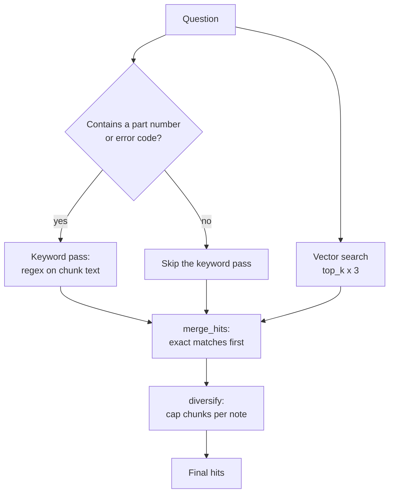

{:class="cover"}

---

By the end of this lesson you will be able to add an exact-match keyword pass for part numbers, merge it with the vector results, and decide which improvements are worth trying first.

Retrieval works. Now let's make it good.

The advice in this lesson is ordered by how much difference it makes, most first. If you only do one thing, do the first one.

---

## Fix the chunks before you fix the search

The single biggest improvement available to you is one we already made in lesson 7: putting the breadcrumb into the chunk text.

The reason it matters so much is that a chunk gets exactly one vector, and that vector can only encode words that are actually in the text. A paragraph about motor wiring that never says "SMARS" cannot be found by searching for SMARS, no matter how clever your retrieval code is.

The same logic extends further. Consider also prepending:

```python
# vault_rag/chunker.py  (inside chunk_note, instead of the plain breadcrumb prefix)
context = f"{section}\nTags: {', '.join(note.tags)}"
text = f"{context}\n\n{piece.strip()}"
```

Now a chunk from a note tagged `#3dprinting` is findable by a question about 3D printing even if the paragraph itself only mentions "layer height".

Try it and measure it - lesson 17 shows how. On some vaults it helps a lot; on vaults with hundreds of tags per note it adds noise. This is a real trade, not a free win.

---



## Hybrid search for exact terms

Embeddings are terrible at exact identifiers. Search for `TB6612FNG` and you get back chunks about motor drivers in general, because that is what the model understands the string to *mean*. The one note that literally contains `TB6612FNG` might not be in the top ten.

The fix is to run a keyword search alongside the vector search and merge the results:

```python
# vault_rag/retrieve.py  (add `import re` at the top, then these below search)
def looks_like_identifier(term: str) -> bool:
    """Part numbers, error codes and the like - digits mixed with letters."""
    return (
        len(term) >= 4
        and any(c.isdigit() for c in term)
        and any(c.isalpha() for c in term)
    )


def keyword_hits(collection, question: str, limit: int = 5) -> list[Hit]:
    """Find chunks that literally contain an identifier from the question."""
    terms = [t.strip(".,?!()[]") for t in question.split()]
    identifiers = [t for t in terms if looks_like_identifier(t)]
    if not identifiers:
        return []

    found: list[Hit] = []
    for identifier in identifiers:
        result = collection.get(
            where_document={"$regex": f"(?i){re.escape(identifier)}"},
            include=["documents", "metadatas"],
            limit=limit,
        )
        for document, metadata in zip(result["documents"], result["metadatas"]):
            found.append(
                Hit(
                    text=document,
                    path=metadata["path"],
                    title=metadata.get("title", metadata["path"]),
                    section=metadata.get("section", ""),
                    distance=0.0,          # an exact match is as good as it gets
                    chunk_index=metadata.get("chunk_index", 0),
                )
            )
    return found
```

Three things to note.

**`(?i)` for case insensitivity.** `where_document={"$contains": ...}` is case sensitive, so `tb6612fng` would miss `TB6612FNG`. The `$regex` operator with an inline flag handles it.

**`re.escape`** because a part number can contain a `.` or a `-`, and in a regex those mean something else.

**`distance=0.0`** so an exact match sorts to the top when merged. It is a fiction - there was no vector comparison - but it encodes the right priority.

Then merge, de-duplicating on chunk identity:

```python
# vault_rag/retrieve.py  (add below keyword_hits)
def merge_hits(vector_hits: list[Hit], exact_hits: list[Hit], limit: int) -> list[Hit]:
    """Exact matches first, then the semantic ones, no duplicates."""
    merged: list[Hit] = []
    seen: set[tuple[str, str]] = set()
    for hit in exact_hits + vector_hits:
        key = (hit.path, hit.text[:80])
        if key in seen:
            continue
        seen.add(key)
        merged.append(hit)
        if len(merged) == limit:
            break
    return merged
```

Only bother running the keyword pass when the question contains something identifier-shaped. For "what did I write about motors" it finds nothing and costs one wasted call; for "did the TB6612FNG run hot" it is the difference between a right answer and a wrong one.

---

## Putting hybrid search to work

The two functions above do nothing until something calls them. Add one more function that does the whole job, and use it in place of `search` from now on:

```python
# vault_rag/retrieve.py  (add below merge_hits)
def hybrid_search(question: str, top_k: int = TOP_K, db_path: Path = DB_PATH,
                  where: dict | None = None) -> list[Hit]:
    """Vector search, plus an exact-match pass for part numbers and error codes."""
    collection = get_collection(db_path)
    if collection.count() == 0:
        return []
    exact = keyword_hits(collection, question)
    semantic = search(question, top_k=top_k, db_path=db_path, where=where)
    return diversify(merge_hits(semantic, exact, limit=top_k * 2), top_k)
```

Try the practice vault with a question that names a part number:

```python
# try_it.py - a scratch script in the project root
from vault_rag.retrieve import hybrid_search

for hit in hybrid_search("did the TB6612FNG run hot?", db_path="testdb", top_k=3):
    print(f"{hit.score:>4.0%}  {hit.label}")
```

The chunk that literally contains `TB6612FNG` comes back first at 100%, because exact matches are given a distance of 0.0. That 100% means "contains your exact term", not "perfect meaning match". One honest limitation: the keyword pass does not apply your `where` filter, so with a tag or folder filter on, exact matches from other notes can still slip in. The finished command line tool in lesson 16 uses `hybrid_search`.

## Ask a better question

Retrieval quality depends enormously on the question, and short questions are weak. "Motors" gives the embedding model three syllables to work with. "Why did the N20 motors stall when the robot was on carpet" gives it a paragraph's worth of meaning.

You cannot make users write better questions, but you can pad short ones:

```python
# vault_rag/retrieve.py  (optional - add below merge_hits)
def expand_query(question: str) -> str:
    """Give a very short question more to work with."""
    if len(question.split()) >= 6:
        return question
    return f"Notes about {question}. Details, explanation and context for {question}."
```

Crude, and it genuinely helps on one and two word queries. A more powerful version asks the language model to rewrite the question into two or three variants, searches with each, and merges - at the cost of an extra API call before every search.

---

## Retrieve neighbours, not just the hit

A chunk boundary can land right before the sentence that answers the question. Since chunk ids are sequential within a note - `smars.md::3`, `smars.md::4` - you can pull in the neighbours of a strong hit:

```python
# vault_rag/retrieve.py  (optional - add below expand_query)
def with_neighbours(collection, hit: Hit) -> list[str]:
    """Fetch the chunks either side of this one from the same note."""
    wanted = [
        f"{hit.path}::{i}"
        for i in (hit.chunk_index - 1, hit.chunk_index + 1)
        if i >= 0
    ]
    result = collection.get(ids=wanted, include=["documents"])
    return result["documents"]
```

`Hit` already carries `chunk_index` (we added it in lesson 10), so there is nothing to look up. Running this on the SMARS "Motor wiring" hit from the practice vault returns the "SMARS" intro chunk and the "Motor driver" chunk either side of it. This trades tokens for recall. If your top hit is usually right but the answer feels truncated, it is a good trade. If your top hit is often wrong, fix that first - neighbours of a wrong chunk are also wrong.

---

## Things that are not worth it yet

Three techniques you will see recommended everywhere, and why we are not reaching for them:

**A bigger embedding model.** Swapping all-MiniLM-L6-v2 for something larger does help, but it is slower, needs more disk, and the improvement is smaller than the one you get from better chunks. Do the free thing first.

**A re-ranker.** A cross-encoder model that re-scores the top 20 hits is genuinely effective and is the standard next step in production RAG. It also adds a second model to download and real latency on every query. Worth it once you have measured that retrieval is your bottleneck - not before.

**Maximal Marginal Relevance.** MMR picks results that are relevant *and* different from each other by comparing candidate embeddings. Our per-note cap from lesson 10 achieves most of the same benefit for a fraction of the complexity, because in a notes vault near-duplicates almost always live in the same note.

The order of operations that actually works: **fix chunking, add hybrid search for identifiers, measure, then reach for the heavy machinery.**

---

## Try it Yourself

1. Search your vault for a part number or error code you know is written down. Does it come first? Now add the keyword pass and try again.
2. Search for one word, then for the same idea as a full sentence. Compare the top three. How much did phrasing matter?
3. Add tags to the chunk prefix, re-index with `full=True`, and re-run three searches you know the right answer to. Better, worse, or no change?
4. Find a question where the answer straddles two chunks. Does `with_neighbours` fix it?
5. Time a search with and without the keyword pass. Is the extra `get()` call even noticeable?

---

## Common Issues

- **Problem**: The keyword pass returns hundreds of hits for a common term.
- **Solution**: Keep the `limit` on the `get()` call, and keep `looks_like_identifier` strict.
- **Why**: Without the digit-and-letter requirement, a word like "motor" triggers the keyword pass and floods the results with weakly relevant exact matches.

- **Problem**: `re.error: bad character range` from the regex filter.
- **Solution**: You skipped `re.escape`.
- **Why**: A part number with a hyphen, like `L298-N`, is a valid regex character range and blows up when the characters are out of order.

- **Problem**: Merged results are full of near-duplicates.
- **Solution**: The de-duplication key `(path, text[:80])` misses chunks that overlap. Fall back to `diversify` after merging.
- **Why**: Overlapping chunks share their *middle*, not their first 80 characters, so they look distinct to the key.

- **Problem**: Query expansion made results worse.
- **Solution**: Only expand very short queries, and drop the padding if a real question comes in.
- **Why**: Adding "notes about..." to an already detailed question dilutes it - you are averaging in the meaning of filler words.

---

## Check your understanding


? What is the single biggest improvement to retrieval, and the cheapest?
- [ ] A bigger embedding model
- [x] Putting the breadcrumb (and optionally tags) into the chunk text
- [ ] Adding a re-ranker
> A chunk's vector can only encode words that are in its text, so give it the words it needs.

? Why does the keyword pass use `where_document` with `$regex` and `(?i)`?
- [x] `$contains` is case sensitive, and the regex flag makes the match ignore case
- [ ] Regex is faster than `$contains`
- [ ] `$contains` cannot be used on documents
> That way `tb6612fng` still finds `TB6612FNG`.

? Why is `re.escape` applied to the identifier?
- [ ] To make it uppercase
- [x] A part number such as `L298-N` can contain characters that mean something special in a regular expression
- [ ] To stop Chroma indexing it
> Without it, a hyphen can turn into a bad character range and raise `re.error`.

? When should `expand_query` pad a question?
- [x] Only when the question is very short, such as one or two words
- [ ] Always
- [ ] Never, it only makes results worse
> Padding a detailed question dilutes it by averaging in filler words.

