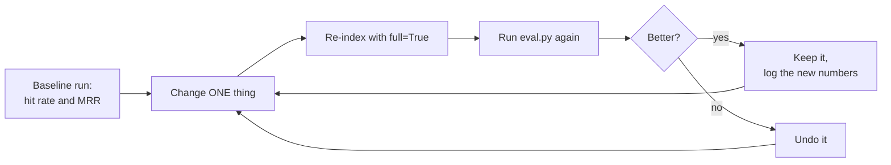

{:class="cover"}

---

By the end of this lesson you will be able to write an evaluation set for your vault, score retrieval with hit rate and mean reciprocal rank, and use the numbers to test one change at a time.

You have a tool that works. Now: is it any *good*?

That question sounds soft, but it has a hard answer, and getting one changes how you work. Without measurement, tuning a RAG pipeline is guesswork - you change the chunk size, ask a couple of questions, think "hmm, that felt better", and move on. Three changes later you have no idea which one helped or whether any of them did.

Twenty minutes of setup fixes this permanently.

---



## Measure retrieval, not the answer

Judging generated prose is hard and subjective. Judging retrieval is neither: **did the right note appear in the results, and how high up?**

That is the metric to build on, and it is enough. If the right note is retrieved, a good prompt almost always produces a good answer. If it is not retrieved, nothing downstream can save you.

---

## Building the evaluation set

You need questions with known right answers. Nobody else can build this for your vault - you are the only person who knows what your notes contain.

Aim for twenty. Fifteen is workable. Fewer than ten and random noise swamps the signal.

```yaml
# eval.yml
- question: which GPIO pins drive the SMARS motors?
  expect: robots/SMARS.md

- question: why did I switch motor drivers?
  expect: robots/SMARS.md

- question: how often should the sourdough starter be fed?
  expect: kitchen/Sourdough.md

- question: what is the onboard LED gotcha on the Pico W?
  expect: electronics/Pico W.md
```

Write the questions the way you would actually type them - short, lowercase, a bit lazy. An evaluation set of beautifully phrased questions measures a tool nobody uses.

Deliberately include:

- **Questions using different words than the note.** This is the whole point of semantic search.
- **Questions whose answer is buried mid-note.** Tests your chunking.
- **A couple of questions your vault genuinely cannot answer**, with `expect: null`. Tests that it declines.

---

## Scoring

Two numbers, both easy to compute.

**Hit rate at k** - the fraction of questions where the expected note appeared anywhere in the top k. Blunt, but it is the one that tracks how the tool feels.

**Mean reciprocal rank** - for each question, take 1 divided by the position of the right answer (1 if first, 0.5 if second, 0.33 if third, 0 if absent) and average. MRR rewards getting the right note *higher*, not just present, which hit rate cannot see.

```python
# eval.py
"""Measure retrieval quality against a hand-written evaluation set."""

import sys

import yaml

from vault_rag.retrieve import search


def evaluate(eval_path: str, db_path: str, top_k: int = 6) -> dict:
    with open(eval_path, encoding="utf-8") as handle:
        cases = yaml.safe_load(handle)
    hits_at_k = 0
    reciprocal_ranks = []
    misses = []

    for case in cases:
        results = search(case["question"], top_k=top_k, db_path=db_path)
        paths = [hit.path for hit in results]
        expected = case.get("expect")

        if expected is None:
            # Should find nothing useful. Count it as a hit if it did not.
            if not results:
                hits_at_k += 1
                reciprocal_ranks.append(1.0)
            else:
                reciprocal_ranks.append(0.0)
                misses.append((case["question"], f"expected nothing, got {paths[0]}"))
            continue

        if expected in paths:
            rank = paths.index(expected) + 1
            hits_at_k += 1
            reciprocal_ranks.append(1 / rank)
        else:
            reciprocal_ranks.append(0.0)
            misses.append((case["question"], f"expected {expected}, got {paths[:2]}"))

    return {
        "cases": len(cases),
        "hit_rate": hits_at_k / len(cases),
        "mrr": sum(reciprocal_ranks) / len(cases),
        "misses": misses,
    }


if __name__ == "__main__":
    result = evaluate("eval.yml", sys.argv[1] if len(sys.argv) > 1 else "testdb")
    print(f"Hit rate @6: {result['hit_rate']:.0%}")
    print(f"MRR:         {result['mrr']:.3f}")
    if result["misses"]:
        print("\nMisses:")
        for question, detail in result["misses"]:
            print(f"  {question}\n    {detail}")
```

The output has this shape. (These figures illustrate the format for a larger vault. With the four-note practice vault there is so little to confuse the search that you should see a hit rate at or near 100%, so run it for real on your own vault.)

```
Hit rate @6: 85%
MRR:         0.712

Misses:
  what did I decide about battery chemistry?
    expected electronics/battery.md, got ['robots/SMARS.md', 'electronics/Pico W.md']
```

The miss list is the most valuable output. It tells you *which* questions fail, and reading three of those teaches you more about your pipeline than any aggregate number.

---

## Using it

Now every change becomes an experiment. Record a baseline, make one change, re-run:

Keep a log like this one, filling in your own numbers as you go:

| Change | Hit rate | MRR |
|---|---|---|
| Baseline (1200 character chunks) | | |
| Chunk size 600 | | |
| Chunk size 2400 | | |
| 600 characters, no breadcrumb prefix | | |
| 600 characters, tags in the prefix too | | |
{:class="table table-single"}

I am deliberately leaving the numbers blank: they depend entirely on your notes, and a table of someone else's results would only tempt you to copy them.

A pattern often reported in RAG write-ups: smaller chunks help up to a point then hurt, and the breadcrumb prefix can matter more than the chunk size. Treat that as a hypothesis to test, because "often" is not "on your vault", and now you can check.

**Change one thing at a time**, and always re-index with `full=True` between runs. Otherwise unchanged notes keep their old chunk boundaries and you are measuring a mixture.

---

## Evaluating the answers too

Retrieval is the high-leverage thing to measure, but if you want a check on generation, the cheapest useful one is the citation audit from lesson 14 run across the whole evaluation set:

```python
cited, invalid = check_citations(answer_text, len(hits))
```

Track two rates over your evaluation set:

- **Invalid citation rate** should be zero. Anything above that means the prompt needs work.
- **Unused source rate** - what fraction of retrieved chunks never get cited. If it is consistently over half, `TOP_K` is too high and you are paying for context that contributes nothing.

Both are computed from text you already have, with no extra API calls.

---

## Try it Yourself

1. Write fifteen evaluation questions against your real vault. It takes about twenty minutes and it is the highest value twenty minutes in this course.
2. Get your baseline. Write the two numbers down somewhere you will find them again.
3. Halve `CHUNK_SIZE`, re-index with `full=True`, re-run. Better or worse?
4. Remove the breadcrumb prefix from `chunk_note`, re-index, re-run. This shows you how much lesson 7 was worth on *your* notes.
5. Read your three worst misses and work out why. Was the note not chunked usefully? Did the question use vocabulary that appears nowhere in the note? Both are fixable, but differently.

---

## Common Issues

- **Problem**: Hit rate is 100% on the first try.
- **Solution**: Your questions are too easy - probably quoting the notes back at themselves.
- **Why**: If the question contains the same distinctive words as the answer, you are testing keyword matching. Rewrite them in different words.

- **Problem**: Scores swing wildly between runs with no changes.
- **Solution**: Check you are not re-indexing between runs with a different `CHUNK_SIZE` still set.
- **Why**: Embedding is deterministic, so retrieval on an unchanged index is repeatable. Any variance means the index changed.

- **Problem**: MRR is much lower than hit rate.
- **Solution**: The right notes are being found but ranked low. Look at what is beating them.
- **Why**: Usually one hub note dominating. `MAX_CHUNKS_PER_NOTE` and the breadcrumb prefix both help.

- **Problem**: The `expect: null` cases always fail.
- **Solution**: Our `search` returns *something* for almost any question, since it returns the nearest chunks however far away they are.
- **Why**: Add `drop_stragglers` from lesson 10 to the evaluation path, or score those cases on the *generated* answer declining rather than on retrieval returning nothing.

---

## Check your understanding


? Why measure retrieval rather than judge the generated answers?
- [ ] Answers cannot be read by a computer
- [x] Retrieval has a hard test (did the right note appear, and how high) while judging prose is subjective
- [ ] Retrieval is cheaper than indexing
> If the right note is retrieved a good prompt almost always works, and if it is not, nothing downstream can save you.

? A question's right note appears at position 2. What does it add to the mean reciprocal rank?
- [ ] 2
- [x] 0.5
- [ ] 0
> Reciprocal rank is 1 divided by the position: 1, 0.5, 0.33 and so on, or 0 if the note is absent.

? Why re-index with `full=True` between experiments?
- [x] Otherwise unchanged notes keep their old chunk boundaries and you measure a mixture of two strategies
- [ ] It makes the evaluation run faster
- [ ] To reset the API key
> Change one thing at a time, and rebuild between runs.

? Your hit rate is 100% on the first try with fifteen questions. What is the likely problem?
- [x] The questions quote the notes back at themselves, so you are testing keyword matching
- [ ] The index is perfect
- [ ] You have too few notes
> Rewrite questions in different words, as you would actually type them.

