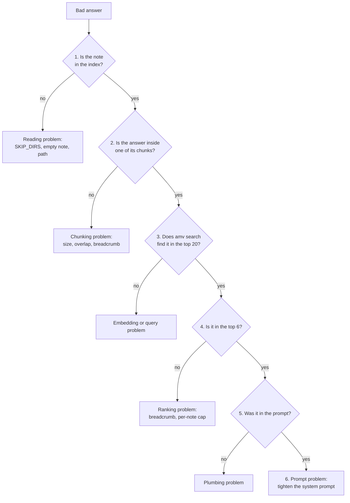

{:class="cover"}

---

By the end of this lesson you will be able to work backwards through the six stages of the pipeline to find where a bad answer went wrong, and recognise the Chroma and API errors you are most likely to meet.

RAG has an unusual failure mode: it almost never crashes. It just gives you a slightly wrong answer, confidently, and you have to work out which of six stages let you down.

This lesson is a diagnostic order and a catalogue of the specific things that go wrong.

---

## Work backwards through the pipeline

When an answer is bad, check in this order. Each step is quick and each one eliminates a stage.



**1. Is the note indexed at all?**

```python
# check_index.py - a scratch script in the project root
from vault_rag.index import get_collection

collection = get_collection("~/.ask-my-vault/chroma")
result = collection.get(where={"path": "robots/SMARS.md"}, include=["documents"])
print(len(result["ids"]), "chunks")
```

Zero chunks means the problem is in reading, not searching. Check `SKIP_DIRS`, check the note is not empty, check the path spelling.

**2. Is the right chunk in there?**

```python
# check_index.py (continued)
for document in result["documents"]:
    print(repr(document[:120]))
```

Read them. Is the answer actually in one of these chunks, or did chunking split it across two? Is the breadcrumb at the top?

**3. Does retrieval find it?**

```bash
amv search "your question" --top-k 20
```

If it appears at rank 15 the retriever knows about it but ranks it low - a chunking or query problem. If it does not appear at all in 20, the embedding genuinely does not see the question and the chunk as related.

**4. Does it survive into the top 6?**

Compare `--top-k 20` against the default. If it is there at 20 but not at 6, that is a ranking problem - the breadcrumb prefix and `MAX_CHUNKS_PER_NOTE` are the levers.

**5. Was it in the prompt?**

```python
print(build_prompt(question, hits))
```

Read the prompt as the model sees it. Surprisingly often the answer simply is not in there, and you have been debugging the wrong half of the tool.

**6. Only now is it a prompt problem.**

If the right chunk was in the prompt and the answer is still wrong, tighten the system prompt.

Most people start at step 6. Almost every real problem is at step 2 or 3.

---

## The index looks empty

```bash
amv stats
```

If `Chunks stored: 0` after an apparently successful index:

- **Different database paths.** `--db` is relative to your current directory. Run from a different folder and you get a different, empty database. Use absolute paths, or always run from the project root.
- **Everything got skipped.** Add a print at the top of `iter_notes` and count. A `SKIP_DIRS` entry that matches a parent folder of your whole vault will silently skip everything.
- **`VAULT_PATH` points somewhere empty.** `python -c "from vault_rag.config import VAULT_PATH; print(VAULT_PATH, VAULT_PATH.is_dir())"`.

---

## Search returns the same note for everything

Usually one of three things.

**A hub note.** An MOC or index note that mentions every topic in your vault is genuinely similar to every question. Reduce `MAX_CHUNKS_PER_NOTE` to 1, or skip notes over a certain link count.

**The breadcrumb is missing.** Without it, chunks from the same note are near-identical to the embedding model. Check `print(hit.text[:60])`.

**Your vault is small.** With 20 notes, everything is the nearest neighbour of everything. This is not a bug and it fixes itself as the vault grows.

---

## Results got worse after a change

```bash
amv index --full
```

This is the first thing to try, every time. Incremental indexing skips unchanged notes, which means they keep their **old** chunk boundaries. Change `CHUNK_SIZE` or the chunk text format and your index becomes a mixture of two strategies, which performs worse than either one alone.

Any change to chunking, metadata or the embedding model needs a full rebuild.

---

## Every note re-indexes on every run

Print one note's `content_hash` across two runs. If it changes, something upstream is non-deterministic.

The usual causes:

- Hashing something with unstable iteration order, like a `set`.
- Including `mtime` in the hash - it changes when a sync client touches the file.
- Including the tags list without sorting it, if the extraction order can vary.

We hash `note.body`, a plain string, precisely to avoid all three.

---

## Chroma errors you will actually meet

| Error | Cause | Fix |
|---|---|---|
| `Expected metadata value to be a str, int, float, bool, SparseVector, list, or None, got ... which is a date` | A `datetime` or `date` from YAML frontmatter | Wrap in `str()` |
| `Expected metadata list value for key 'tags' to be non-empty` | An empty list in metadata | Use a placeholder such as `["untagged"]` |
| `Expected metadata to be a non-empty dict` | An empty `{}` in your metadatas list | Always write at least one key |
| `Number of requested results 0, cannot be negative, or zero` | `n_results` computed as 0 on an empty collection | Guard with `if collection.count() == 0` |
| `Expected where to have exactly one operator, got {}` | Passed `{}` instead of `None` for no filter | Return `None` |
| `Expected where value for $and or $or to be a list with at least two where expressions` | `$and` with one clause | Unwrap single clauses |
| `Expected a name containing 3-512 characters from [a-zA-Z0-9._-]` | Collection name too short or has illegal characters | Use something like `vault_notes` |
{:class="table table-single"}

---

## Metadata is missing or comes back as None

You wrote metadata and `collection.get()` hands back `None` for that chunk, or a field you wrote is simply not there.

The cause is a `None` **value** somewhere in the dict. Chroma does not reject it and does not warn. It silently drops that key, and if every value in the dict was `None` the whole entry comes back as `None`.

```python
# Guarantees no None values ever reach Chroma
metadata = {k: v for k, v in metadata.items() if v is not None}
```

This is why `chunk_note` writes `note.tags or ["untagged"]` rather than letting an empty list through, why `collection_stats` guards with `if m`, and why optional fields are read with `metadata.get(...)` instead of `metadata[...]`.

---

## The API call fails

| Error | Meaning | Fix |
|---|---|---|
| `AuthenticationError: invalid x-api-key` | Key missing or wrong | `echo $ANTHROPIC_API_KEY` in the shell you are running from |
| `RateLimitError` | Too many requests | The SDK retries automatically; if it persists, slow down |
| `APIConnectionError` | Network | Check connectivity; the SDK already retries twice |
| `BadRequestError` about `max_tokens` | Asked for more than the model allows | Lower `MAX_ANSWER_TOKENS` |
| `TypeError: Could not resolve authentication method` | `ANTHROPIC_API_KEY` is not set at all | Export it; `amv ask` checks for it first |
{:class="table table-single"}

---

## It is slow

**Indexing is slow.** Expected on the first run - the model is downloading. After that, time your own machine with the `time_it.py` script from lesson 8 and treat that figure as normal for you. If it is much worse, check you are batching (lesson 8) and not calling `upsert` once per chunk.

**Every query is slow to start.** The embedding model loads once per process, and a CLI is a new process every time. Interactive mode fixes it.

**Queries are slow after the model loads.** Unusual. Check `collection.count()` - if it is in the millions, something is generating far too many chunks, probably a `MIN_CHUNK_SIZE` of 0 combined with a tiny `CHUNK_SIZE`.

---

## Answers are technically correct but useless

Retrieval is fine, generation is fine, and the answer still does not help. Usually the prompt:

- **Too long and hedged**: be specific about length. "Two or three short paragraphs" beats "be concise".
- **Restates the question**: add "Do not restate the question".
- **Says "based on the provided sources" constantly**: add "Do not mention the sources as a concept - just cite them".
- **Too formal for your own notes**: "Match the user's own vocabulary" is already in there; strengthen it.

---

> **Teachers**: This lesson works well as a find-the-fault session. Have each learner break the practice vault in one way from this page (add `robots` to `SKIP_DIRS`, point `--db` at the wrong folder, put a `date` in the metadata), swap with a neighbour, and make them walk the six steps to find the fault, noting which step caught it. Steps 1 to 4 need no API key, so the whole exercise works without one.

## Try it Yourself

1. Break something deliberately: add `"robots"` to `SKIP_DIRS`, re-index, and walk the six diagnostic steps. How quickly did you find it?
2. Put a `datetime` into a chunk's metadata and read the exact error. Recognising it later saves you five minutes.
3. Set `MIN_CHUNK_SIZE = 0` and re-index. Look at the tiny chunks you get. Now search - do they pollute the results?
4. Run `amv search` with `--top-k 50` for a question you know the answer to. How far down does the correct note appear? That is your headroom.

---

## Common Issues

- **Problem**: Everything worked yesterday and nothing works today.
- **Solution**: `amv index --full`, then `amv stats`.
- **Why**: An interrupted index run can leave partial state. A full rebuild takes under a minute and eliminates the whole category.

- **Problem**: You cannot reproduce a bad answer.
- **Solution**: Log the question, the hit paths and the scores for every `ask`.
- **Why**: Retrieval is deterministic, so if you have the question you can always reproduce the retrieval. Generation varies slightly, but generation is rarely the problem.

- **Problem**: The tool works on your test vault and fails on the real one.
- **Solution**: Run `amv stats` on both and compare chunk counts per note.
- **Why**: Real vaults have daily notes, MOCs, attachments and templates. Those shapes do not appear in a four-note test vault, and they are exactly what breaks things.

---

## Check your understanding


? An answer is wrong. What should you check first?
- [ ] The system prompt
- [x] Whether the note is in the index, then whether the right chunk exists
- [ ] The API key
> Most people start at step 6 (the prompt), but almost every real problem is at step 2 or 3.

? Results got worse after you changed `CHUNK_SIZE`. What is the first thing to try?
- [x] `amv index --full`
- [ ] Reinstall ChromaDB
- [ ] Lower `TOP_K`
> Unchanged notes keep their old chunk boundaries, so your index is a mix of two strategies until you rebuild.

? You wrote metadata containing `{"title": None, "path": "a.md"}`. What does Chroma do?
- [ ] Raises an error straight away
- [x] Silently drops the `title` key
- [ ] Stores the string "None"
> If every value had been `None` the whole entry would read back as `None`.

? `amv search "x" --top-k 20` shows the right chunk at rank 15 but it is missing at the default of 6. What kind of problem is it?
- [x] A ranking problem: the retriever knows about it but ranks it low
- [ ] A prompt problem
- [ ] An indexing problem
> The breadcrumb prefix and `MAX_CHUNKS_PER_NOTE` are the levers.

