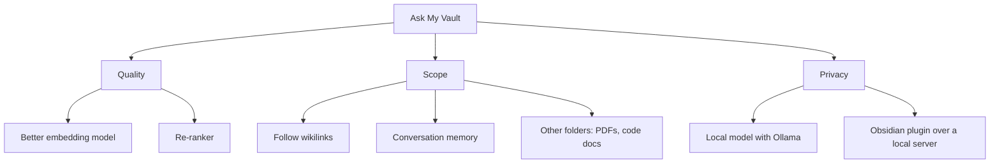

{:class="cover"}

---

By the end of this lesson you will be able to describe what each part of Ask My Vault does, say what RAG cannot do, and pick a next project to build on it.

You started this course with a vault full of notes you could not find, and you finished it with a tool that answers questions about them and shows its working. Nicely done.

## What you built

**Ask My Vault** - eight Python modules plus an optional watcher, three required dependencies, and a command you can run from anywhere:

```bash
amv index                                        # keep it current
amv search "why did the motors stall"            # see the raw matches
amv ask "why did the motors stall" --tag robots  # get a cited answer
amv stats                                        # check on the index
amv watch                                        # re-index as you edit
```

| Module | Job |
|---|---|
| `config.py` | Every setting in one place |
| `vault.py` | Read notes, parse frontmatter, tags and links |
| `chunker.py` | Split notes on headings, add the breadcrumb |
| `index.py` | Build and incrementally maintain the ChromaDB index |
| `retrieve.py` | Search, filter, diversify and hybrid-search the hits |
| `answer.py` | Build the grounded prompt, call Claude, check citations |
| `cli.py` | Five commands (index, search, ask, stats, watch) and an argument parser |
| `watch.py` | Optional: re-index a few seconds after your notes change |
{:class="table table-single"}

---

## What you actually learned

The tool is nice. The transferable knowledge is nicer, because it applies to any RAG system you build after this one.

**Embeddings turn meaning into geometry.** Similar text lands at nearby points, and "search" becomes "find the closest points". Once that clicks, the rest is engineering.

**Chunking is where the quality lives.** More than the model, more than the prompt. A chunk that carries its own context can be found; one that does not, cannot.

**Retrieval and generation fail differently, so debug them separately.** The `search` command exists purely so you can tell in ten seconds which half is broken.

**Grounding is a prompt discipline, not a feature.** "Use only these sources", "cite them", "never invent a fact", and refusing to call the model with nothing retrieved. Four rules that are the difference between a research assistant and a confident liar.

**Filters run before ranking, so they change what wins - not just what survives.** That is what makes metadata worth storing.

**If you do not measure it, you are guessing.** Twenty questions in a YAML file turn "that felt better" into a number you can compare.

---



## Where to take it next

Roughly in order of how much fun they are relative to the effort.

**A better embedding model.** Swap the default for something larger through Chroma's `embedding_function` argument. Measure it with your evaluation set before and after - you may be surprised how little difference it makes compared to fixing chunking.

**A re-ranker.** Retrieve 20 candidates, score them with a cross-encoder, keep the best 5. This is the standard next step in production RAG and it works, at the cost of another model and real latency.

**Follow the graph.** You already store `links` on every chunk. When a note is retrieved, pull in the notes it links to. Obsidian users build dense link graphs and there is a lot of signal in there you are currently ignoring.

**Conversation.** Keep the message history and let follow-up questions work. "What about the quad version?" needs the previous turn to make any sense. You will need to rewrite follow-ups into standalone questions before retrieving - that is the interesting part of the problem.

**Fully offline.** Swap the Claude call for a local model served by [Ollama](https://ollama.com) and the whole pipeline can run with no network at all once the models are downloaded. Only `answer.py` changes: it builds the same grounded prompt and sends it to the local server instead. Privacy goes to absolute, but answer quality depends on the model you pick, and a local model needs enough RAM to hold it, so look up the size of any model in the Ollama library before you pull it. I have not built this variant in the course, so measure it with your own evaluation set from lesson 17.

**An Obsidian plugin.** Run the retrieval as a small local HTTP service and call it from a plugin, so you can ask questions without leaving Obsidian. Our [FastAPI](/learn/fastapi/) course covers the server side.

**Point it at something else entirely.** Nothing in the pipeline is Obsidian-specific except the frontmatter and wikilink parsing. Swap `vault.py` and you have a RAG over your code documentation, your email archive, or a folder of PDFs.

---

> **Teachers**: If learners want the fully offline variant, set expectations first. A local model has to fit in the machine's RAM alongside everything else, so on school hardware with 4GB or 8GB it may not run at all, and downloading model files on a school network can be slow or blocked. Check a model's size on its page in the Ollama library before you set it as homework, and treat this as an extension for learners with their own capable machine.

## What RAG cannot do

Worth restating, because it is easy to forget once the tool is working well.

**It cannot know what you did not write down.** RAG searches your notes. If the decision only ever lived in your head, no amount of retrieval finds it.

**It cannot tell that your notes are wrong.** A confidently cited answer sourced from a note containing a mistake is a confidently cited mistake. The citation tells you where a claim came from, not that it is true. Click through.

**It cannot do maths across your whole vault.** "How many robots have I built?" needs counting, not similarity. Retrieval finds relevant text, and no set of six chunks contains a count over a thousand notes.

**It cannot replace a good note.** The best thing you can do for your RAG is write clearer notes with real headings. Everything in this course amplifies the quality of your notes - it does not create it.

---

## Prerequisites and related courses

If you want to go deeper on the pieces:

- [Obsidian](/learn/obsidian/) - the note-taking side, if your vault needs some love
- [Python for beginners](/learn/python/) - the fundamentals
- [FastAPI](/learn/fastapi/) - building a Python web API, the starting point for wrapping this in a local service
- [SQLite](/learn/sqlite3/) - Chroma is SQLite underneath, and knowing what is in there helps
- [Docker](/learn/docker/) - if you want to run the indexer on a Pi as a container

---

## Try it Yourself

1. Add `--json` output to `amv search`, then pipe it through a script of your own.
2. Write twenty evaluation questions for your real vault (lesson 17) and record your baseline numbers before you change anything else.
3. Make `vault.py` read a different folder of Markdown, such as the documentation for one of your own projects, and ask it a question.
4. Challenge: store a second collection for a different set of notes, and add a `--collection` option so you can search either one.

## Common Issues

- **Problem**: It worked on the practice vault but gives poor answers on your real one.
- **Solution**: Run the six-step diagnosis from lesson 18, starting with `amv search` and your evaluation set.
- **Why**: Real vaults have daily notes, hub pages and long logs that a four-note vault never shows, and each needs its own chunking or skip rule.

## One last thing

Run `amv ask` on a question you have genuinely wondered about for months. Something you know you wrote down and never found again.

That moment - when it comes back with the answer and a link to a note you wrote two years ago and completely forgot - is the whole point of building this.

Thanks for following along. Go and ask your vault something.

---

## Check your understanding


? Which of these can RAG NOT do well?
- [ ] Answer "what motor driver did I use?"
- [x] Count how many robots you have built across a thousand notes
- [ ] Quote the note a claim came from
> Retrieval finds relevant text. No set of six chunks holds a count over the whole vault.

? Where does most of the quality of a RAG tool live, according to the summary?
- [ ] In the size of the model
- [x] In chunking: a chunk that carries its own context can be found
- [ ] In the colour of the terminal output
> More than the model, more than the prompt.

? Which single file changes if you swap Claude for a local Ollama model?
- [x] `answer.py`
- [ ] `vault.py`
- [ ] `chunker.py`
> Everything before generation (parsing, chunking, indexing, retrieval) is unchanged.

? The tool cites a note that contains a mistake. What does the citation tell you?
- [ ] That the claim is true
- [x] Where the claim came from, not that it is correct
- [ ] That the note was edited recently
> RAG grounds answers in your notes. It does not grade your notes.

