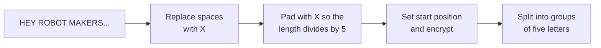

{:class="cover"}

---

By the end of this lesson you will be able to prepare a long message for Enigma by replacing spaces and padding it, and print the ciphertext in the five-letter groups that operators sent.

---

## Messages that look like the real thing

`HEY ROBOT MAKERS THIS IS A SECRET MESSAGE` becomes:

`SUPSH GPYCV JTPYF TDQWV HIBEW FPDBN TAUEL IQXMS ZBDCT`

That is how a wartime message looked on the radio: neat blocks of five letters. It is also the message we will crack in the next lesson, so it is worth understanding how it was made.



---

## Three small jobs

**1. No spaces.** The Enigma keyboard had no spacebar, and operators used the letter X where a space belonged. Python's `.replace()` method does this for us:

```python
plaintext = plaintext.replace(" ", "X")
```
{: .no-snakie }

The receiver turns Xs back into spaces when they read the answer. `py-enigma` also quietly drops any spaces you feed it, but an explicit X keeps the words readable after decryption.

**2. Pad to a multiple of five.** Messages were sent in groups of five letters, so the last group needs filling with Xs. The sum `(5 - len(text) % 5) % 5` works out how many are needed. The `%` operator gives the remainder after division. The outer `% 5` stops us adding five extra letters when the length already divides evenly.

**3. Split into groups.** A slice of five letters at a time, joined with spaces, gives the radio format.

## The complete program

Save this as `long_message.py`:

```python
from enigma.machine import EnigmaMachine

machine = EnigmaMachine.from_key_sheet(
    rotors='II V III',
    reflector='B',
    ring_settings='1 1 1',
    plugboard_settings='AV BS CG DL FU HZ IN KM OW RX')


def pad_string(text):
    """Add X on the end until the length is a multiple of five."""
    padding_needed = (5 - len(text) % 5) % 5
    return text + "X" * padding_needed


def format_for_transmission(text):
    """Break the text into groups of five letters."""
    return ' '.join(text[i:i + 5] for i in range(0, len(text), 5))


plaintext = 'HEY ROBOT MAKERS THIS IS A SECRET MESSAGE'
plaintext = plaintext.replace(' ', 'X')
plaintext = pad_string(plaintext)

machine.set_display('QJF')
ciphertext = machine.process_text(plaintext)

print(plaintext)
print(format_for_transmission(ciphertext))
```

The output is:

```text
HEYXROBOTXMAKERSXTHISXISXAXSECRETXMESSAGEXXXX
SUPSH GPYCV JTPYF TDQWV HIBEW FPDBN TAUEL IQXMS ZBDCT
```

The original has 41 characters, so four Xs were added to reach 45, which is nine groups of five.

The start position `QJF` is part of the key. Keep it, because the next lessons try to *find* it.

> **Teachers**: this makes a good unplugged activity first. Give pairs a short message on paper, ask them to prepare it (spaces to X, pad, groups of five) by hand, then check against the program.

---

## Try it Yourself

1. Change the plaintext to your own message of about 30 characters and run the program. How many Xs of padding did it need?
2. Change the grouping from five letters to four. Which line do you change?
3. Take the printed ciphertext, remove the spaces, and decrypt it with the same settings (reset the start position first). Replace the Xs with spaces to read it.
4. Challenge: write a function `prepare(text)` that also removes punctuation, so `HELLO, WORLD!` becomes clean Enigma text.

## Common Issues

- **Problem**: The groups of five come out different from the lesson.
- **Solution**: Check you call `machine.set_display('QJF')` once, directly before `process_text`, and that you replaced spaces before padding.
- **Why**: The ciphertext depends on the start position and on the exact letters going in, including every X.

- **Problem**: The last group has fewer than five letters.
- **Solution**: Make sure you call `pad_string` before encrypting, not after.
- **Why**: Padding after encryption adds plain letters to the ciphertext, which the receiver cannot decrypt properly.

## Check your understanding


? What did Enigma operators use in place of a space?
- [ ] A dash
- [x] The letter X
- [ ] The letter Z
> The machine had no spacebar, so the letter X stood in for a space.

? Why do we pad the message before encrypting it?
- [x] So the last group has five letters and the message divides evenly into groups
- [ ] So the rotors turn faster
- [ ] So Python can find the crib
> The padding is part of the plaintext, so it is encrypted along with the rest.

? The message has 41 characters after replacing spaces. How many X letters does pad_string add?
- [ ] 1
- [x] 4
- [ ] 5
> The next multiple of five is 45, and 45 minus 41 is 4.

