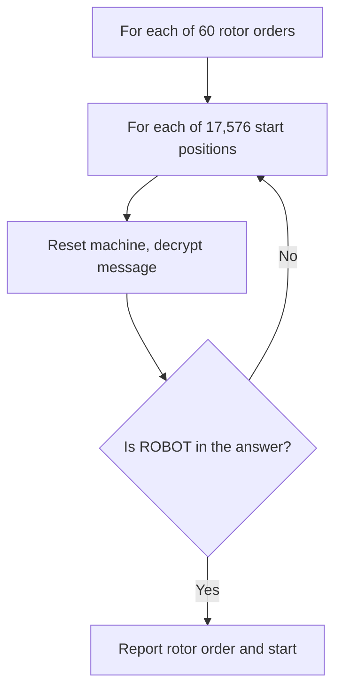

{:class="cover"}

---

By the end of this lesson you will be able to count how many settings a brute force attack must try, and write a Python program that finds the Enigma settings for a message by using a crib.

---

## What is a brute force attack?

A brute force attack tries every possible key until one works. It is not clever, but it is guaranteed to find the answer eventually, as long as you can recognise it when you see it. Computers are good at being not clever very fast, and a cluster is even better.

## Recognising the answer: the crib

Trying a key is easy. Knowing it was the *right* key is the hard part, because wrong keys produce plausible-looking nonsense. Codebreakers at Bletchley Park used a **crib**: a word or phrase they could guess was somewhere in the message, such as a weather report ending with a known sign-off. If a trial decryption contains the crib, we may have found the key.

Our message was sent by a robot maker, so we guess the word `ROBOT` appears:

`SUPSH GPYCV JTPYF TDQWV HIBEW FPDBN TAUEL IQXMS ZBDCT`

## How many settings?

To keep the lesson fair, we assume we already know the reflector (B), the ring settings (`1 1 1`) and the plugboard. We only search the rotors:

- **Rotor order.** There are five rotors (I to V) and the machine holds three, in order. That gives 5 x 4 x 3 = **60** orders.
- **Start position.** Each of the three rotors can start on any of 26 letters: 26 x 26 x 26 = **17,576** positions.

Together: 60 x 17,576 = **1,054,560** combinations. A real attacker also faced unknown ring settings and plugboards, which makes the number enormous. That is why Enigma was so hard to break.



---

## The program

`itertools.permutations` builds the 60 rotor orders for us (a hand-typed list is easy to get wrong), and `itertools.product` walks through every three-letter start position. Save this as `brute_force.py`:

```python
from itertools import permutations, product
from string import ascii_uppercase
import time

from enigma.machine import EnigmaMachine

CIPHERTEXT = "SUPSH GPYCV JTPYF TDQWV HIBEW FPDBN TAUEL IQXMS ZBDCT".replace(" ", "")
CRIB = "ROBOT"
PLUGBOARD = "AV BS CG DL FU HZ IN KM OW RX"
RINGS = "1 1 1"

# Every way to pick 3 of the 5 rotors in order: 5 x 4 x 3 = 60
ROTOR_ORDERS = [" ".join(p) for p in permutations(["I", "II", "III", "IV", "V"], 3)]


def try_rotor_order(rotors):
    """Try all 17,576 start positions. Return the first that reveals the crib."""
    machine = EnigmaMachine.from_key_sheet(
        rotors=rotors, reflector="B", ring_settings=RINGS,
        plugboard_settings=PLUGBOARD)
    for letters in product(ascii_uppercase, repeat=3):
        start = "".join(letters)
        machine.set_display(start)
        if CRIB in machine.process_text(CIPHERTEXT):
            return start
    return None


def decrypt(rotors, start):
    machine = EnigmaMachine.from_key_sheet(
        rotors=rotors, reflector="B", ring_settings=RINGS,
        plugboard_settings=PLUGBOARD)
    machine.set_display(start)
    return machine.process_text(CIPHERTEXT).replace("X", " ")


if __name__ == "__main__":
    print(len(ROTOR_ORDERS), "rotor orders,", len(ROTOR_ORDERS) * 26 ** 3, "combinations")
    began = time.perf_counter()
    for rotors in ROTOR_ORDERS:
        start = try_rotor_order(rotors)
        if start:
            print("Crib found:", rotors, start, "->", decrypt(rotors, start))
    print(f"Took {time.perf_counter() - began:.1f} seconds")
```

On a 4-core cloud computer, using one core, it printed:

```text
60 rotor orders, 1054560 combinations
Crib found: II V III QJF -> HEY ROBOT MAKERS THIS IS A SECRET MESSAGE    
Crib found: IV V III SLF -> KGEFMMUTNAHOMDPMC SZKKIQ JWEVQZCNUMJROBOTD LE
Crib found: V I IV OZD -> YTI VUVVWTQCMHH BPB PFOAVJMG IROBOTKIRRYQHFWG
Crib found: V IV I LHA -> PJNRMZROJTDAROBOTAZN YD GTKFMFGTWKPFBDFRQJYF 
Took 99.1 seconds
```

Your time will differ. A Raspberry Pi will have its own time, which we did not measure here.

**Look at the four hits.** Only the first reads as English. The other three contain `ROBOT` by pure chance: with a million trials and a five-letter crib, a few false alarms are expected. Real codebreakers had the same problem, so a crib shortlists candidates and a human (or a longer crib) picks the winner. The printed message ends in four spaces because those were our padding Xs.

The code runs `set_display` before every attempt, because the machine remembers where its rotors are (lesson 2).

> **Teachers**: this program keeps one processor core busy for a minute or more, so on a shared computer lab run it on one machine per pair and warn students not to start several copies at once. Laptops on battery will get warm and the fan may spin up.

---

## Try it Yourself

1. Run the program and note how many seconds it takes on your computer. We will compare this with the cluster later.
2. Change `CRIB` to `MAKERS`. How many false alarms are there now? Why?
3. Reduce the search to only the rotor order `II V III` by setting `ROTOR_ORDERS = ["II V III"]`. How much faster is it, and does the speed-up match your maths?
4. Challenge: change the program to print how many start positions it tried in total.

## Common Issues

- **Problem**: The program finds nothing.
- **Solution**: Check the ciphertext, the plugboard and the ring settings against the lesson, and that spaces are removed from the ciphertext.
- **Why**: A brute force search only works if every setting we are *not* searching is correct.

- **Problem**: It reports several matches and only one makes sense.
- **Solution**: Read each decrypted line, or use a longer crib.
- **Why**: A short crib appears in random text now and then, so a match is a clue, not a proof.

## Check your understanding


? How many rotor orders can you make by choosing three of the five rotors in order?
- [ ] 15
- [x] 60
- [ ] 125
> The order matters, so it is 5 x 4 x 3 = 60.

? What is a crib?
- [ ] The reflector setting
- [x] A word we guess is in the message, used to recognise the right decryption
- [ ] The first letter of the ciphertext
> A crib lets the computer decide when a trial decryption might be correct.

? Why did the search report three wrong answers as well as the right one?
- [ ] The plugboard was wrong
- [x] With a million trials, a short crib turns up by chance in some wrong decryptions
- [ ] Python made a mistake
> A match is a clue, so we check that the whole message makes sense.

