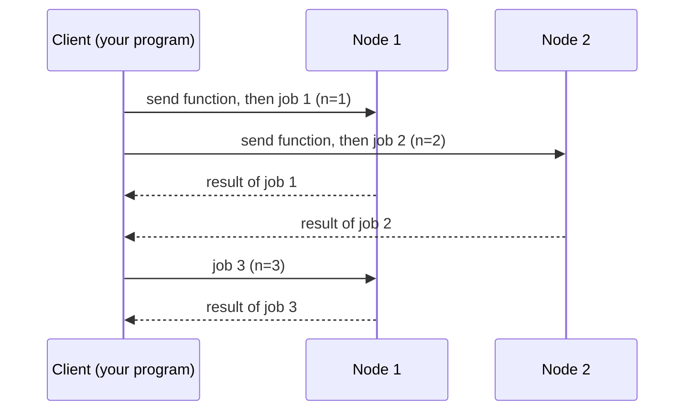

{:class="cover"}

---

By the end of this lesson you will be able to start a `dispy` node, write a client that submits jobs to it, and collect the results.

---

## What is dispy?

`dispy` is a Python package for sharing a computation between several computers. It is a little like the `multiprocessing` module, but the helpers can be different machines on your network, not just extra cores in one. It was checked for this course at version 4.15.2, and its documentation is at [dispy.org](https://dispy.org).

There are two halves:

- A **node** is a computer that does the work. You start the `dispynode.py` program on it and leave it waiting.
- The **client** is your Python program. It describes a function, sends **jobs** (calls of that function with different arguments) to the nodes, and gathers the answers.



The nodes need `dispy` and any package your function uses (for us, `py-enigma`) installed. The client's function is sent to the nodes for you.

---

## Install dispy

In your virtual environment from lesson 1:

```bash
pip install dispy psutil
```
{: .no-snakie }

`psutil` is optional. Without it, `dispynode.py` warns that node status will not reach the client.

> **Python version note.** `dispy` 4.15.2 crashes on Python 3.13 when the *client* starts (details in Common Issues below). The new Raspberry Pi OS, based on Debian Trixie, uses a newer Python than Bookworm did, so check with `python3 --version`. Python 3.11 and 3.12 work as they are, and 3.13 works with a two-line workaround we show later.

---

## Your first nodes and jobs on one computer

You can practise with no cluster at all. Open two terminals, activate your virtual environment in both.

**Terminal 1**: start a node on this computer, using four of its processors:

```bash
dispynode.py --daemon -c 4 -i 127.0.0.1
```
{: .no-snakie }

`-c 4` sets how many processors the node offers, `-i 127.0.0.1` keeps it on this computer, and `--daemon` stops it waiting for keyboard commands. By default a node uses all the processors it has, and `--help` lists every option.

**Terminal 2**: save this client as `first_job.py` and run it:

```python
import dispy

# One computer test: a node on this machine. Change to your Pis' addresses later.
NODES = ["127.0.0.1"]


def square(n):
    # Imports go inside the function: it is sent to the node and runs there.
    import socket
    import time

    time.sleep(1)  # pretend this is hard work
    return socket.gethostname(), n * n


if __name__ == "__main__":
    # host="127.0.0.1" keeps everything on this computer.
    cluster = dispy.JobCluster(square, nodes=NODES, host="127.0.0.1")

    jobs = [cluster.submit(n) for n in range(1, 9)]
    cluster.wait()

    for job in jobs:
        if job.status == dispy.DispyJob.Finished:
            node_name, answer = job.result
            print(f"{node_name} says the square of job {job.id} is {answer}")
        else:
            print("Job failed:", job.exception)

    cluster.print_status()
    cluster.close()
```

Eight jobs of one second each finished in about two seconds, because four ran at once:

```text
vm says the square of job 1 is 1
vm says the square of job 2 is 4
vm says the square of job 3 is 9
...
vm says the square of job 8 is 64

            Node |  CPUs |    Jobs |  Sec/Job | Node Time Sec |    Sent |    Rcvd
---------------------------------------------------------------------------------
              vm |     4 |       8 |      1.0 |           8.0 |   1.4 K |   1.9 K

Total job time: 8.033 sec, wall time: 2.026 sec, speedup: 3.964
```
{: .no-snakie }

Your node name will be your computer's hostname instead of `vm`. The last line is the key one: **speedup** is the total job time divided by the wall-clock time.

The pieces to learn:

- `dispy.JobCluster(function, nodes=[...])` tells `dispy` which function to run and where. Nodes can be IP addresses, host names or patterns like `'192.168.1.*'`.
- `cluster.submit(args)` sends one job and returns a `DispyJob` straight away. `dispy` gives each job an `id` too.
- `cluster.wait()` pauses until every job has finished.
- `job.result` holds the return value, and `job.exception` holds the error text if the function crashed.
- `cluster.close()` tidies up.

On a real network, leave out `host="127.0.0.1"` and list your nodes' addresses. By default a client talks on port 9700 and a node on port 9701, both TCP and UDP, so those must not be blocked. Version 4.15.0 changed the old client port (61590).

> **Teachers**: `dispy` uses broadcast and direct connections between machines, so locked-down school networks and Wi-Fi with client isolation may stop it. Test in advance, or use the one-computer version above, which only uses the local machine. Remember that a node runs whatever code a client sends it, so only run nodes on a network you trust, and do not leave them running on a public network.

---

## Try it Yourself

1. Change `range(1, 9)` to `range(1, 17)`. How does the wall time change, and why?
2. Start the node with `-c 2` instead of `-c 4`. What happens to the speedup?
3. Change `square` to return `n * n` only after `time.sleep(0.01)`. Is it still worth using a cluster for tiny jobs? What does the speedup say?
4. Challenge: make one job crash on purpose (for example, divide by zero when `n == 5`) and print `job.exception` for that job only.

## Common Issues

- **Problem**: Your client stops with `sqlite3.ProgrammingError: SQLite objects created in a thread can only be used in that same thread`, or crashes while starting `JobCluster`.
- **Solution**: Use Python 3.11 or 3.12 for the client, or put these two lines above `import dispy`: `import dbm.dumb, dbm` then `dbm._defaultmod = dbm.dumb`. We tested the workaround on Python 3.13.
- **Why**: `dispy` saves recovery data with `shelve`, and Python 3.13 switched the default storage to SQLite, which does not allow that use from several threads.

- **Problem**: The client waits forever and no jobs run.
- **Solution**: Check that `dispynode.py` is running and that the address in `nodes` matches the node's address.
- **Why**: With no node found, there is nowhere to send the jobs.

- **Problem**: `NameError` or `ModuleNotFoundError` inside a job.
- **Solution**: Put your `import` lines inside the function you submit, and install the package on every node.
- **Why**: The function runs on the node, not in your program.

## Check your understanding


? What does a dispy node do?
- [ ] It writes your client program
- [x] It waits for jobs from a client and runs them
- [ ] It encrypts your messages
> You start dispynode.py on each worker computer and it runs the jobs it is sent.

? Why do we put import lines inside the function we submit?
- [ ] To make it run faster
- [x] Because the function runs on the node, which has its own Python environment
- [ ] Because Python forbids imports at the top of a file
> The node needs to import the packages itself.

? Which line in the output tells you how much faster the work went?
- [ ] The Sec/Job column
- [x] The speedup figure
- [ ] The Sent and Rcvd columns
> Speedup is the total job time divided by the real time it took.

