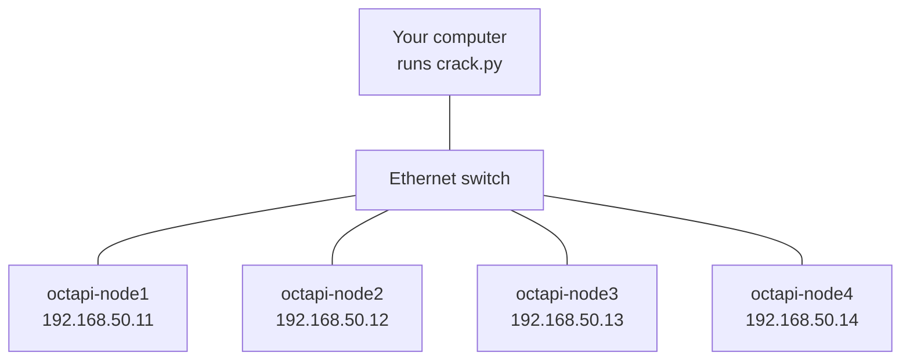

{:class="cover"}

---

By the end of this lesson you will be able to prepare Raspberry Pi nodes, run `dispynode.py` on each, and use a `dispy` client to crack the Enigma message across the cluster.

---

## The plan

The project is a small star: every Pi plugs into one Ethernet switch, and your computer (the client) plugs in too. The client hands one rotor order to whichever node is free, and collects the answers.



The addresses above are examples. Use ones that suit your own network, and keep them off the range your router hands out to other devices.

> **Teachers**: the classroom catches are power, heat and the network. Eight Pis running flat out draw far more than one, so give each Pi its own official power supply (or a powered board that is rated for the total) and never run a bank of Pis from a single phone charger. Packed close together they get hot: leave gaps, and consider a case with a fan. And a cluster needs its own network: a small unmanaged switch is best, because a school's managed switches and Wi-Fi can block the broadcast and direct connections that `dispy` uses. Do not plug the cluster switch into the school network by mistake. One class set of four to eight Pis is plenty for a group of students, who can take turns running the client.

---

## Step 1: Prepare each Pi

This matches the sibling [Docker Swarm cluster course](/learn/docker_swarm/), so if you have built that cluster you can reuse the same cards and addresses.

For each Pi, use Raspberry Pi Imager on your computer:

1. Choose **Raspberry Pi OS (64-bit)** or the Lite version. A desktop is not needed.
2. Open the OS customisation settings and set a unique hostname (`octapi-node1`, `octapi-node2` and so on), your username and password, and enable SSH.
3. Write the card, put it in the Pi, connect Ethernet and power, and boot.

Each Pi needs a fixed address so your client's list never goes out of date. The easiest way is a DHCP reservation in your router. Without one, Raspberry Pi OS (Bookworm and later) uses NetworkManager, so on each Pi you can set it like this (find your connection name first, and use your own network's addresses):

```bash
nmcli connection show
sudo nmcli connection modify "Wired connection 1" \
  ipv4.method manual \
  ipv4.addresses 192.168.50.11/24 \
  ipv4.gateway 192.168.50.1 \
  ipv4.dns 192.168.50.1
sudo nmcli connection up "Wired connection 1"
```
{: .no-snakie }

Take care: a typo can lock you out until you plug in a monitor. Then check it from your computer with `ping 192.168.50.11` and `ssh your-user@octapi-node1.local`, or use the IP address if the name will not resolve.

---

## Step 2: Install dispy on each node

Log in to each Pi over SSH and create a virtual environment (recent Raspberry Pi OS does not allow plain `pip install` into the system Python):

```bash
sudo apt update
sudo apt install python3-venv
python3 -m venv ~/octapi-env
source ~/octapi-env/bin/activate
pip install dispy py-enigma psutil
```
{: .no-snakie }

Then start the node:

```bash
dispynode.py --daemon
```
{: .no-snakie }

It offers all of the Pi's processors by default. A Pi 4 or Pi 5 has four cores, so four Pis give 16 workers. To leave a core free, or keep temperatures down, add `-c 3`. To stop strangers using your nodes, add the same `--secret yourpassphrase` to every node and pass `secret="yourpassphrase"` to `JobCluster` in the client.

The node runs in that terminal, so keep the SSH session open, or run it inside `tmux`. Restarting at boot is a nice extension, but not needed here.

The original OctaPi lesson used a Docker image from [Kev's ClusteredPi repository](https://github.com/kevinmcaleer/ClusteredPi/tree/main/stacks/octapi) to start a node. It is still a good route if you like Docker, but the course now uses the plain Python route above, because that is the setup we could check end to end.

---

## Step 3: Run the cracker on the client

On your computer, in the virtual environment with `dispy` and `py-enigma` installed, save this as `crack.py`. It is the same search as lesson 4, but each rotor order is a job:

```python
import sys
import time
from itertools import permutations

# dispy 4.15.2 needs this on Python 3.13 and newer (see lesson 5, Common Issues)
if sys.version_info >= (3, 13):
    import dbm
    import dbm.dumb
    dbm._defaultmod = dbm.dumb

import dispy
from enigma.machine import EnigmaMachine

# The addresses of your Pi nodes. A pattern such as "192.168.50.*" also works.
NODES = ["192.168.50.11", "192.168.50.12", "192.168.50.13", "192.168.50.14"]
CLIENT_HOST = None  # use "127.0.0.1" with NODES = ["127.0.0.1"] for a one-computer test

CIPHERTEXT = "SUPSH GPYCV JTPYF TDQWV HIBEW FPDBN TAUEL IQXMS ZBDCT".replace(" ", "")
CRIB = "ROBOT"
PLUGBOARD = "AV BS CG DL FU HZ IN KM OW RX"
RINGS = "1 1 1"

ROTOR_ORDERS = [" ".join(p) for p in permutations(["I", "II", "III", "IV", "V"], 3)]


def try_rotor_order(rotors, ciphertext, crib, plugboard, rings):
    """Runs on a node. Try every start position for one rotor order."""
    # Everything the job needs is inside the function: it runs on another computer.
    from itertools import product
    from string import ascii_uppercase
    from enigma.machine import EnigmaMachine

    machine = EnigmaMachine.from_key_sheet(
        rotors=rotors, reflector="B", ring_settings=rings,
        plugboard_settings=plugboard)
    for letters in product(ascii_uppercase, repeat=3):
        start = "".join(letters)
        machine.set_display(start)
        if crib in machine.process_text(ciphertext):
            return start
    return None


def decrypt(rotors, start):
    """Runs here on the client, to show what each hit says."""
    machine = EnigmaMachine.from_key_sheet(
        rotors=rotors, reflector="B", ring_settings=RINGS,
        plugboard_settings=PLUGBOARD)
    machine.set_display(start)
    return machine.process_text(CIPHERTEXT).replace("X", " ")


if __name__ == "__main__":
    cluster = dispy.JobCluster(try_rotor_order, nodes=NODES, host=CLIENT_HOST)
    began = time.perf_counter()

    jobs = []
    for rotors in ROTOR_ORDERS:
        job = cluster.submit(rotors, CIPHERTEXT, CRIB, PLUGBOARD, RINGS)
        job.id = rotors  # label each job with its rotor order
        jobs.append(job)

    cluster.wait()

    found = False
    for job in jobs:
        if job.status != dispy.DispyJob.Finished:
            print("Job", job.id, "did not finish:", job.exception)
        elif job.result:
            found = True
            print("Crib found:", job.id, job.result, "->", decrypt(job.id, job.result))
    if not found:
        print("Attack unsuccessful")

    print(f"Took {time.perf_counter() - began:.1f} seconds")
    cluster.print_status()
    cluster.close()
```

Edit `NODES` to match your Pis, then run `python3 crack.py`. We could not test on real Pis, so here is the same program running against a node on one computer, for four processors:

```text
Crib found: II V III QJF -> HEY ROBOT MAKERS THIS IS A SECRET MESSAGE    
Crib found: IV V III SLF -> KGEFMMUTNAHOMDPMC SZKKIQ JWEVQZCNUMJROBOTD LE
Crib found: V I IV OZD -> YTI VUVVWTQCMHH BPB PFOAVJMG IROBOTKIRRYQHFWG
Crib found: V IV I LHA -> PJNRMZROJTDAROBOTAZN YD GTKFMFGTWKPFBDFRQJYF 
Took 32.9 seconds

            Node |  CPUs |    Jobs |  Sec/Job | Node Time Sec |    Sent |    Rcvd
---------------------------------------------------------------------------------
              vm |     4 |      60 |      2.1 |         128.3 |  16.8 K |  13.1 K

Total job time: 128.269 sec, wall time: 32.918 sec, speedup: 3.897
```
{: .no-snakie }

With real Pis, the table has one row per node. The **speedup** shows how many times faster you were than doing the same work on one core, and the number to aim for is the total number of CPUs. It will fall a little short because sending jobs takes time. With 60 jobs and, say, 16 workers, the last jobs may leave some workers idle, so speedup is rarely perfect.

Compare with lesson 4, which tried the same 1,054,560 combinations on one core. Write down your times for both runs.

---

## Try it Yourself

1. Start with one node and then add a second to `NODES`. Does the speedup double?
2. Run the cracker with a node started with `-c 1`, then `-c 2`, then `-c 4`. Write down the wall time and speedup each time. Where does it stop scaling?
3. Change the crib to `MAKERS` so there are fewer false alarms. Does it change the speed?
4. Challenge: make your own puzzle. Encrypt a new message with `long_message.py` using a different rotor order and start position, put the new ciphertext and a crib into `crack.py`, and crack it on the cluster.

## Common Issues

- **Problem**: The client prints nothing and waits, or the table shows no nodes.
- **Solution**: Check `dispynode.py` is running on each Pi, ping each address from the client, and make sure nothing blocks ports 9700 and 9701 (TCP and UDP).
- **Why**: Nodes listen on port 9701 and the client uses port 9700, so a firewall on a Pi, a switch or your own computer that blocks either one stops the conversation.

- **Problem**: Jobs fail with `ModuleNotFoundError: No module named 'enigma'`.
- **Solution**: Activate the virtual environment on that Pi and run `pip install py-enigma`, then restart the node.
- **Why**: Each node runs its jobs with its own Python packages.

- **Problem**: The client crashes with an SQLite thread error on a newer Python.
- **Solution**: The program above already has the workaround for Python 3.13 and newer. Or use Python 3.11 or 3.12.
- **Why**: See lesson 5, Common Issues.

- **Problem**: One Pi is much slower, or reboots during the run.
- **Solution**: Check its power supply and temperature, and start it with `-c 2` to lower the load.
- **Why**: Four busy cores draw more power and create more heat than a Pi that is just idling.

## Check your understanding


? Why should each Pi have a fixed IP address?
- [ ] So SSH is faster
- [x] So the NODES list in the client stays correct
- [ ] So the Pi gets more power
> The client lists the nodes by address, so a changing address would break the list.

? What are the two ports dispy uses by default (version 4.15)?
- [ ] 22 and 80
- [x] 9700 for the client and 9701 for a node
- [ ] 5000 and 5001
> Both need to be reachable over TCP and UDP.

? What does the speedup figure show?
- [ ] How hot the Pis got
- [ ] The number of jobs submitted
- [x] How many times faster the cluster was than doing the same work on one core
> It is the total time spent in jobs divided by the real time the run took.

