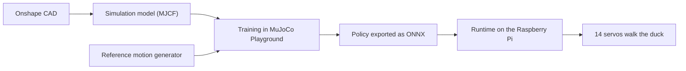

{:class="cover"}

---

Before we pick up a screwdriver, let's get the big picture. Knowing how the pieces fit together will make every later lesson make more sense, especially when something doesn't work first time.

---

## Inspired by BDX

Disney Research built a small bipedal droid, often called BDX, that walks with a lot of character. Its walk was trained with reinforcement learning, and Disney published a paper describing how. Antoine Pirrone set out to make a small, affordable, open-source robot in the same spirit. That robot is the Open Duck Mini.

The version we're building is **v2**. It stands about 42 cm tall and has:

- **14 Feetech STS3215 serial bus servos**: five in each leg and four in the neck and head
- **A Raspberry Pi Zero 2W** as its brain (a Raspberry Pi 5 also works)
- **A BNO055 IMU**, which tells it which way is up and how it's tilting
- **Two foot switches**, which click when a foot touches the ground
- Optional **expression features**: eye LEDs, a projector LED, a speaker, two antenna servos and ear servos

---

## Four repos, one robot

The project is split across four GitHub repos. Each one does one job.

| Repo | What it does | When you use it |
|---|---|---|
| [Open_Duck_Mini](https://github.com/apirrone/Open_Duck_Mini) | The CAD, the BOM, the print guide and the assembly guide | Lessons 2 to 7 |
| [Open_Duck_Mini_Runtime](https://github.com/apirrone/Open_Duck_Mini_Runtime) | The code on the Pi: motor setup, tests, calibration and the walking script | Lessons 4 and 8 to 11 |
| [Open_Duck_reference_motion_generator](https://github.com/apirrone/Open_Duck_reference_motion_generator) | Makes example walking gaits for the policy to copy | Lesson 12 and 13 |
| [Open_Duck_Playground](https://github.com/apirrone/Open_Duck_Playground) | Trains the walking policy in simulation on a GPU | Lesson 13 |
{:class="table table-single"}

For the runtime, always use the **`v2` branch**. We'll check it out when we clone it.

---

## From CAD to a walking duck

Here's the journey the walking brain takes before it ever reaches your robot.

1. **CAD.** The duck is designed in Onshape. A tool called onshape-to-robot (from Rhoban) turns the design into a robot description that a physics simulator can load.
2. **Simulation.** The model runs in MuJoCo. Its part masses and motor behaviour are tuned so the simulated duck acts like the real one.
3. **Training.** The Playground trains a neural network, the **policy**, by letting thousands of simulated ducks try to walk at once on a GPU. The reference motion generator gives it example gaits to imitate.
4. **ONNX.** The trained policy is saved as an `.onnx` file, a portable format for neural networks.
5. **The Pi.** The runtime loads the ONNX file with onnxruntime. Many times a second it reads the servos, IMU and foot switches, asks the policy what to do, and sends new positions to the servos.

The good news: steps 1 to 4 are already done for you. The runtime repo ships with a pretrained policy, so you can get your duck walking without training anything. We'll come back to steps 1 to 4 in the last section, once your duck is on its feet.

---

## What the Pi actually does

It helps to think of the walk as a loop:

- **Sense**: read the servo positions and speeds, the IMU and the foot switches
- **Ask**: hand those readings, plus your joystick command, to the policy
- **Act**: send the policy's chosen joint positions to the 14 servos
- **Repeat**: many times a second

If you've done the [Reinforcement Learning for Beginners](/learn/reinforcement_learning/) course, that's the observe, act, repeat loop you already know. The difference is that the learning happened earlier, in simulation. On the Pi, the policy only acts.

---

## Try it Yourself

1. Open the [Open_Duck_Mini](https://github.com/apirrone/Open_Duck_Mini) repo and find the link to the BOM sheet in the README.
2. Open the `docs` folder and find `print_guide.md` and `assembly_guide.md`. Skim the assembly guide's headings. Note that it's marked as incomplete, so we'll follow it alongside this course.
3. In [Open_Duck_Mini_Runtime](https://github.com/apirrone/Open_Duck_Mini_Runtime), switch to the `v2` branch and look in the `scripts` folder. Spot `find_soft_offsets.py` and `v2_rl_walk_mujoco.py`. You'll run both later in the course.

## Common Issues

**Problem**: The runtime files don't match what this course describes.
**Solution**: Check you are on the `v2` branch, not the default branch.
**Why**: The runtime has code for more than one version of the duck.

**Problem**: A link or file name here no longer exists upstream.
**Solution**: Follow the repo's README. It is kept up to date.
**Why**: The project is active and files get moved and renamed.
