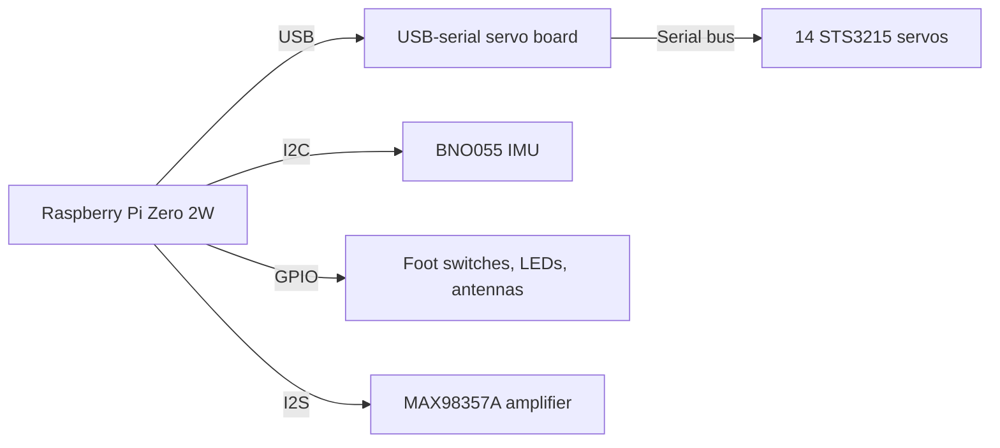

{:class="cover"}

---

This is where the duck gets its nervous system. We'll fit the servo board and the IMU, then wire everything to the Raspberry Pi's header. Take your time here. A single wire on the wrong pin is the cause of a lot of "my duck doesn't work" moments.

Here's Kev's wiring video. Watch it first, then use the tables below as your checklist.



---

## The wiring diagram

The Electronics step of the [assembly guide](https://github.com/apirrone/Open_Duck_Mini) (`docs/assembly_guide.md`) points to a wiring diagram image in the repo. Keep it open as you work. The tables below come from the same guide, set out pin by pin.

There are three kinds of connection to make:

---

## Step 8: the servo bus

The servos don't connect to the Pi's header at all. The Pi talks to them through a **USB-serial servo control board**: the Pi sends messages over USB, and the board turns them into messages on the servo bus. All 14 servos then hang off that bus in a daisy chain. The exact board is listed on the [BOM](https://github.com/apirrone/Open_Duck_Mini).

Mount the board where the assembly guide shows, plug the first servo cable into it, and make sure every servo is on the chain.

---

## Step 9: the IMU

The BNO055 IMU talks to the Pi over **I2C**, a two-wire bus. One wire carries data (SDA) and one carries the clock (SCL). Several devices can share an I2C bus, each with its own address.

Mount it firmly, because any wobble shows up as noise in the readings. The assembly guide prefers the IMU **flipped along its X axis**. That's fine, as long as you tell the software. In lesson 10 you'll set `imu_upside_down` in the config file to match how you mounted it. Get that setting wrong and the duck's gait will oscillate badly.

| BNO055 pin | Pi pin | Pi function |
|---|---|---|
| VIN | 1 | 3V3 |
| GND | 9 | GND |
| SDA | 3 | GPIO2 (SDA) |
| SCL | 5 | GPIO3 (SCL) |
| 3VO | Not connected | |
| RST | Not connected | |
{:class="table table-single"}

---

## Step 10: the rest of the header

### Foot switches

| Function | Pi pin | GPIO |
|---|---|---|
| Left foot switch | 15 | GPIO22 |
| Right foot switch | 13 | GPIO27 |
| Foot switch ground | 9 | GND |
{:class="table table-single"}

### LEDs

The eye LEDs and the projector share a common cathode on ground. Each anode gets its own GPIO.

| Function | Pi pin | GPIO |
|---|---|---|
| Left eye LED anode | 16 | GPIO23 |
| Right eye LED anode | 18 | GPIO24 |
| Projector LED anode | 22 | GPIO25 |
| LED common cathode | 6 | GND |
{:class="table table-single"}

### Antenna servos

| Function | Pi pin | GPIO |
|---|---|---|
| Left antenna PWM | 32 | GPIO12 |
| Right antenna PWM | 33 | GPIO13 |
| Antenna 5V | 2 | 5V |
| Antenna GND | 6 | GND |
{:class="table table-single"}

### MAX98357A speaker amplifier

The amplifier uses **I2S**, a digital audio bus.

| MAX98357A pin | Pi pin | Pi function |
|---|---|---|
| LRC | 35 | GPIO19 |
| BCLK | 12 | GPIO18 |
| DIN | 40 | GPIO21 |
| VIN | 2 | 5V |
| GND | 6 | GND |
| GAIN | Not connected | |
| SD | Not connected | |
{:class="table table-single"}

Notice that several things share pin 2 (5V), pin 6 (GND) and pin 9 (GND). Join those wires neatly, with a good soldered joint and some heat shrink, rather than trying to cram several wires onto one header pin.

The LEDs, antennas and speaker are optional expression features. You can leave them unwired for now and still get the duck walking.

---

## Power

Power for the robot comes from the battery pack you'll fit in step 11, back in lesson 6. Follow the wiring diagram in the repo for how the battery feeds the servo board and the Pi, and use the parts the BOM lists. Double-check polarity before you connect the battery for the first time.

---

## Try it Yourself

1. Before soldering, print the tables above and tick each wire off as you make it.
2. With the battery disconnected, use a multimeter in continuity mode to check each wire goes from the right part pin to the right Pi pin.
3. Count your ground wires. Every part needs one.

## Common Issues

**Problem**: The IMU doesn't show up later.
**Solution**: Check SDA is on pin 3 and SCL on pin 5, not swapped, and that VIN is on 3V3 (pin 1).
**Why**: I2C won't work if the data and clock lines are swapped.

**Problem**: A foot switch never changes.
**Solution**: Check it's on the right GPIO (22 left, 27 right) and shares ground on pin 9.
**Why**: Without a ground the switch has nothing to pull the pin to.

**Problem**: Confusing pin numbers with GPIO numbers.
**Solution**: Pin numbers count the physical header pins. GPIO numbers are the chip's names. The tables give both, so use them together.
**Why**: Pin 15 is GPIO22, not GPIO15. Mixing them up is the most common wiring mistake.

## Check your understanding


? How do the 14 servos connect to the Raspberry Pi?
- [ ] Each servo has its own GPIO pin
- [x] Through a USB-serial servo control board, on one daisy-chained bus
- [ ] Over the I2C bus with the IMU
> The Pi talks USB to the servo board, and the board drives the serial bus that all 14 servos share.

? Which Pi pins does the BNO055 use for SDA and SCL?
- [x] Pin 3 (GPIO2) and pin 5 (GPIO3)
- [ ] Pin 15 (GPIO22) and pin 13 (GPIO27)
- [ ] Pin 12 (GPIO18) and pin 35 (GPIO19)
> Pins 3 and 5 are the Pi's I2C pins. Pins 15 and 13 are the foot switches, and 12 and 35 belong to the amplifier.

? You mounted the IMU flipped along its X axis, as the guide prefers. What must you do?
- [ ] Nothing, the software works it out
- [x] Set imu_upside_down in the config file to match
- [ ] Rewire SDA and SCL the other way round
> The software needs to know how the IMU is mounted. If the setting is wrong, the gait oscillates badly.

