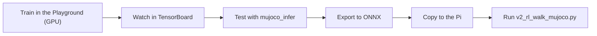

{:class="cover"}

---

So far your duck has walked with a brain someone else trained. In this lesson we'll train one of our own. This is an **advanced, optional** step. Your duck already walks with the pretrained policy, and you don't need this lesson to enjoy it. But if you want to change how it walks, or just see RL working at full scale, this is where it happens.

---

## What you need

- **A decent NVIDIA GPU, or a cloud GPU.** Training runs thousands of simulated ducks at once on the GPU, and the Pi can't do this. Neither can most laptops.
- That GPU set up so JAX can use it (the Playground README has the requirements)
- Time and patience. We won't promise how long training takes, because it depends heavily on your GPU and settings

Training does **not** happen on the duck. You train on the big computer, then copy the result to the Pi.

---

## How the Playground works

[Open_Duck_Playground](https://github.com/apirrone/Open_Duck_Playground) is built on **MuJoCo Playground**. It uses **MuJoCo MJX**, a version of the MuJoCo physics engine that runs on a GPU through JAX. That lets it simulate thousands of ducks in parallel. Each one tries to walk, gets its reward, and the policy improves from all of their experience at once.



Always check the [Playground README](https://github.com/apirrone/Open_Duck_Playground) before you start. It's the up-to-date guide, and this lesson follows it.

---

## Step 1: get the Playground and uv

The Playground uses **uv**, a fast Python package manager, to handle its dependencies. Install it:

```bash
curl -LsSf https://astral.sh/uv/install.sh | sh
```

Then clone the Playground:

```bash
git clone https://github.com/apirrone/Open_Duck_Playground
cd Open_Duck_Playground
```

`uv run` creates the environment and installs what's needed the first time you run something.

---

## Step 2: (optional) turn on the imitation reward

In lesson 12 we saw the imitation reward. To use it, the Playground needs the reference motion from the reference motion generator:

1. Copy `polynomial_coefficients.pkl` into `playground/open_duck_mini_v2/data/`.
2. In `joystick.py`, set `USE_IMITATION_REWARD=True`.

Check the README for where to get `polynomial_coefficients.pkl`, and for where `joystick.py` lives.

---

## Step 3: train

```bash
uv run playground/open_duck_mini_v2/runner.py --task flat_terrain_backlash --num_timesteps 300000000
```

| Part | What it means |
|---|---|
| `runner.py` | The training script |
| `--task flat_terrain_backlash` | Train on flat ground, with gear backlash modelled |
| `--num_timesteps 300000000` | How many simulation steps to train for in total |
{:class="table table-single"}

The algorithm is PPO, through MuJoCo Playground's Brax trainer. Check `runner.py` for the details and any other options.

---

## Step 4: watch it learn

While training runs, open a second terminal and start TensorBoard, pointing it at the folder where your run is saving its logs:

```bash
uv run tensorboard --logdir=<yourlogdir>
```

Open the address it prints in your browser. The reward curve is the one to watch. If it climbs and then levels off, the policy is learning. If it stays flat, something is wrong.

---

## Step 5: test it in simulation

Before your policy goes anywhere near the real duck, watch it walk in MuJoCo:

```bash
uv run playground/open_duck_mini_v2/mujoco_infer.py -o <path_to_.onnx>
```

If it falls over in simulation, it will certainly fall over on your floor. Only move on when it walks well here.

---

## Step 6: export to ONNX

The Pi runs policies as ONNX files with onnxruntime. The Playground has a helper for exporting, `playground/common/export_onnx.py`. Check its arguments in the repo, and check the README in case your training run already writes an ONNX file for you.

---

## Step 7: run it on the duck

Copy your `.onnx` file to the Pi's home folder from your computer, for example with `scp`:

```bash
scp <your_policy>.onnx <user>@<robot ip>:~/
```

Then run the walk script, just as in lesson 11. Here's that command again. Swap `~/BEST_WALK_ONNX_2.onnx` for the path to your own file:

```bash
cd scripts/
python v2_rl_walk_mujoco.py --duck_config_path ~/duck_config.json --onnx_model_path ~/BEST_WALK_ONNX_2.onnx
```

Follow all the safety rules from lesson 11. A new policy is an unknown policy, so have your hands ready and your thumb on A.

---

## Try it Yourself

1. Run a short training run with a smaller `--num_timesteps` first, just to check everything works before you commit to a long one.
2. Train once with the imitation reward and once without. Compare the two in `mujoco_infer.py`. Which walk looks more like a duck?
3. Challenge: open `playground/common/randomize.py` and read what gets randomised. Which of those would matter most on your floor?

## Common Issues

**Problem**: Training is extremely slow or won't start.
**Solution**: Check JAX can see your NVIDIA GPU.
**Why**: Without the GPU, MJX can't run thousands of ducks in parallel.

**Problem**: The policy walks in simulation but falls on the real duck.
**Solution**: Check you trained the backlash task, kept domain randomisation on, and that your duck's offsets and `imu_upside_down` are right.
**Why**: These are what help a policy cross the sim-to-real gap.

**Problem**: The reward curve in TensorBoard never rises.
**Solution**: Go back to the Playground's default settings and get those working first.
**Why**: Change one thing at a time, so you know what made the difference.
