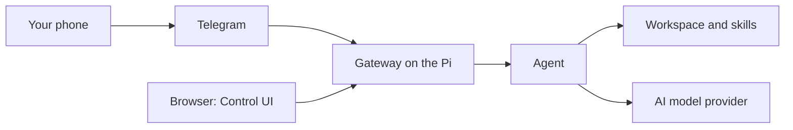
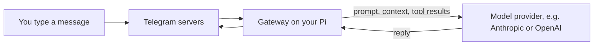

{:class="cover"}

---

By the end of this lesson you'll know what OpenClaw is, what each of its parts does, and exactly which bits of your data stay on the Pi and which travel to an AI company. You'll also meet Pi Butler, the assistant we build together across the whole course.

---

## OpenClaw in one paragraph

OpenClaw is an open-source personal AI assistant that you host yourself. You run one long-running program, called the **Gateway**, on a computer you own. The Gateway connects the chat apps you already use, such as Telegram, WhatsApp or Discord, to an AI **agent**. You send a message from your phone, the agent thinks about it with the help of an AI model, uses tools if it needs to, and replies in the same chat.

It is MIT licensed and developed in the open. There's no paid tier and no hosted OpenClaw service in the middle. The bit that is *not* free is the AI model itself, and we'll be honest about that below.

---

## The parts

| Part | What it does |
| --- | --- |
| **Gateway** | A Node.js service that runs all the time. It holds your config, sessions and channel connections, and routes every message |
| **Channels** | The chat apps the Gateway talks through, such as Telegram, WhatsApp, Discord, Signal and Slack |
| **Agents** | The assistant itself. An agent reads your message, calls an AI model, and can use tools such as running a command or reading a file |
| **Control UI** | The browser dashboard served by the Gateway, for chat, config, sessions and approvals |
| **Skills** | `SKILL.md` instruction files that teach the agent how and when to use tools for a particular job |
| **Workspace** | A folder of files the agent works from, including its persona, notes about you and its memory |
{:class="table table-single"}

### Agents and tools

Think of the Gateway as a switchboard that everything plugs into. The agent is more than a chatbot: it can call **tools**, so it can run a shell command, read and write files, or fetch a web page. That's what makes OpenClaw useful, and it's why we take security seriously later on.

### Skills

A skill is a folder with a `SKILL.md` file inside. The file has a short name and description at the top, then plain instructions underneath. The agent loads skills when they're relevant, so a "check the Pi's health" skill only kicks in when you ask about the Pi. You'll dig into skills, and write one for Pi Butler, in [lesson 10](/learn/openclaw_raspberry_pi/10_understanding-skills.html). Community skills are shared on **ClawHub** at [clawhub.ai](https://clawhub.ai).

### The workspace

The workspace is a folder, `~/.openclaw/workspace/`, holding files like `SOUL.md` (the agent's persona and tone), `USER.md` (facts about you) and `AGENTS.md` (operating instructions), plus memory files. Edit them and the agent's behaviour changes. It's the agent's default working folder, not a locked box, which matters in [lesson 3](/learn/openclaw_raspberry_pi/03_why-docker.html).

---

## What stays on the Pi, and what does not

Here's the part a lot of write-ups get wrong. The Raspberry Pi runs the Gateway. It does **not** run the AI model. The official Raspberry Pi guide is clear that you should use cloud-hosted API models and not try to run a local language model on the Pi, because even small models are too slow to be useful.

So when you chat with your agent, this happens:

| Stays on your Pi | Leaves your Pi |
| --- | --- |
| The Gateway program and its config | Each message you send, to the model provider |
| Your credentials and the Gateway token | The context the agent sends with it: persona, relevant memory, skill instructions |
| Chat history and sessions | The output of any tools the agent ran, such as a file it read |
| Workspace files and memory | Your messages, on their way through the chat app's servers |
{:class="table table-single"}

In short, your files and history *live* on the Pi, but anything the agent needs to think about is sent to the model provider you pick. Read your provider's data policy, and don't feed the agent anything you wouldn't be happy to send them.

### What about local models?

OpenClaw can talk to local model servers such as Ollama or LM Studio. Running one needs a much bigger computer, ideally with a decent GPU. That's possible on another machine on your network, but it is outside this course. We'll use a cloud API model throughout.

---

## What it costs

| Item | Cost |
| --- | --- |
| OpenClaw | Free and open source |
| Raspberry Pi, power supply, storage | A one-off hardware cost |
| Electricity | A few watts, all day |
| AI model API | **Pay per use**, billed by your provider for every message |
| Telegram | Free |
{:class="table table-single"}

API pricing depends on the model and how much text goes back and forth. A long chat with a large model costs more than a quick question to a small one. Most providers let you set a monthly spending limit, so let's set one before you start.

> **Teachers**: every learner, or the class, needs an API key from a model provider, and every message costs money. Use one key with a firm spending limit, and check the provider's minimum age rules before students sign up.

---

## When is OpenClaw a good fit?

**A great fit if you want:**

- A personal assistant you message from your phone, on any chat app
- Something always on, that can run scheduled jobs such as a morning summary
- To learn how AI agents, tools and skills really work, on hardware you control
- Your config, history and files on your own box rather than on someone's website

**Not the right tool if you want:**

- Everything fully offline on the Pi. The model lives in the cloud
- A service shared by people who don't trust each other. One Gateway is meant for one trusted operator
- Zero running costs. The API is metered

---

## Meet Pi Butler

Across this course we build **Pi Butler**: an always-on OpenClaw agent on your Pi, running in Docker, that you chat to from your phone over Telegram. By the end it has its own persona, a custom `pi-health` skill that reports the Pi's temperature, memory and disk space, and a 7 am morning brief. Each lesson adds one piece.

## Pi Butler progress

Nothing built yet. You know what the parts are and where your data goes, which is the right place to start.

---

## Try it Yourself

1. **Trace a message.** Using the second diagram, write down every place your message "Is it going to rain?" visits on its way to an answer and back.
2. **Check the price.** Look up your chosen model provider's pricing page and find how to set a monthly spending limit.
3. **Challenge:** Make a list of three jobs you'd like Pi Butler to do for you. For each one, note which part does the work: a channel, a skill, a tool, or a scheduled job.

---

## Common Issues

**Problem**: You expected OpenClaw to work with no internet connection.
**Solution**: Keep the Pi online. It needs the internet to reach the model provider and your chat app.
**Why**: The Pi only runs the Gateway. The thinking is done by a cloud model.

**Problem**: You searched for "ClawdHub" and found nothing useful.
**Solution**: The skills registry is called ClawHub, at clawhub.ai.
**Why**: The name is easy to misspell, and older guides got it wrong.

**Problem**: Your first API bill is higher than expected.
**Solution**: Set a spending limit with your provider, and use a smaller model for everyday chat.
**Why**: You pay for every message and all the context sent with it, so long chats add up.

---

## Check your understanding


? On a Raspberry Pi set up the way this course recommends, where does the AI model run?
- [ ] On the Pi's CPU
- [x] At a cloud model provider, reached with an API key
- [ ] On an AI HAT+ attached to the Pi
> The Pi runs only the Gateway. The official guide says not to run local language models on a Pi because even small ones are too slow.

? Which of these stays on your Pi?
- [ ] The messages you send to the agent
- [ ] The output of a tool the agent ran
- [x] Your chat history and workspace files
> History, config and workspace files live on the Pi. Messages, context and tool results are sent to the model provider so it can reply.

? What is a skill in OpenClaw?
- [ ] A paid add-on from the OpenClaw website
- [x] A folder with a SKILL.md file that teaches the agent how and when to use tools
- [ ] A separate AI model for each task
> Skills are instruction files. The agent loads them when relevant. Community skills are shared on ClawHub.

