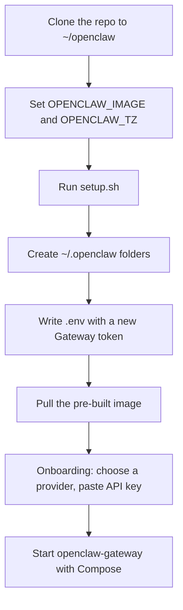

{:class="cover"}

---

This is the big one. In this lesson we'll download OpenClaw, run the official setup script with the pre-built image, and get the Gateway running in Docker. By the end you'll understand what the Compose file and the `.env` file do, and you'll have checked that Pi Butler's Gateway is healthy.

Everything here is typed **on the Pi**, over SSH.

---

## What the setup script does

There's no Compose file to write by hand. The OpenClaw repository ships one, plus a script that does all the fiddly bits for you.



---

## Step 1: Clone the repository

```bash
git clone --depth 1 https://github.com/openclaw/openclaw.git ~/openclaw
cd ~/openclaw
```

`--depth 1` downloads only the latest version of the code, not its whole history, which saves time and space. We only need the repo for its `docker-compose.yml` and scripts. The actual program comes in the Docker image.

From now on, **always run `docker compose` commands from `~/openclaw`**. That's where Compose finds its file.

---

## Step 2: Choose the image and timezone

Two settings, both typed into the same SSH session you'll run the script from:

```bash
export OPENCLAW_IMAGE="ghcr.io/openclaw/openclaw:latest"
export OPENCLAW_TZ="Europe/London"
```

`OPENCLAW_IMAGE` tells the script to **download** the official pre-built image. This one matters. Without it, the script tries to build the image from source on your Pi, which needs 6 GB or more of RAM and will almost certainly fail.

`OPENCLAW_TZ` sets the timezone inside the container. Use the same IANA name you gave the Pi in [lesson 4](/learn/openclaw_raspberry_pi/04_preparing-your-pi.html).

---

## Step 3: Run the setup script

```bash
./scripts/docker/setup.sh
```

The script works through these stages, printing a `==>` heading for each:

1. Checks that `docker compose` is available.
2. Creates `~/.openclaw`, `~/.openclaw/workspace` and `~/.openclaw-auth-profile-secrets` on the Pi.
3. Generates a random Gateway token and writes it, with your other settings, to `~/openclaw/.env`.
4. Pulls the image. On a Pi this can take several minutes.
5. Fixes folder ownership so the container's `node` user (uid 1000) can write to them.
6. Runs interactive **onboarding**.
7. Pins Docker-friendly Gateway settings and starts the `openclaw-gateway` container.

> **Teachers**: the image pull is the slow part, and a classroom of Pis pulling at once can crawl on shared Wi-Fi. Pull it ahead of time with `docker pull ghcr.io/openclaw/openclaw:latest` on each Pi, or run this step in a lesson with spare time.

### What onboarding asks

The exact screens change between releases, but expect roughly this:

| Question | What to do |
| --- | --- |
| A pointer to the security guide | Read it, then carry on |
| **Quick start** or **Custom setup** | Choose **Quick start** for this course |
| Which AI provider to use | Pick the provider you have an API key for, such as Anthropic or OpenAI |
| Your API key | Paste it. It's saved in OpenClaw's credential store inside `~/.openclaw` |
| A test reply | Onboarding sends one real message to check the key works |
{:class="table table-single"}

You'll also see a few notes the script prints for Docker: Gateway mode is pinned to `local`, the bind is `lan`, the token is "not printed", and the Gateway daemon is "managed by Docker Compose". That's all expected.

At the end it prints example commands for adding WhatsApp, Telegram or Discord. Ignore those for now. We connect Telegram later in the course.

---

## What the Compose file does

Let's look inside `~/openclaw/docker-compose.yml`. Here's a trimmed **excerpt** of the Gateway service. It's for reading, not for pasting: the real file has many more settings, and the setup script relies on all of them.

```yaml
# EXCERPT ONLY - do not copy this into a file
services:
  openclaw-gateway:
    image: ${OPENCLAW_IMAGE:-openclaw:local}
    env_file:
      - path: .env
        required: false
    environment:
      HOME: /home/node
      OPENCLAW_STATE_DIR: /home/node/.openclaw
      OPENCLAW_GATEWAY_TOKEN: ${OPENCLAW_GATEWAY_TOKEN:-}
      TZ: ${OPENCLAW_TZ:-UTC}
    volumes:
      - "${OPENCLAW_CONFIG_DIR:-${HOME:-/tmp}/.openclaw}:/home/node/.openclaw"
      - "${OPENCLAW_WORKSPACE_DIR:-${HOME:-/tmp}/.openclaw/workspace}:/home/node/.openclaw/workspace"
    cap_drop:
      - NET_RAW
      - NET_ADMIN
    security_opt:
      - no-new-privileges:true
    extra_hosts:
      - "host.docker.internal:host-gateway"
    ports:
      - "${OPENCLAW_GATEWAY_PORT:-18789}:18789"
    init: true
    restart: unless-stopped
    command: ["node", "dist/index.js", "gateway", "--bind", "${OPENCLAW_GATEWAY_BIND:-lan}", "--port", "18789"]
    healthcheck:
      test: ["CMD", "node", "dist/docker-healthcheck.js"]
      interval: 30s
```

| Line | What it means |
| --- | --- |
| `image` | Which image to run. It reads `OPENCLAW_IMAGE` from `.env`. `openclaw:local` is the fallback for a local build, which we avoid |
| `env_file` | Loads the settings in `~/openclaw/.env` into the container |
| `volumes` | Bind mounts. `~/.openclaw` on the Pi appears as `/home/node/.openclaw` in the container, so config and history survive the container being replaced |
| `cap_drop`, `security_opt` | The hardening from lesson 3: no raw sockets, no network admin, no gaining extra privileges |
| `extra_hosts` | Lets the container reach services on the Pi itself as `host.docker.internal` |
| `ports` | Publishes port `18789`, the Gateway and Control UI, on the Pi |
| `init`, `restart` | A tiny init process inside, and automatic restarts unless you stop it yourself |
| `command` | Starts the Gateway, bound to `lan` so the published port works |
| `healthcheck` | Every 30 seconds, checks the Gateway answers on `/healthz` |
{:class="table table-single"}

The real file also mounts `~/.openclaw-auth-profile-secrets`, and publishes two more ports: `18790` for the bridge and `3978` for Microsoft Teams.

### Two services, one job each

The file defines two services:

- **`openclaw-gateway`** is the long-running Gateway. This is Pi Butler.
- **`openclaw-cli`** is for one-off OpenClaw commands. It starts, runs a command and exits. It shares the Gateway's network, so it can talk to it directly.

You'll use `openclaw-cli` constantly from the next lesson on.

---

## The .env file

The setup script wrote `~/openclaw/.env`. Compose reads it every time you run a `docker compose` command. Have a look at the settings without printing the token:

```bash
grep -E '^OPENCLAW_(IMAGE|TZ|GATEWAY_PORT|GATEWAY_BIND|CONFIG_DIR)=' ~/openclaw/.env
```

You'll see something like:

```text
OPENCLAW_CONFIG_DIR=/home/<user>/.openclaw
OPENCLAW_GATEWAY_PORT=18789
OPENCLAW_GATEWAY_BIND=lan
OPENCLAW_IMAGE=ghcr.io/openclaw/openclaw:latest
OPENCLAW_TZ=Europe/London
```

The file also holds `OPENCLAW_GATEWAY_TOKEN`, which works like a password for your Gateway. Make sure only you can read the file:

```bash
chmod 600 ~/openclaw/.env
```

Never paste the token into a chat, a screenshot or a forum post. Remember too that everything in `.env` is passed into the container, where the agent can see it.

---

## Step 4: Check it's running

```bash
cd ~/openclaw
docker compose ps
```

You're looking for the Gateway with a status of `Up` and, after about half a minute, `(healthy)`:

```text
NAME                          SERVICE            STATUS
openclaw-openclaw-gateway-1   openclaw-gateway   Up 2 minutes (healthy)
```

Your output has more columns, such as the image and ports. If it says `(health: starting)`, give it a moment and run it again.

Now watch the logs live:

```bash
docker compose logs -f openclaw-gateway
```

Press Ctrl+C to stop watching. That only stops the log view, not the Gateway.

Finally, ask the Gateway directly whether it's alive. This health check needs no login:

```bash
curl -fsS http://127.0.0.1:18789/healthz
```

A healthy Gateway answers:

```text
{"ok":true,"status":"live"}
```

There are two deeper checks too: `/startupz` says whether start-up has finished, and `/readyz` also checks that your channels are working. Before we've connected any channels, `/healthz` is the one to watch.

Don't open the Control UI in a browser yet. We do that safely, through an SSH tunnel, in [lesson 7](/learn/openclaw_raspberry_pi/07_first-access.html).

## Pi Butler progress

**Gateway running.** Pi Butler's Gateway is up in Docker, healthy, with its state in `~/.openclaw` and its token in `~/openclaw/.env`. It can't chat with you yet, but it's alive.

---

## Try it Yourself

1. **Prove it restarts.** Run `sudo reboot`, SSH back in, `cd ~/openclaw`, and run `docker compose ps`. Did the Gateway come back on its own?
2. **Find your state.** Run `ls ~/.openclaw` and `ls ~/.openclaw/workspace`. Which file do you think holds the config?
3. **Challenge:** Run `docker compose config` from `~/openclaw` and find the `ports` section for `openclaw-gateway`. That's the full file with your `.env` values filled in. Why do the host side and container side of port 18789 match?

---

## Common Issues

**Problem**: The script says `==> Building Docker image: openclaw:local` and the Pi grinds to a halt.
**Solution**: Press Ctrl+C, run the two `export` lines from Step 2 in this same session, then run `./scripts/docker/setup.sh` again.
**Why**: Without `OPENCLAW_IMAGE`, the script builds from source, which needs 6 GB of RAM or more. Exported variables also vanish when you log out, so set them again in any new session before re-running the script.

**Problem**: The image pull fails or times out.
**Solution**: Run `docker pull ghcr.io/openclaw/openclaw:latest` on its own until it completes, then run the setup script again.
**Why**: The image is large and Wi-Fi can be slow. Once the layers are on the Pi, the script's own pull only has to confirm they're up to date.

**Problem**: The logs show `EACCES` on `/home/node/.openclaw`.
**Solution**: Run `sudo chown -R 1000:1000 ~/.openclaw`, then `docker compose up -d openclaw-gateway`.
**Why**: The container runs as `node`, uid 1000, and needs to own the folders mounted into it.

**Problem**: `docker compose ps` shows nothing, or `no configuration file provided`.
**Solution**: `cd ~/openclaw` first, then run the command again.
**Why**: Compose looks for `docker-compose.yml` in the folder you're in.

---

## Check your understanding


? What happens if you run the setup script without setting OPENCLAW_IMAGE?
- [ ] It downloads the latest image anyway
- [x] It tries to build the image from source on the Pi
- [ ] It refuses to run
> The default image name is openclaw:local, which tells the script to build. On a Pi that usually runs out of memory.

? Where does the Gateway's config and chat history live on the Pi?
- [ ] Inside the container only, so it's lost on upgrade
- [x] In ~/.openclaw, bind mounted into the container
- [ ] In ~/openclaw/docker-compose.yml
> ~/.openclaw on the Pi appears as /home/node/.openclaw inside the container, so it survives the container being replaced.

? Which command checks the Gateway is alive without logging in?
- [ ] docker compose down
- [ ] cat ~/openclaw/.env
- [x] curl -fsS http://127.0.0.1:18789/healthz
> /healthz is an unauthenticated liveness check. A healthy Gateway answers with ok true and status live.

