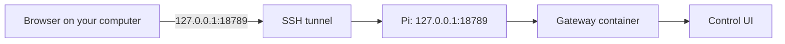

{:class="cover"}

---

By the end of this lesson you will have opened the OpenClaw Control UI from your own computer, signed in with your Gateway token and had your first conversation with Pi Butler. We will also set up a handy `openclaw` shortcut that the rest of the course uses.

---

## Where we are

In [lesson 6](/learn/openclaw_raspberry_pi/06_docker-compose-setup.html) the setup script pulled the image, ran onboarding and started the Gateway in Docker. The Gateway is now listening on port `18789` on your Pi. That one port serves two things: the Gateway's WebSocket and the **Control UI**, which is the browser dashboard.

The Control UI is an admin surface. From it you can chat with your agent, change config and approve commands. So we want to reach it from our own computer without opening it up to the whole network.

Throughout this course `openclaw-pi` is the Pi's hostname and `<user>` is the username you log in to the Pi with. Swap in your own.

---

## The SSH tunnel

An SSH tunnel carries a port from the Pi to your computer through your normal SSH login. Your browser talks to `127.0.0.1` on your own machine, and SSH quietly forwards that to the Pi.



Open a terminal **on your computer** (not on the Pi) and run:

```bash
ssh -N -L 18789:127.0.0.1:18789 <user>@openclaw-pi.local
```

Type your Pi password when asked. The `-N` means "no shell, just forward the port", so the command looks like it has frozen. That is normal. Leave this window open for as long as you want to use the dashboard, and press Ctrl+C to close the tunnel.

Now open this address in your computer's browser:

```text
http://127.0.0.1:18789/
```

### Why not just use the Pi's IP address?

The setup script only allows the browser origins `http://localhost:18789` and `http://127.0.0.1:18789`. If you browse to `http://<pi-ip>:18789` from another machine, the Control UI refuses the connection. That is deliberate. The tunnel makes your browser look local, so it works, and nobody else on your Wi-Fi gets an easy way in.

Never port-forward `18789` on your router to the internet. If you want to reach Pi Butler away from home later, use the SSH tunnel or Tailscale, which we cover in the security lesson.

---

## Sign in with your Gateway token

The first time you open the page you will see a login screen with a **Gateway secret** field. The secret is the token the setup script wrote to `~/openclaw/.env`.

Open a second terminal, SSH into the Pi as normal, and run this **on the Pi**:

```bash
grep OPENCLAW_GATEWAY_TOKEN ~/openclaw/.env
```

You will see a line like `OPENCLAW_GATEWAY_TOKEN=` followed by a long string of letters and numbers. Copy only the part after the `=` and paste it into **Gateway secret**, then connect.

Treat that token like a password. Don't paste it into chats, screenshots or forum posts. If you ever need to change it later, the field also lives in **Settings → Gateway**.

### Pairing required

Gateway auth comes first, then device pairing. A new browser usually needs a one-time approval, and the page will say something like `pairing required`. Keep the page open, and **on the Pi** run:

```bash
cd ~/openclaw
docker compose run --rm openclaw-cli devices list
```

Find the pending request and copy its request ID, then approve it:

```bash
docker compose run --rm openclaw-cli devices approve <requestId>
```

Only approve a request you recognise. The waiting page connects on its own once you approve it. If the browser retries, it can create a new request ID, so run `devices list` again if the approval fails.

---

## Set up the openclaw shortcut

Typing `docker compose run --rm openclaw-cli` every time gets old fast. The official docs write commands as `openclaw <command>`, so let's make that work on the Pi too. Run this **on the Pi**:

```bash
echo "alias openclaw='docker compose -f ~/openclaw/docker-compose.yml run --rm openclaw-cli'" >> ~/.bashrc
source ~/.bashrc
```

Now `openclaw devices list` does exactly the same as the long version, from any folder. Each run starts a short-lived CLI container that shares the Gateway's network, does its job and removes itself.

Try it:

```bash
openclaw status
```

From the next lesson on, every `openclaw ...` command means this alias. Commands that start or stop the Gateway itself stay as `docker compose ...`, run in `~/openclaw`.

---

## A quick tour of the Control UI

The Control UI has a lot in it, and it changes between releases. Here are the parts we will use in this course.

| Area | What it is for |
| --- | --- |
| **Pages** | The rail on the left. Built-in pages such as **Automations**, **Sessions** and **Usage** |
| **Sessions** | Your conversations with the agent, one row per session |
| **New session** (the **+**) | Start a fresh conversation |
| Chat and composer | Where you type messages and read replies |
| **Settings → Gateway** | The Gateway URL and **Gateway secret** for this browser |
| **Settings → Devices** | Browsers and phones paired with your Gateway |
| **Settings → Agents**, **Models**, **Skills** | Your agent's files, its AI model and its skills |
{:class="table table-single"}

Have a click around. You can't break anything by looking.

---

## Say hello to Pi Butler

Open your agent's chat and type a first message in the composer:

```text
Hello! Who are you, and what can you help me with?
```

Your message leaves the Pi, goes to the model provider you chose during onboarding, and the reply comes back through the Gateway. That round trip costs a tiny amount of API credit. The conversation history itself is stored on your Pi.

If you get a sensible reply, congratulations. Pi Butler is alive, even if it doesn't know it is called Pi Butler yet. We fix that in the next lesson.

> **Teachers**: every message uses the API key from onboarding, so a class sharing one key shares one bill. Set a spend limit on the provider's dashboard before the lesson, and on shared school Wi-Fi check that SSH to the Pis is allowed.

---

## Pi Butler progress

Pi Butler now answers you. You reached the Control UI through an SSH tunnel, signed in with your Gateway token and had your first conversation. You also have the `openclaw` shortcut that the rest of the course leans on.

---

## Try it Yourself

1. **Close and reopen.** Press Ctrl+C in the tunnel window, refresh the browser and watch it lose the connection. Start the tunnel again and reconnect.
2. **Use the alias.** Run `openclaw devices list` on the Pi and find your browser in the list of paired devices.
3. **Challenge:** Ask Pi Butler what time zone it thinks it is in and what today's date is. Note the answer, because we will set the time zone properly in the next lesson.

---

## Common Issues

**Problem**: The browser says it can't reach `127.0.0.1:18789`.
**Solution**: Check the tunnel window is still open, then on the Pi run `cd ~/openclaw && docker compose ps` to see the Gateway is up.
**Why**: The page only works while the tunnel is running and the Gateway container is healthy.

**Problem**: `bind: Address already in use` when starting the tunnel.
**Solution**: Close any other tunnel you already have open, or use another local port such as `ssh -N -L 18800:127.0.0.1:18789 <user>@openclaw-pi.local` and browse to `http://127.0.0.1:18800/`.
**Why**: Only one program on your computer can listen on a port at a time.

**Problem**: The UI says unauthorized, or pairing required.
**Solution**: Paste the token from `~/openclaw/.env` into **Gateway secret**, then run `devices list` and `devices approve <requestId>` on the Pi.
**Why**: The Gateway checks the shared secret first, then wants each new browser approved once.

**Problem**: `openclaw: command not found` after adding the alias.
**Solution**: Run `source ~/.bashrc`, or log out and back in.
**Why**: A new alias only appears in shells that have re-read `~/.bashrc`.

---

## Check your understanding


? Why do we open the Control UI at http://127.0.0.1:18789/ through an SSH tunnel?
- [ ] Because the Pi has no IP address
- [x] Because the setup script only allows localhost origins, and the tunnel keeps the admin UI off the open network
- [ ] Because SSH makes the AI model run faster
> The setup script allows only http://localhost:18789 and http://127.0.0.1:18789. The tunnel makes your browser local to the Pi without exposing the dashboard.

? Where do you find the Gateway secret to paste into the login screen?
- [ ] On the Telegram bot page
- [ ] It is printed on the Pi's case
- [x] In ~/openclaw/.env, on the line OPENCLAW_GATEWAY_TOKEN
> The setup script generates the token and writes it to ~/openclaw/.env on the Pi.

? What does the openclaw alias actually run?
- [x] docker compose run --rm openclaw-cli, using the compose file in ~/openclaw
- [ ] A copy of OpenClaw installed directly on Raspberry Pi OS
- [ ] The Gateway restart command
> The alias runs a short-lived openclaw-cli container, so docs commands work on the Pi without a native install.

