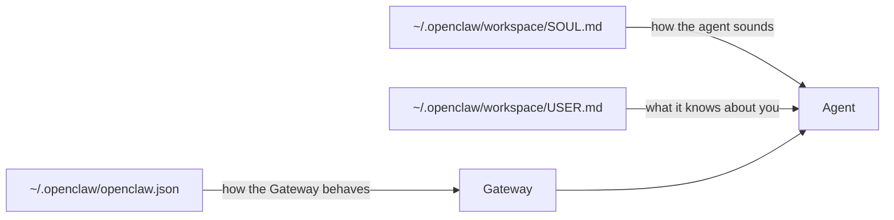

{:class="cover"}

---

In this lesson you will learn where OpenClaw keeps its settings, how to change them without breaking anything, and how to pick your AI model. Then we will give Pi Butler a name, a voice and a few facts about you.

A quick reminder: every `openclaw ...` command in this lesson is the alias we made in [lesson 7](/learn/openclaw_raspberry_pi/07_first-access.html). Type them **on the Pi**, over SSH.

---

## Two kinds of settings

OpenClaw splits its settings into two places, and it helps to know which is which.



- **`openclaw.json`** is the config file. It holds channels, models, tool rules, time zone and so on.
- **Workspace files** such as `SOUL.md` and `USER.md` are plain Markdown the agent reads at the start of every session.

Both live in `~/.openclaw` on the Pi, which Docker mounts into the container at `/home/node/.openclaw`. So editing them on the Pi changes what the container sees.

---

## openclaw.json is JSON5

The config file is **JSON5**, a friendlier JSON that allows comments and trailing commas. If the file is missing, OpenClaw uses safe defaults. A small example looks like this:

```json5
// ~/.openclaw/openclaw.json
{
  agents: {
    defaults: {
      userTimezone: "Europe/London",
    },
  },
}
```

OpenClaw is strict about this file. Unknown keys or wrong types make the Gateway refuse to start. So rather than hand-editing, let's use the tools that check our work for us.

### The config commands

| Command | What it does |
| --- | --- |
| `openclaw configure` | Interactive wizard for models, channels, skills and more |
| `openclaw config file` | Print the path of the active config file |
| `openclaw config get <path>` | Read one setting |
| `openclaw config set <path> <value>` | Change one setting, leaving the rest alone |
| `openclaw config unset <path>` | Remove one setting |
| `openclaw config validate` | Check the whole file against the schema |
{:class="table table-single"}

`config get` hides secrets, so it won't show you your full token. That is a feature.

The wizard can also jump straight to one part, for example `openclaw configure --section model`.

### Hot reload

The Gateway watches its config and applies most changes on its own, with no restart. After every `config set`, the CLI tells you what will happen, with a hint such as `Change will apply without restarting the gateway.` or `Restart the gateway to apply.`

Agent, model, tool and skill settings all hot-apply. A few things, like the Gateway's network bind, need a restart. In Docker we do that from `~/openclaw`:

```bash
cd ~/openclaw
docker compose restart openclaw-gateway
```

---

## Set your time zone

Pi Butler will send you a morning brief later, so it needs to know what "morning" means. Set your time zone with an IANA name like `Europe/London` or `America/New_York`:

```bash
openclaw config set agents.defaults.userTimezone "Europe/London"
openclaw config get agents.defaults.userTimezone
```

If you don't set it, OpenClaw falls back to the host's time zone. Inside the container that comes from `OPENCLAW_TZ` in `~/openclaw/.env`, which defaults to `UTC` if you didn't export it in lesson 6.

---

## Choose your model

Your agent calls an AI model in the cloud through the API key you gave during onboarding. Let's see what it is using:

```bash
openclaw models status
```

This shows the default model, any fallbacks, and whether the credentials look usable. Now list what's available:

```bash
openclaw models list
```

Model IDs look like `anthropic/<model>`. Pick one from your own list, then set it as the default:

```bash
openclaw models set <model-from-the-list>
```

We are not hard-coding a model name here on purpose. Providers rename and retire models often, so trust `models list` over any tutorial.

### Fallbacks

A fallback is a model OpenClaw tries if the main one fails, for example because of a rate limit. Add one from your list:

```bash
openclaw models fallbacks add <another-model-from-the-list>
openclaw models fallbacks list
```

Cheaper, smaller models make good fallbacks and keep your bill down.

---

## Give Pi Butler a personality

Now the fun bit. Your workspace has a few Markdown files the agent loads every session:

| File | What goes in it |
| --- | --- |
| `AGENTS.md` | Operating rules and priorities |
| `SOUL.md` | Persona, tone and boundaries |
| `USER.md` | Stable facts and preferences about you |
| `IDENTITY.md` | The agent's name, vibe and emoji |
{:class="table table-single"}

You can edit them in the Control UI under **Settings → Agents → Files**, or on the Pi with `nano`. Let's use `nano`:

```bash
nano ~/.openclaw/workspace/SOUL.md
```

Replace what is there with something short and sharp. Short beats long.

```markdown
# SOUL.md

You are Pi Butler, a calm and slightly dry British butler who lives on a
Raspberry Pi.

- Keep answers short. One sentence if one sentence will do.
- Be helpful first and witty second. Never sarcastic about the user.
- Never open with "Great question". Just answer.
- If you are not sure, say so plainly rather than guessing.
- You are a guest on this Pi. Ask before deleting or changing anything.
```

Save with Ctrl+X, then Y, then Enter.

Now tell Pi Butler about you. `USER.md` works best as a list of directives, each starting with a word like `Always`, `Never` or `Prefer`:

```bash
nano ~/.openclaw/workspace/USER.md
```

```markdown
# USER.md

## Directives

- Always call me Alex.
- Prefer metric units and 24-hour times.
- Prefer plain English over jargon. I am learning Linux and Docker.
- Always mention the Pi's temperature if it is above 70 C.
```

Don't put passwords or API keys in these files. They are sent to the model with every session.

### Try the new personality

Workspace files load when a session starts. In the Control UI chat, type `/new` to start a fresh session, then say hello again. Pi Butler should now sound like a butler and call you by name.

---

## Pi Butler progress

Pi Butler now has a personality. It knows its name and tone from `SOUL.md`, a few facts about you from `USER.md`, your time zone, and which model to use, with a fallback if the main one fails.

---

## Try it Yourself

1. **Read a setting.** Run `openclaw config file`, then `openclaw config get agents.defaults.userTimezone`.
2. **Tune the voice.** Change one line in `SOUL.md`, start a new session with `/new`, and see how the replies change.
3. **Challenge:** Add a fallback model, run `openclaw models status`, and check the fallback appears. Then run `openclaw config validate` to prove your config is still happy.

---

## Common Issues

**Problem**: `Permission denied` when saving `SOUL.md`.
**Solution**: Run `sudo chown -R 1000:1000 ~/.openclaw`, then edit again without `sudo`.
**Why**: The container runs as user `node` (uid 1000), and files created by root can't be written by either of you.

**Problem**: The Gateway won't start after a hand edit to `openclaw.json`.
**Solution**: Run `openclaw config validate` to see what is wrong, then `openclaw doctor` for repair suggestions.
**Why**: OpenClaw only accepts config that fully matches its schema, so one typo or unknown key stops startup.

**Problem**: Pi Butler ignores the new `SOUL.md`.
**Solution**: Type `/new` in chat to start a fresh session.
**Why**: Workspace files are read when a session starts, so an old session keeps its old instructions.

**Problem**: `models set` warns the model is unknown.
**Solution**: Copy the exact ID from `openclaw models list`.
**Why**: Model IDs must match a provider OpenClaw knows about, including the `provider/` prefix.

---

## Check your understanding


? Which file controls how Pi Butler sounds?
- [ ] openclaw.json
- [x] SOUL.md in the workspace
- [ ] ~/openclaw/.env
> SOUL.md holds persona, tone and boundaries. openclaw.json is for Gateway settings, and .env holds secrets for Docker.

? You run openclaw config set on a model setting. Do you need to restart the Gateway?
- [ ] Yes, always
- [x] Usually not, model and agent settings hot-reload, and the CLI prints a hint telling you
- [ ] Only if you reboot the Pi first
> The Gateway watches its config. After each set, the CLI says whether the change applies without a restart.

? Why does the course say to pick a model from openclaw models list instead of copying a name?
- [ ] Because the list is the only way to pay for a model
- [ ] Because typed model names are ignored
- [x] Because providers rename and retire models, and the list shows what your setup can actually use
> Model IDs change over time. Your own models list is the source of truth.

