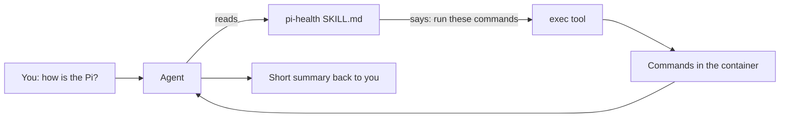

{:class="cover"}

---

In this lesson you will learn what a skill is, where OpenClaw finds skills, and how to check a community skill before you trust it. Then we will write our own `pi-health` skill so Pi Butler can tell you how its Pi is feeling, right from Telegram.

Every `openclaw ...` command here is the alias from [lesson 7](/learn/openclaw_raspberry_pi/07_first-access.html), typed **on the Pi**.

---

## What is a skill?

A skill is a folder with a `SKILL.md` file in it. That file is plain instructions that teach the agent **how and when** to use its tools. It isn't a program. Think of it as a recipe card the agent reads when a job calls for it.

A `SKILL.md` has two parts:

- **YAML front matter** at the top, with a `name` and a one-line `description`.
- **A Markdown body** with the actual instructions.

The agent sees each skill's description, so it knows the skill exists. When your request matches, it follows the instructions, using tools such as `exec` to run commands.



---

## Where skills load from

OpenClaw looks in several places. If two skills share a name, the higher one wins.

| Priority | Source | Path |
| --- | --- | --- |
| 1, highest | Workspace skills | `~/.openclaw/workspace/skills/` |
| 2 | Project agent skills | `<workspace>/.agents/skills/` |
| 3 | Shared managed skills | `~/.openclaw/skills/` |
| 4 | Bundled skills | Shipped with OpenClaw |
| 5, lowest | Extra folders and plugin skills | Set in config |
{:class="table table-single"}

The real list has a couple more tiers, but this is the part that matters for us. Workspace skills win, so that's where Pi Butler's own skill goes.

### Looking at your skills

```bash
openclaw skills list
openclaw skills info <name>
openclaw skills check
```

`list` shows what's installed, `info` shows the details of one skill, and `check` tells you which skills are ready to use and which are missing something, such as a program they need.

---

## Community skills from ClawHub

[ClawHub](https://clawhub.ai) is the public registry of community skills. You can search it from the Pi:

```bash
openclaw skills search "calendar"
```

Install one into your workspace with its owner and slug:

```bash
openclaw skills install @owner/<slug>
```

And ask ClawHub for its trust and scan results:

```bash
openclaw skills verify @owner/<slug>
```

ClawHub refuses releases it has marked as malicious or blocked, and each skill page shows its latest security scan. That helps, but it isn't a guarantee. The OpenClaw docs are clear: treat third-party skills as **untrusted code**.

### A safety checklist

Before you install a community skill, run through this list:

1. **Read the `SKILL.md`** on its ClawHub page. Does it do what the description says, and nothing more?
2. **Read every script** that comes with it. If you can't understand a script, don't install it.
3. **Look for network calls**, such as `curl` or `wget` to unknown sites, and anything that reads `.env`, tokens or keys.
4. **Check the scan results** with `openclaw skills verify`.
5. **Prefer popular, maintained skills** with a clear owner.
6. **Check it runs on arm64.** A skill that downloads an x86 binary will fail on the Pi with `exec format error`.

Remember that your agent can run commands. A bad skill is a set of instructions telling it to do bad things.

---

## Build the pi-health skill

Now let's write our own. We want Pi Butler to report the Pi's temperature, uptime, memory and disk.

One thing to know first: the agent's `exec` tool runs commands **inside the Gateway container**, not on Raspberry Pi OS. That's the whole point of Docker here. So we can't use `vcgencmd`, which only exists on the Pi itself. Instead we read the temperature from the Linux kernel, which the container can see.

### Step 1: Make the folder

The folder name must match the skill's `name`. On the Pi:

```bash
mkdir -p ~/.openclaw/workspace/skills/pi-health
nano ~/.openclaw/workspace/skills/pi-health/SKILL.md
```

### Step 2: Write SKILL.md

Paste this in:

````markdown
---
name: pi-health
description: Report the Raspberry Pi's temperature, uptime, memory and disk space as a short summary.
---

# Pi health check

Use this skill when the user asks how the Pi is doing, whether it is too hot,
or how much memory or disk is left.

Use the `exec` tool to run each of these commands:

```bash
cat /sys/class/thermal/thermal_zone0/temp
uptime
free -m
df -h /home/node/.openclaw
```

Then reply with a short summary:

- Temperature: the first command prints millidegrees Celsius. Divide by 1000
  and round to one decimal place. Say "warm" above 70 C and "hot" above 80 C.
- Uptime: how long the Pi has been running, in plain words.
- Memory: used and available, in MB.
- Disk: size, used and available for the OpenClaw data folder.

Keep it to four or five lines. Do not run any other commands.
````

Save with Ctrl+X, then Y, then Enter.

The rules that matter:

- `name` uses lowercase letters, digits and hyphens, and matches the folder name.
- `description` is one line, under 160 characters.
- The body says when to use the skill, exactly which commands to run, and what to do with the output.

### Step 3: Check it loaded

OpenClaw watches skill folders, so a new `SKILL.md` is picked up on its own:

```bash
openclaw skills list
openclaw skills info pi-health
```

If `pi-health` doesn't appear, check the folder name and the front matter, then restart the Gateway from `~/openclaw` with `docker compose restart openclaw-gateway`.

### Step 4: Test it from Telegram

Open your Pi Butler chat on your phone and send:

```text
/skill pi-health
```

`/skill <name>` always works. Skills can also appear as their own slash command, but OpenClaw tidies those names to letters, digits and underscores, so look for `/pi_health`. You can also just ask "How's the Pi feeling?" and the agent should reach for the skill on its own.

Depending on your exec permission mode, you might be asked to approve the commands first. We look at permission modes properly in the security lesson.

---

## Pi Butler progress

Pi Butler now knows how its Pi is feeling. It has its first custom skill, `pi-health`, living in your workspace, and you can call it from your phone. In the next lesson it becomes part of a daily morning brief.

---

## Try it Yourself

1. **Explore.** Run `openclaw skills list` and pick one bundled skill. Use `openclaw skills info` on it and read what it does.
2. **Ask naturally.** Without using `/skill`, ask Pi Butler "Is the Pi running hot?" and see if it uses `pi-health` by itself.
3. **Challenge:** Add `cat /proc/loadavg` to the skill and ask for the one-minute load average in the summary. Start a fresh session with `/new` and test it.

---

## Common Issues

**Problem**: `pi-health` doesn't appear in `openclaw skills list`.
**Solution**: Check the file is at `~/.openclaw/workspace/skills/pi-health/SKILL.md` and that `name: pi-health` matches the folder.
**Why**: OpenClaw only loads a skill when the folder and front matter follow the format.

**Problem**: The skill runs but an old session ignores your edits.
**Solution**: Send `/new` to start a fresh session.
**Why**: Sessions take a snapshot of their skills when they start. Edits usually arrive on the next turn, and `/new` guarantees a fresh list.

**Problem**: The agent says `vcgencmd: not found`.
**Solution**: Use the `/sys/class/thermal/thermal_zone0/temp` file in the skill, as shown above.
**Why**: `vcgencmd` lives on Raspberry Pi OS, but the agent's commands run inside the container.

**Problem**: A community skill fails with `exec format error`.
**Solution**: Remove it and look for a skill that supports arm64.
**Why**: It is trying to run a program built for a different processor.

---

## Check your understanding


? What is a skill in OpenClaw?
- [ ] A compiled plugin that adds new hardware drivers
- [x] A folder with a SKILL.md file of instructions that teach the agent how and when to use tools
- [ ] A paid upgrade from ClawHub
> A skill is instructions in SKILL.md, with a name and description in its front matter and the steps in the body.

? Why does pi-health read /sys/class/thermal/thermal_zone0/temp instead of running vcgencmd?
- [ ] Because vcgencmd is slower
- [x] Because the agent's exec tool runs inside the container, where vcgencmd isn't available
- [ ] Because vcgencmd only works on a Pi 5
> The container is separate from Raspberry Pi OS. The kernel's thermal file is visible inside it, so the skill uses that.

? ClawHub says a skill passed its scans. What should you still do before installing it?
- [ ] Nothing, a passed scan means it is safe
- [ ] Turn off pairing
- [x] Read its SKILL.md and any scripts yourself
> ClawHub refuses blocked releases, but third-party skills are still untrusted code and you are responsible for what you install.

