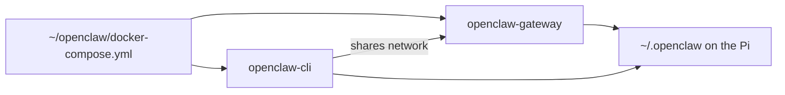

{:class="cover"}

---

By the end of this lesson you will be comfortable looking after the OpenClaw containers day to day: starting, stopping, reading logs and cleaning up disk space. Then we will put the Gateway to work with a 7 am morning brief sent straight to your phone.

`openclaw ...` commands use the alias from [lesson 7](/learn/openclaw_raspberry_pi/07_first-access.html). Everything here is typed **on the Pi**.

---

## Two services, one folder

The compose file in `~/openclaw` defines two services:

- **`openclaw-gateway`** is the long-running Gateway. It restarts on its own after a crash or reboot (`restart: unless-stopped`).
- **`openclaw-cli`** is for one-off commands. It starts, does one job, and is removed. Our alias runs this one.



Run every `docker compose` command from `~/openclaw`, so Compose finds the right file and `.env`:

```bash
cd ~/openclaw
```

---

## The day-to-day commands

| Task | Command |
| --- | --- |
| Start the Gateway | `docker compose up -d openclaw-gateway` |
| Stop the whole stack | `docker compose down` |
| Restart the Gateway | `docker compose restart openclaw-gateway` |
| See what is running | `docker compose ps` |
| Follow the logs | `docker compose logs -f openclaw-gateway` |
| Open a shell in the Gateway | `docker compose exec openclaw-gateway bash` |
| Run a CLI command | `docker compose run --rm openclaw-cli <command>` |
{:class="table table-single"}

A few notes:

- `docker compose ps` shows the Gateway's health. You want to see `healthy`. The image has a built-in health check that pings the Gateway every 30 seconds.
- Press Ctrl+C to stop following logs. The Gateway keeps running.
- In the `exec` shell you are user `node` inside the container. Type `exit` to leave. It's a good way to see what the agent sees, for example `ls ~/.openclaw/workspace`.

### up -d or restart?

This one catches everybody. If you change `~/openclaw/.env`, a plain `restart` **does not** pick up the change. Restart reuses the existing container with its old settings.

Use `up -d` instead, which recreates the container with the new values:

```bash
docker compose up -d openclaw-gateway
```

Rule of thumb: changed `.env`, use `up -d`. Gateway acting oddly, use `restart`.

---

## What docker compose down deletes

`docker compose down` sounds scary, so let's be precise.

| Removed | Kept |
| --- | --- |
| The `openclaw-gateway` container | `~/.openclaw`: config, sessions, memory, workspace, skills |
| The Compose network | `~/openclaw/.env`: your token and settings |
| | The downloaded OpenClaw image |
{:class="table table-single"}

Your data lives in folders on the Pi that are bind-mounted into the container, so the container itself is disposable. `docker compose up -d openclaw-gateway` brings everything back exactly as it was.

The only way to lose Pi Butler's memory is to delete `~/.openclaw` yourself, so don't.

---

## Cleaning up old images

Every update downloads a new image, and the old ones stay behind. On a 32 GB SD card that adds up. See how much Docker is using:

```bash
docker system df
```

To remove **dangling** images, the untagged leftovers from old pulls, run:

```bash
docker image prune
```

It asks before deleting anything. Images that a container is using are never removed, so your running Gateway is safe.

Be careful with `docker image prune -a`. That removes every image not used by a container, including an older OpenClaw tag you might want for a rollback. And avoid `docker system prune --volumes` unless you know exactly what it will remove.

---

## Schedule the morning brief

Now for something useful. OpenClaw has a built-in scheduler, called **cron** or **automations**. A job runs a prompt on a schedule and can send the result to a chat.

You need your Telegram user ID. If you didn't note it in lesson 9, send `/whoami` to Pi Butler in Telegram.

Now create the job:

```bash
openclaw cron create "0 7 * * *" "Good morning. Use the pi-health skill to check the Pi, then send me a short morning brief with today's date and the Pi's health. Keep it under six lines." --name "Morning brief" --tz Europe/London --announce --channel telegram --to "<your Telegram user id>"
```

Let's break that down:

| Part | Meaning |
| --- | --- |
| `"0 7 * * *"` | Cron schedule: minute 0, hour 7, every day |
| The second string | The prompt Pi Butler runs |
| `--name` | A friendly name for the job |
| `--tz` | The time zone for the schedule. Use your own IANA name |
| `--announce` | Send the result as a message |
| `--channel telegram --to` | Where to send it |
{:class="table table-single"}

Cron schedules don't understand plain English like "every day at 7am", so stick with the five-field form.

### List it and run it once

Check the job is there and copy its ID:

```bash
openclaw cron list
```

Don't wait until tomorrow. Run it now:

```bash
openclaw cron run <job-id>
```

Within a minute or so your phone should buzz with a morning brief. If it doesn't, look at the run history:

```bash
openclaw cron runs <job-id>
```

`openclaw automations` works too, as it is the same command with a different name. You can also just ask Pi Butler in Telegram to set up a reminder for you.

Each run calls your model, so a daily brief costs a little every day. Keep the prompt short.

> **Teachers**: scheduled jobs keep spending API credit after the lesson ends. Ask students to list and remove their test jobs, or use a short-lived schedule for practice.

---

## Pi Butler progress

Pi Butler now sends a morning brief. Every day at 7 am it runs `pi-health` and messages your phone. You also know how to start, stop and inspect its container, and how to free up disk space without losing anything.

---

## Try it Yourself

1. **Prove the data survives.** Run `docker compose down`, then `docker compose up -d openclaw-gateway`. Message Pi Butler and check it still knows your name.
2. **Peek inside.** Open a shell with `docker compose exec openclaw-gateway bash` and run `ls ~/.openclaw/workspace/skills`. Find your `pi-health` skill, then `exit`.
3. **Challenge:** Create a second job that runs every weekday at 5 pm (`"0 17 * * 1-5"`) and asks Pi Butler for one fun fact about robots. Run it once with `cron run` to test it.

---

## Common Issues

**Problem**: You changed `.env` but nothing changed.
**Solution**: Run `docker compose up -d openclaw-gateway` instead of `restart`.
**Why**: `restart` reuses the old container and its old environment. `up -d` recreates it.

**Problem**: `no configuration file provided: not found`.
**Solution**: `cd ~/openclaw` first, then run the command again.
**Why**: `docker compose` looks for `docker-compose.yml` in the current folder.

**Problem**: The morning brief never arrives.
**Solution**: Check `openclaw cron runs <job-id>` for an error, and check the `--to` value is your numeric Telegram user ID from `/whoami`.
**Why**: Delivery fails if the target is wrong, and run history records the reason.

**Problem**: The brief arrives at the wrong hour.
**Solution**: Edit the job with the right `--tz`, for example `openclaw cron edit <job-id> --cron "0 7 * * *" --tz Europe/London`.
**Why**: Without `--tz`, cron uses the Gateway host's time zone, which in the container is `OPENCLAW_TZ` and defaults to UTC.

---

## Check your understanding


? You add a new value to ~/openclaw/.env. Which command applies it?
- [ ] docker compose restart openclaw-gateway
- [x] docker compose up -d openclaw-gateway
- [ ] docker compose logs -f openclaw-gateway
> restart keeps the old container and its environment. up -d recreates the container with the new .env values.

? What does docker compose down remove?
- [x] The containers and network, but not ~/.openclaw, .env or the image
- [ ] Everything, including Pi Butler's memory
- [ ] Only the image
> Your data is bind-mounted from folders on the Pi, so removing the container doesn't touch it.

? What does the schedule "0 7 * * *" mean?
- [ ] Every 7 minutes
- [ ] At 7 pm on Sundays
- [x] At 07:00 every day
> The five fields are minute, hour, day of month, month and day of week. Minute 0, hour 7, every day.

