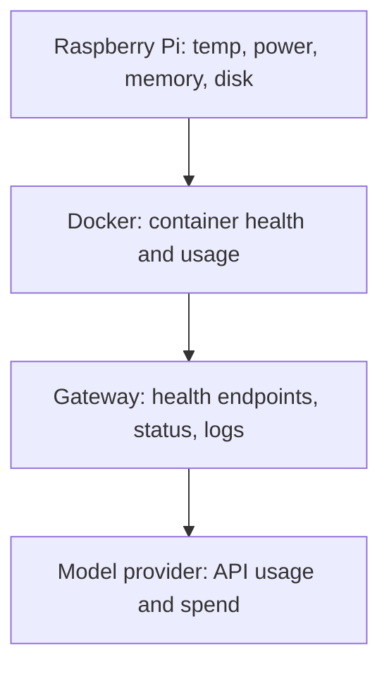

{:class="cover"}

---

In this lesson you will learn how to check that your Pi and Pi Butler are healthy: memory, disk, temperature, the Gateway itself, and the one that surprises people most, your API bill. We finish by writing a tiny script that checks the lot in one go.

`openclaw ...` commands use the alias from [lesson 7](/learn/openclaw_raspberry_pi/07_first-access.html). Everything here is typed **on the Pi**, over SSH.

---

## What to watch

There are three layers to keep an eye on, plus your wallet.



Remember the AI model runs in the cloud, not on the Pi. So the Pi's job is light, and the most likely problems are a full SD card, poor power, overheating, or a surprise bill.

---

## The Pi itself

These run on Raspberry Pi OS, not in the container.

| Command | What it tells you |
| --- | --- |
| `free -h` | Memory and swap in use |
| `df -h` | Free space on each disk |
| `vcgencmd measure_temp` | CPU temperature |
| `vcgencmd get_throttled` | Whether the Pi has slowed down because of power or heat |
{:class="table table-single"}

### Memory

```bash
free -h
```

Look at the `available` column. On a 2 GB Pi, check that the `Swap` line shows some swap. If memory runs out, Linux starts killing programs, and the Gateway may be one of them.

### Disk

```bash
df -h
```

Find the line for `/`. Logs, sessions and old Docker images all grow over time. If you are over about 85 percent full, it's time to tidy up with `docker image prune` from [lesson 11](/learn/openclaw_raspberry_pi/11_managing-containers.html).

### Temperature and throttling

```bash
vcgencmd measure_temp
vcgencmd get_throttled
```

You will see something like `temp=52.1'C` and `throttled=0x0`.

`0x0` is what you want: no problems. Any other value means the Pi has had under-voltage or has slowed itself down to cool off. For example `0x50000` means both have happened since the last boot. The usual fixes are the official power supply, a case with a fan or heatsink, and some space around the Pi. The Pi starts slowing itself down at around 80 C.

---

## Docker's view

```bash
docker stats
```

This shows live CPU, memory and network use for each container. Press Ctrl+C to quit. For a single snapshot, add `--no-stream`. The Gateway container will have a name like `openclaw-openclaw-gateway-1`.

And the health check from the last lesson:

```bash
cd ~/openclaw
docker compose ps
```

You want to see `healthy` next to the Gateway. If it says `unhealthy`, the built-in check has failed several times in a row.

---

## The Gateway's view

### Health endpoints

The Gateway answers three simple web checks with no login needed. The port is published on the Pi, so you can call them from the Pi's own shell:

```bash
curl -fsS http://127.0.0.1:18789/healthz
curl -fsS http://127.0.0.1:18789/readyz
```

| Endpoint | Question it answers |
| --- | --- |
| `/healthz` | Is the Gateway's web server alive? |
| `/startupz` | Has it finished starting up? |
| `/readyz` | Is it ready for traffic, including channels like Telegram? |
{:class="table table-single"}

`-f` makes `curl` fail loudly on an error, so no output and an error message means trouble.

### Status and logs

```bash
openclaw status
```

That gives you a quick summary of the Gateway, channels and sessions. `openclaw status --all` does a fuller check you can paste when asking for help, though do read it for anything private first.

To watch what the Gateway is doing live, follow the logs:

```bash
openclaw logs --follow
```

Send Pi Butler a message on Telegram while this is running and watch it arrive. Press Ctrl+C to stop.

---

## Watching your API spend

This is the one that really matters. Every message, every skill run and every morning brief is a paid call to your model provider. Long conversations cost more, because the model re-reads the whole history each turn.

Check what OpenClaw can see:

```bash
openclaw models status
```

Along with your model and credential health, it shows provider usage windows and quota where your provider reports them. `openclaw status --usage` prints the same windows as `X% left`, and `/status` in the Telegram chat shows usage too.

But the real numbers live with your provider. Log in to your provider's dashboard on the web, where you can:

- see how much you have spent today and this month
- set a **monthly spend limit**, so the API simply stops when you hit it
- set up email alerts before you get there

Set a limit now, before you forget. A small one is fine to start with. If Pi Butler ever goes quiet because the limit is reached, that's the limit doing its job.

> **Teachers**: set a spend limit on the provider account before students start, and check it after the lesson. A scheduled job left running over a holiday is the usual surprise.

---

## A one-command pi-check

Let's wrap the most useful checks into one script. On the Pi:

```bash
nano ~/pi-check.sh
```

Paste this in:

```bash
#!/usr/bin/env bash
# Quick health check for Pi Butler's Raspberry Pi

echo "== Pi check $(date '+%Y-%m-%d %H:%M') =="

echo
echo "-- Temperature and throttling --"
vcgencmd measure_temp
vcgencmd get_throttled

echo
echo "-- Memory --"
free -h

echo
echo "-- Disk --"
df -h /

echo
echo "-- Gateway --"
if curl -fsS http://127.0.0.1:18789/healthz; then
  echo
  echo "Gateway is alive"
else
  echo "Gateway is NOT responding"
fi
```

Save with Ctrl+X, then Y, then Enter, and run it:

```bash
bash ~/pi-check.sh
```

You get temperature, throttling, memory, disk and Gateway health in one screen. It's a nice first thing to run whenever you SSH in.

---

## Pi Butler progress

Pi Butler is now being watched over. You can check the Pi's temperature, power, memory and disk, see the Gateway's health and logs, keep an eye on API usage, and you have a spend limit in place. `~/pi-check.sh` gives you all the basics in one command.

---

## Try it Yourself

1. **Watch it work.** Run `docker stats` in one SSH window and send Pi Butler a few messages from your phone. How much do CPU and memory move?
2. **Read the logs.** Run `openclaw logs --follow`, then trigger your morning brief with `openclaw cron run <job-id>` and watch the run in the logs.
3. **Challenge:** Add a section to `~/pi-check.sh` that runs `cd ~/openclaw && docker compose ps` so the script also shows whether the container is `healthy`.

---

## Common Issues

**Problem**: `vcgencmd: command not found`.
**Solution**: Run it on the Pi's own shell over SSH, not inside the container or from Pi Butler.
**Why**: `vcgencmd` is part of Raspberry Pi OS. The container doesn't have it.

**Problem**: `get_throttled` shows something other than `0x0`.
**Solution**: Use the official power supply for your Pi model and add cooling.
**Why**: Under-voltage or heat makes the Pi slow itself down, which can make the Gateway sluggish or unstable.

**Problem**: `curl` to `/healthz` says connection refused.
**Solution**: Run `cd ~/openclaw && docker compose ps`, start the Gateway with `docker compose up -d openclaw-gateway`, then check `docker compose logs openclaw-gateway`.
**Why**: Nothing is listening on port 18789 while the container is stopped or still starting.

**Problem**: The API bill is higher than expected.
**Solution**: Use `/new` to keep sessions short, pick a cheaper model or fallback, and review your scheduled jobs with `openclaw cron list`.
**Why**: Long histories and frequent automations both send more text to the model, and you pay for every bit of it.

---

## Check your understanding


? What does vcgencmd get_throttled returning 0x0 mean?
- [ ] The Pi is overheating right now
- [x] No under-voltage or throttling has been detected
- [ ] The Gateway has stopped
> 0x0 is the healthy answer. Any other value points at power or heat problems.

? Where is the best place to set a hard limit on how much the AI model can cost you?
- [ ] In SOUL.md
- [ ] In docker-compose.yml
- [x] On your model provider's dashboard, as a spend limit
> The model runs at the provider and they bill you, so their dashboard is where usage is counted and where a spend limit can stop it.

? Which endpoint tells you whether the Gateway is ready for traffic, including its channels?
- [ ] /healthz
- [x] /readyz
- [ ] /startupz
> /healthz is basic liveness, /startupz checks startup has finished, and /readyz is the deeper, channel-aware readiness check.

