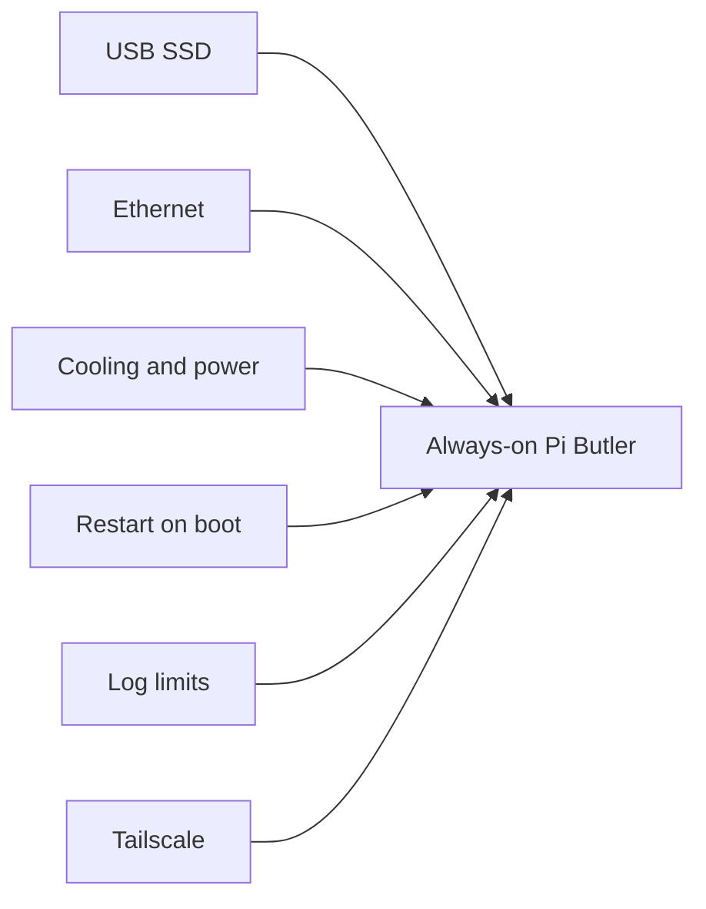

{:class="cover"}

---

Pi Butler works. Now let's make it the kind of thing you forget about because it just keeps going. By the end of this lesson your Pi will boot from a fast drive, stay cool, ride out power cuts, keep its logs in check and be reachable safely from anywhere.

---

## What "production" means here

For a home appliance, production simply means: it runs all day, it comes back on its own after a power cut, and it doesn't slowly fill its disk or cook itself. Each part of this lesson tackles one of those.



---

## Boot from a USB SSD

The official OpenClaw Pi guide is clear: SD cards are slow and wear out. A USB SSD is much faster and survives far more writes, which matters for the SQLite databases Pi Butler writes to all day.

Pi 4 and Pi 5 can boot straight from USB. The simplest route to an SSD install:

1. Take a cold copy of Pi Butler, as in [lesson 15](/learn/openclaw_raspberry_pi/15_backup-and-recovery.html), and copy it to your computer.
2. Use Raspberry Pi Imager to write **Raspberry Pi OS Lite (64-bit)** to the SSD, with the same hostname, user and SSH settings as before.
3. Boot from the SSD with the SD card removed, then follow lessons 4 to 6 again.
4. Stop the Gateway, unpack your cold copy over the fresh folders, and start it again.

If your Pi will not boot from USB, see the Raspberry Pi documentation on [USB mass storage boot](https://www.raspberrypi.com/documentation/computers/raspberry-pi.html#usb-mass-storage-boot).

---

## Ethernet, cooling and power

### Ethernet

Wi-Fi is fine for testing, but a cable is better for something that runs all day. It is faster, steadier and has no power saving to put it to sleep. Plug it in and check the Pi has an address on `eth0`:

```bash
ip -br addr
```

### Cooling

A Pi that gets too hot slows itself down. A Pi 5 really wants its Active Cooler or a case with a fan. A Pi 4 is happier with a heatsink case. Check the temperature and throttling now and then, on the Pi's own shell:

```bash
vcgencmd measure_temp
vcgencmd get_throttled
```

`throttled=0x0` is what we want. Your `pi-health` skill reports the temperature too.

### Power, and a UPS

Use the official power supply: 5.1 V 3 A USB-C for a Pi 4, and the 27 W (5.1 V 5 A) USB-C supply for a Pi 5. Cheap supplies cause low-voltage warnings and odd crashes, which `get_throttled` will show.

A UPS (uninterruptible power supply) keeps the Pi running through short power cuts and flickers. A small mains UPS for your router and Pi, or a UPS HAT made for the Pi, both work. It isn't essential, because Pi Butler comes back by itself, but every sudden power loss is a small risk to the SD card or SSD.

---

## Coming back after a power cut

Two things bring Pi Butler back after a reboot or power cut:

- Docker starts at boot. The official Docker install enables it, but let's check.
- The compose file gives the Gateway `restart: unless-stopped`, so Docker starts it again when Docker starts.

```bash
systemctl is-enabled docker
```

It should print `enabled`. If not, run `sudo systemctl enable docker`.

One thing to know about `unless-stopped`: if **you** stopped the container, it stays stopped after a reboot. And `docker compose down` removes the container completely, so nothing comes back until you run `docker compose up -d openclaw-gateway`. Always leave Pi Butler with `up -d` when you have finished tinkering.

### Test it

Don't take it on trust. Reboot the Pi:

```bash
sudo reboot
```

Give it a minute or two, SSH back in, and check:

```bash
cd ~/openclaw
docker compose ps
curl -fsS http://127.0.0.1:18789/healthz
```

You want `openclaw-gateway` showing `Up` and `(healthy)`. Then send Pi Butler a Telegram message. If it answers, it will survive a power cut too.

---

## Log rotation

There are two sets of logs, and only one of them looks after itself.

**OpenClaw's own log file** lives in `~/.openclaw/logs/`. OpenClaw rotates it already: one file per day, dated files pruned after 24 hours, and a file rolls over at 100 MB keeping five old copies.

**Docker's container log** is what `docker compose logs` shows. By default Docker keeps it forever, and on a small SSD that slowly adds up. Let's cap it. This is a Docker setting, not an OpenClaw one. **On the Pi**:

```bash
sudo nano /etc/docker/daemon.json
```

```json
{
  "log-driver": "json-file",
  "log-opts": {
    "max-size": "10m",
    "max-file": "3"
  }
}
```

That keeps at most three files of 10 MB each per container. If the file already exists, add the two settings to it rather than replacing it. Restart Docker, then recreate the Gateway, because the setting only applies to newly created containers:

```bash
sudo systemctl restart docker
cd ~/openclaw
docker compose up -d --force-recreate openclaw-gateway
```

---

## Tailscale for remote access

At home, the SSH tunnel is perfect. Away from home you could forward SSH on your router, but please don't. Tailscale is a much safer answer. It puts your computer, your phone and your Pi on a private network of their own, a **tailnet**, without opening any ports on your router.

OpenClaw has a built-in Tailscale mode, but it expects the Gateway to run directly on the host, and inside a container there is no Tailscale interface. So let's keep it simple: we put Tailscale on the Pi itself and carry on using the SSH tunnel, just over the tailnet.

**On the Pi**, install Tailscale and sign in:

```bash
curl -fsSL https://tailscale.com/install.sh | sh
sudo tailscale up
```

It prints a link. Open it, sign in, and the Pi joins your tailnet. Install the Tailscale app on your computer and sign in with the same account. Then find the Pi's tailnet name or address:

```bash
tailscale status
```

Now, **on your computer**, from anywhere in the world, the same tunnel as lesson 7 works over Tailscale. Use the name or `100.x` address that `tailscale status` showed:

```bash
ssh -N -L 18789:127.0.0.1:18789 <user>@openclaw-pi
```

Open `http://127.0.0.1:18789/` as before. Port `18789` is still published on the Pi's loopback only, from [lesson 14](/learn/openclaw_raspberry_pi/14_security.html), so nothing new is exposed. Telegram needs none of this, because Pi Butler connects out to Telegram by itself.

---

## Weekly maintenance

Ten minutes a week keeps Pi Butler healthy.

| Job | Command (on the Pi) |
| --- | --- |
| Check the container is healthy | `docker compose ps` |
| Check temperature and throttling | `vcgencmd get_throttled` |
| Check free disk space | `df -h` |
| Check last night's backup worked | `tail ~/openclaw-backup.log` |
| Copy backups off the Pi | `scp`, from your computer |
| Update the OS | `sudo apt update && sudo apt full-upgrade` |
| Look for OpenClaw problems | `openclaw doctor --json` |
| Check who is waiting to pair | `openclaw pairing list telegram` |
| Re-run the security audit | `openclaw security audit` |
{:class="table table-single"}

The `openclaw` commands use the alias from lesson 7, updated in lesson 14. Your `~/pi-check.sh` script from [lesson 12](/learn/openclaw_raspberry_pi/12_monitoring-resources.html) covers several of these in one go.

> **Teachers**: a classroom Pi Butler that runs all term needs an owner. Put a name on each Pi and give someone the weekly checklist, or switch the Pis off over the holidays with `docker compose stop openclaw-gateway` and a clean `sudo halt`.

---

## Production readiness checklist

| Check | Done when |
| --- | --- |
| Boots from a USB SSD | `lsblk` shows the root filesystem on `sda` |
| On Ethernet | `ip -br addr` shows an address on `eth0` |
| Cool and well powered | `vcgencmd get_throttled` shows `throttled=0x0` |
| Docker starts at boot | `systemctl is-enabled docker` shows `enabled` |
| Survives a reboot | After `sudo reboot`, Pi Butler answers on Telegram |
| Docker logs capped | `/etc/docker/daemon.json` has `max-size` and `max-file` |
| Port off the home network | `docker compose ps` shows `127.0.0.1:18789` |
| Nightly backups, copied off the Pi | `crontab -l` and a recent archive on your computer |
| Remote access without port forwarding | Tunnel works over Tailscale |
| Security audit clean | No critical findings from `openclaw security audit --deep` |
{:class="table table-single"}

---

## Pi Butler progress

Pi Butler is now **always on**. It runs from a fast drive, stays cool, comes back after power cuts, keeps its logs tidy and you can reach it safely from anywhere.

---

## Try it Yourself

1. **Pull the plug.** With Pi Butler running, do a proper reboot test with `sudo reboot`. Time how long it takes before it answers you on Telegram again.
2. **Cap the logs.** Add the Docker log settings, recreate the Gateway, then check `docker compose logs` still works.
3. **Challenge:** Set up Tailscale, leave your home network (use your phone's hotspot for the laptop), and open the Control UI through the tunnel over your tailnet.

---

## Common Issues

**Problem**: After a reboot, `docker compose ps` shows nothing.
**Solution**: Run `docker compose up -d openclaw-gateway` in `~/openclaw`.
**Why**: The container was stopped or removed with `docker compose down` before the reboot, and `unless-stopped` respects that.

**Problem**: Docker won't start after editing `daemon.json`.
**Solution**: Check the file is valid JSON, with no trailing commas, then run `sudo systemctl restart docker` again.
**Why**: Docker refuses to start with a broken config file.

**Problem**: `ssh` over Tailscale cannot find `openclaw-pi`.
**Solution**: Use the `100.x` address from `tailscale status`, and check Tailscale is running on your computer.
**Why**: Tailscale names only resolve when your computer is connected to the tailnet.

---

## Check your understanding


? Why does Pi Butler come back by itself after a power cut?
- [ ] OpenClaw installs a systemd service on the Pi
- [x] Docker starts at boot, and the Gateway container has `restart: unless-stopped`
- [ ] The Pi keeps the container in memory
> In Docker, the restart policy does the job. That is also why a container you stopped yourself stays stopped.

? Which logs need a limit setting from you?
- [ ] OpenClaw's own log files in `~/.openclaw/logs`
- [x] Docker's container logs, shown by `docker compose logs`
- [ ] Neither, both clean themselves up
> OpenClaw already rotates its own files. Docker keeps container logs until you set `max-size` and `max-file`.

? What is the safest way to reach the Control UI when you are away from home?
- [ ] Port forward 18789 on your router
- [ ] Port forward SSH on your router
- [x] Use Tailscale and run the same SSH tunnel over your tailnet
> Tailscale opens no ports on your router, and the tunnel keeps the dashboard on the Pi's loopback.

