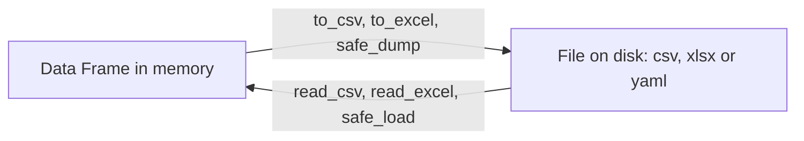

{:class="cover"}

---

By the end of this lesson you will be able to save a Data Frame to CSV, Excel and YAML files and read each one back in.

## Overview

This lesson is centered on importing and exporting data using Pandas. We'll cover how to read data from various sources like CSV, Excel, and YAML files into Pandas Data Frames, and similarly, how to export Data Frames into these file formats. Mastering these skills is essential for efficient data handling and analysis.

---



We'll save a small sensor log, then read it back. That way every example works on your own computer without needing a file from anywhere else. Put all the code in this lesson in one script called `sensor_files.py`. The files appear in the folder you run it from.

---

## Exporting Data

### Writing to CSV

First make the log, then export it with `df.to_csv()`:

```python
import pandas as pd

df = pd.DataFrame({
    'robot':   ['BurgerBot', 'SMARS', 'Quad'],
    'sensor':  ['distance', 'distance', 'imu'],
    'reading': [23.5, 41.0, None],
    'battery': [87, 64, 92],
})

# Writing to a CSV file
df.to_csv('sensor_log.csv', index=False)
```

`index=False` stops Pandas writing the row numbers as an extra, unnamed column. Leave it out if your index holds useful labels.

---

### Writing to Excel

Excel files need the `openpyxl` library (`pip install openpyxl`):

```python
# Writing to an Excel file
df.to_excel('sensor_log.xlsx', index=False)
```

---

### Writing to YAML

YAML needs the `PyYAML` library (`pip install pyyaml`). Turn the Data Frame into a list of records, one per row, then dump it:

```python
import yaml

with open('sensor_log.yaml', 'w') as file:
    yaml.safe_dump(df.to_dict(orient='records'), file, sort_keys=False)
```

Open `sensor_log.yaml` in a text editor and you'll see one block per robot.

---

## Importing Data

### Reading from CSV

To read a CSV file into a Data Frame, use `pd.read_csv()`:

```python
# Reading from a CSV file
df_csv = pd.read_csv('sensor_log.csv')
print(df_csv)
```

If the file has a column of dates or times, add `parse_dates=['time']` (using that column's name) so they load as real dates instead of text.

---

### Reading from Excel

```python
# Reading from an Excel file
df_excel = pd.read_excel('sensor_log.xlsx')
print(df_excel)
```

---

### Reading from YAML

Load the records back with `yaml.safe_load()` and build a Data Frame from them:

```python
# Reading from a YAML file
with open('sensor_log.yaml', 'r') as file:
    yaml_data = yaml.safe_load(file)

df_yaml = pd.DataFrame(yaml_data)
print(df_yaml)
```

All three print the same table, and the missing Quad reading comes back as `NaN` each time.

---

## Try it Yourself

1. Run the whole script and open `sensor_log.csv` in a text editor. Can you see the missing reading?
2. Export the Data Frame again without `index=False`, read it back, and look at the columns. What is the extra column called?
3. Add a `time` column with `pd.date_range('2024-01-01', periods=3, freq='h')`, save it, then read it back with and without `parse_dates=['time']`. Compare `df.dtypes`.
4. Challenge: build a Data Frame from a list of five SMARS battery readings that fall from 100 to 80, save it as `smars_battery.csv`, and read it back.

---

## Common Issues

- **Problem**: `FileNotFoundError: No such file or directory: 'sensor_log.csv'`
- **Solution**: Run the script from the folder that holds the file, or give the full path. Print `os.getcwd()` (after `import os`) to see where Python is looking.
- **Why**: Relative file names are looked up from the folder you ran Python in, not where the script lives.

- **Problem**: A strange `Unnamed: 0` column appears after reading a CSV.
- **Solution**: Save with `index=False`, or read with `pd.read_csv('file.csv', index_col=0)`.
- **Why**: Without `index=False`, Pandas writes the row numbers as a first column with no name.

- **Problem**: `ImportError: Missing optional dependency 'openpyxl'`
- **Solution**: Run `pip install openpyxl`. For YAML, run `pip install pyyaml`.
- **Why**: Pandas leaves Excel support in a separate package to keep the main install small.

> **Teachers**: these examples write files into the current folder, so on shared school machines check learners can save there, and that network drives or a cloud-synced folder are not slowing things down. Excel will refuse to open a file that another program has open, and Windows may lock `sensor_log.xlsx` while it is open, so close it before re-running.

---

## Check your understanding


? Why pass `index=False` to `to_csv()`?
- [ ] To make the file smaller by removing headers
- [x] To stop the row numbers being saved as an extra column
- [ ] To sort the rows
> Without it, reading the file back in gives you an unwanted "Unnamed: 0" column.

? Which function turns a CSV file into a Data Frame?
- [ ] `df.to_csv()`
- [x] `pd.read_csv()`
- [ ] `pd.open_csv()`
> `read_csv()` loads a file in, while `to_csv()` writes one out.

? What extra package does `read_excel()` and `to_excel()` need?
- [ ] `matplotlib`
- [x] `openpyxl`
- [ ] `numpy`
> The lesson installs `openpyxl` for Excel files and `pyyaml` for YAML.


---

## Summary

In this lesson, we've covered the fundamentals of importing and exporting data using Pandas. You've learned how to work with different file formats, which is a key part of the data analysis workflow.

---
