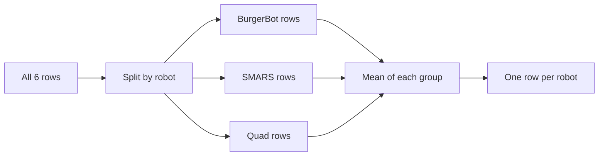

{:class="cover"}

---

By the end of this lesson you will be able to summarise a Data Frame with `describe()`, and use `groupby()` and pivot tables to answer questions about each robot or sensor.

## Overview

Effective data analysis often involves summarising data, grouping it, and performing calculations on each group. We'll keep using the robot sensor data.


import pandas as pd

df = pd.DataFrame({
    'robot':   ['BurgerBot', 'SMARS', 'BurgerBot', 'SMARS', 'Quad', 'Quad'],
    'sensor':  ['distance', 'distance', 'line', 'distance', 'imu', 'distance'],
    'reading': [23.5, 41.0, 1.0, 12.2, None, 30.1],
    'battery': [87, 64, 85, 60, 92, 90],
})
print(df)



---

## Summarizing Data

### Descriptive Statistics

`describe()` gives you the key statistics for every numeric column in one go:

```python
print(df.describe())
```

```shell
         reading    battery
count   5.000000   6.000000
mean   21.560000  79.666667
std    15.531677  13.952300
min     1.000000  60.000000
25%    12.200000  69.250000
50%    23.500000  86.000000
75%    30.100000  89.250000
max    41.000000  92.000000
```

- `count` is how many values are present. `reading` has 5 because one is missing
- `mean` is the average and `std` the standard deviation (how spread out the values are)
- `25%`, `50%` and `75%` are percentiles. The `50%` value is the median

---

### Unique Values and Value Counts

```python
print(df['robot'].unique())         # each different robot, once
print(df['robot'].value_counts())   # how many rows each robot has
```

---

## Grouping Data

### Group By

`groupby()` splits the data into groups that share a value, runs a calculation on each group, then puts the answers back together:



In code:

```python
grouped = df.groupby('robot')
```

---

### Aggregating Data

Then you run a calculation on each group:

```python
# Average battery for each robot
print(grouped['battery'].mean())

# Several calculations at once
print(grouped['battery'].agg(['min', 'max', 'mean']))
```

```shell
           min  max  mean
robot
BurgerBot   85   87  86.0
Quad        90   92  91.0
SMARS       60   64  62.0
```

> ## Older examples
>
> You may see `grouped.aggregate(np.sum)` in older tutorials. Recent versions of Pandas prefer the name as a string, like `.agg('sum')`, or simply `.sum()`.

---

## Pivot Tables

A pivot table summarises one column, broken down by two others:

```python
pivot = df.pivot_table(values='reading', index='robot', columns='sensor', aggfunc='mean')
print(pivot)
```

Each robot becomes a row, each sensor becomes a column, and each cell holds the average reading. Combinations with no data show `NaN`.

---

## Try it Yourself

1. Use `value_counts()` on the `sensor` column. Which sensor is used most?
2. Find the lowest battery for each robot with `groupby('robot')['battery'].min()`.
3. Build a pivot table of the average `battery` for each robot (rows) and sensor (columns). Which cells are `NaN`, and why?
4. Challenge: use named aggregation to get the average battery and the number of readings for each robot in one table: `df.groupby('robot').agg(avg_battery=('battery', 'mean'), readings=('reading', 'count'))`.

---

## Common Issues

- **Problem**: The `groupby` answer has `robot` as the row labels, and you wanted it as a normal column.
- **Solution**: Add `.reset_index()` to the end, such as `df.groupby('robot')['battery'].mean().reset_index()`.
- **Why**: `groupby()` makes the group names the index of the result.

- **Problem**: `describe()` shows `count` lower than the number of rows.
- **Solution**: Check for missing values with `df.isna().sum()`, then fill or drop them as you did in the cleaning lesson.
- **Why**: `describe()` and `mean()` skip missing values, so the `count` only includes readings that exist.

- **Problem**: `KeyError` when you group by a column name.
- **Solution**: Check the spelling and case with `print(df.columns)`.
- **Why**: Column names must match exactly, so `'Robot'` and `'robot'` are different columns.

---

## Check your understanding


? In the output of `describe()`, what does the `50%` row show?
- [ ] The average
- [x] The median, the middle value
- [ ] Half of the maximum
> The 50th percentile is the median. The average is the `mean` row.

? What does `df.groupby('robot')['battery'].mean()` calculate?
- [ ] The average battery across all robots
- [x] The average battery for each robot separately
- [ ] The number of robots
> `groupby()` splits the rows by robot, then `mean()` runs on each group.

? In a pivot table made with `index='robot'` and `columns='sensor'`, what does an empty (`NaN`) cell mean?
- [ ] The reading was zero
- [x] That robot has no data for that sensor
- [ ] The table is broken
> Each cell summarises the rows for one robot and sensor, so no matching rows means `NaN`.


---

## Summary

In this lesson, we've explored summarising, grouping and aggregating data with Pandas, and building pivot tables. These are the tools you'll reach for to turn raw data into answers.

---
