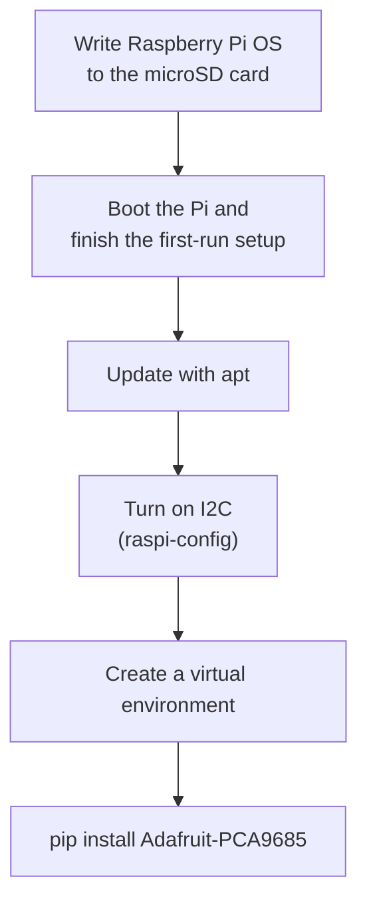

{:class="cover"}

---

By the end of this lesson you will be able to turn on the I2C bus on a Raspberry Pi, and install the Adafruit PCA9685 library into a Python virtual environment.

## The Pi is the brain

Buddy Jr's brain is a Raspberry Pi. It runs our Python, works out where each joint should go and sends short messages to the PCA9685 over I2C. Before we wire anything, let's get the Pi ready, so that when the board arrives, there is nothing left to set up.



## What you need for this lesson

- A Raspberry Pi with header pins, a power supply and a microSD card (16 GB or larger)
- A computer with a card reader, to write the card
- A way to use the Pi: a monitor, keyboard and mouse, or SSH from another computer
- An internet connection

## Install the operating system

1. Download the Raspberry Pi Imager for your computer from [raspberrypi.com/software](https://www.raspberrypi.com/software/) and install it.
2. Put the microSD card in your card reader and open the Imager.
3. Choose your Pi model, then **Raspberry Pi OS (64-bit)**, then your card.
4. When the Imager offers to customise the settings, set a hostname, a username and password, your Wi-Fi details and turn on SSH. Doing this now saves a trip through the setup wizard later.
5. Write the card, put it in the Pi and power it up. The first boot takes a minute or two.

## Update, then turn on I2C

Open a terminal on the Pi (or SSH in) and bring the system up to date.

```bash
sudo apt update
sudo apt full-upgrade
```

The Pi's I2C bus is switched off by default, so the PCA9685 would never answer. Turn it on:

```bash
sudo raspi-config
```

Choose **Interface Options**, then **I2C**, and answer **Yes**. Reboot when asked. You'll also want the I2C tools, which let us ask "who is on the bus?" in lesson 5:

```bash
sudo apt install -y i2c-tools
```

## Make a virtual environment

Recent versions of Raspberry Pi OS stop `pip` installing packages system-wide, and a virtual environment is the tidy answer. It is a private folder of Python packages for one project, so this arm cannot upset your other projects.

```bash
mkdir ~/buddy_jr
cd ~/buddy_jr
python3 -m venv venv
source venv/bin/activate
pip install Adafruit-PCA9685
```

When the environment is active your prompt starts with `(venv)`. Next time you open a terminal, run `cd ~/buddy_jr` and `source venv/bin/activate` again before running any of the course programs.

**About the library.** `Adafruit-PCA9685` is the original Adafruit Python package for this chip. You install it with `pip` under that name, but import it as `Adafruit_PCA9685`. It brings along its helper packages by itself.

**Common mistake:** installing into the wrong Python. If `pip` says you must use a virtual environment, or Python later says `No module named 'Adafruit_PCA9685'`, check that `(venv)` shows in your prompt.

## Check the install

Save this as `check_install.py` in `~/buddy_jr` and run it with `python3 check_install.py`.

```python
# Prove the library is installed and can be imported.
from Adafruit_PCA9685 import PCA9685

print("Adafruit_PCA9685 imported OK")
print("Default I2C address: 0x40, class:", PCA9685.__name__)
```

You should see two lines of output. It does not touch any hardware yet, so it works without the board plugged in.

## Try it Yourself

1. Run `ls /dev/i2c*` in the terminal. Do you see `/dev/i2c-1`? Turn I2C off in `raspi-config`, reboot, and look again. What changed?
2. Run `pip list` inside the environment, then `deactivate` and run it again. How do the lists differ?
3. Challenge: create a second environment called `venv2` and install the library there. Why might you want one environment per project?

## Common Issues

- **Problem**: `error: externally-managed-environment` when running `pip install`
- **Solution**: Create and activate a virtual environment first, then run `pip install` again inside it
- **Why**: The operating system protects its own Python packages, so `pip` refuses to change them. A virtual environment is separate, so `pip` can do what it likes there

- **Problem**: `pip install` fails while building a package called `spidev`
- **Solution**: Install the build tools with `sudo apt install -y build-essential python3-dev`, then run the `pip install` again
- **Why**: One of the library's helper packages contains a small piece of C code that needs a compiler on the Pi

- **Problem**: `No module named 'Adafruit_PCA9685'`
- **Solution**: Activate the environment with `source venv/bin/activate` and run the program again
- **Why**: The library was installed into the environment, so Python only finds it while the environment is active

## Check your understanding


? Why do we use a virtual environment for this project?
- [ ] It makes the servos move faster
- [x] It keeps this project's Python packages separate from the system's
- [ ] It turns on the I2C bus
> The environment is a private set of packages, so `pip install` works and nothing else on the Pi is disturbed.

? Which tool turns on the I2C bus on a Raspberry Pi?
- [ ] `pip`
- [x] `sudo raspi-config`, under Interface Options
- [ ] `source venv/bin/activate`
> I2C is switched off by default. `raspi-config` is where you enable it, and a reboot makes it active.

? What name do you use in the `pip install` command and what name do you import in Python?
- [x] `pip install Adafruit-PCA9685`, then `import Adafruit_PCA9685`
- [ ] `pip install pca9685`, then `import pca9685`
- [ ] The names are always identical
> The package name has a hyphen and the Python module name has an underscore.


Your Pi is ready. Next, a quick tour of the Python we'll lean on.
