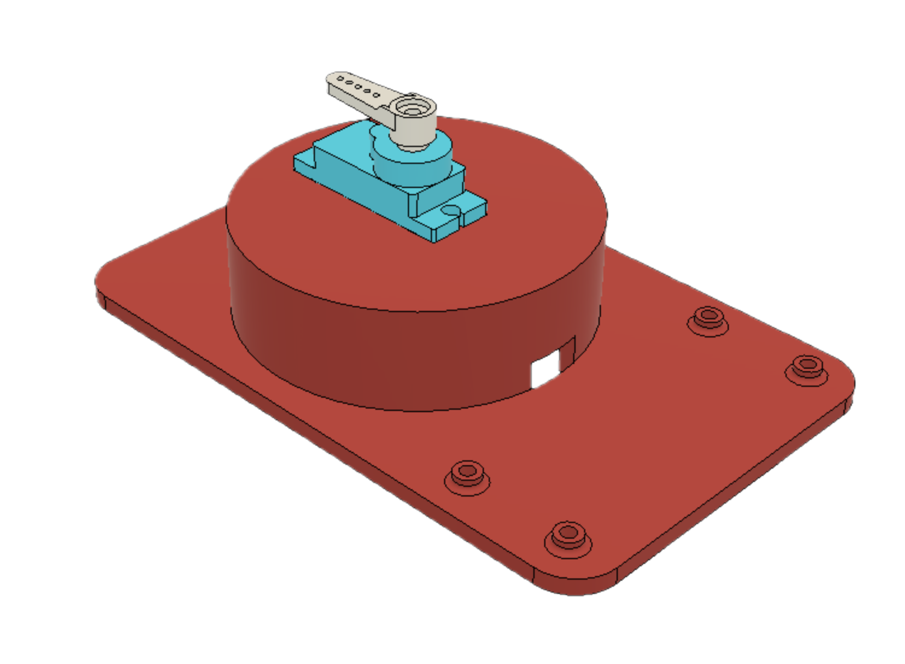
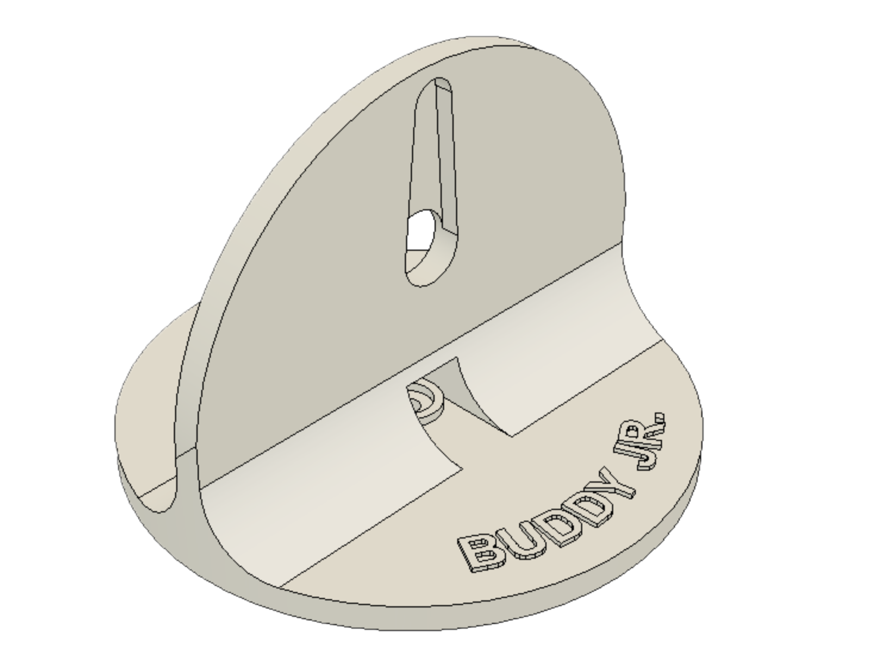
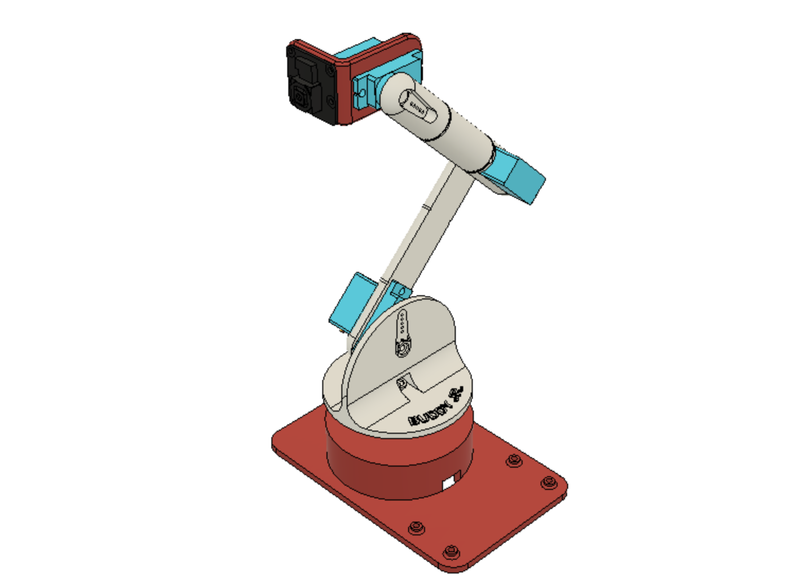

{:class="cover"}

---

By the end of this lesson you will be able to assemble Buddy Jr with every servo centred before its horn goes on, and plug each servo into the right PCA9685 channel.

## Why the order matters

If you screw a servo horn on at a random angle, the joint will start from a random angle too, and you will spend an evening fixing it in software. The trick every arm builder learns is to **centre the servo first**, then fit the horn pointing the way the design wants. Then 90 degrees in your code means "straight", every time.

That is why lesson 5 gave you `centre.py`. Run it now, and leave it running while you build. It keeps sending a 1.5 ms pulse (count 307) to channels 0 to 3, so every servo you plug in goes to its middle position and stays there.

## What you need

- The printed parts from lesson 6 and four SG90 style servos, each with its horn and screws
- The PCA9685 board and the wiring from lesson 4
- A small cross-head screwdriver
- `centre.py` from lesson 5, running on the Pi

## Step 1: the base servo

{:class="img-fluid w-50"}

Mount the first servo in the slot on top of the base, with the horn on its output shaft. Plug it into **channel 0**. This joint turns the whole arm. Fit the horn so that the arm will sit square to the base plate, which we'll call the centre position.

## Step 2: the shoulder

{:class="img-fluid w-50"}

The curved upright sits on the base servo's horn. Fit the shoulder servo into its slot on the upright, plug it into **channel 1** and fit its horn so that the upper arm leans back at the angle you want as its centre position. The pictures in this lesson show a good starting point.

## Step 3: the upper arm and forearm

Screw the upper arm to the shoulder servo's horn. Fit the elbow servo into the other end of the upper arm and plug it into **channel 2**. The forearm then fits on this servo's horn. Pick a centre position that matches the picture below, with the forearm angled up and away from the upper arm. Exact angles depend on how your horns clip on, so the aim is a pose you like and can repeat.

## Step 4: the camera holder

The L-shaped camera holder screws to the last servo's horn at the end of the forearm. Plug that servo into **channel 3**. If you have a Raspberry Pi camera module, it fits in the holder, but the arm moves perfectly well without it.

{:class="img-fluid w-50"}

## Step 5: tidy the wiring

Servo leads are short. Run each one along its part, leaving a little slack at every joint so the arm can swing freely, and tie them lightly together. A cable pulled tight at one extreme of the travel will either stop the joint or, worse, rip out of its plug.

This table shows the final plan:

| Servo | PCA9685 channel | Centre position (angle 90 in code) |
|---|---|---|
| Base | 0 | Arm square to the base plate |
| Shoulder | 1 | Upper arm leaning back, as in the pictures |
| Elbow | 2 | Forearm angled up from the upper arm |
| Camera holder | 3 | Camera facing forward |
{:class="table table-single"}

## Step 6: first test

Stop `centre.py` with Ctrl+C and run `servo_test.py` from lesson 5 once for each joint, changing `CHANNEL` each time. Move the servo supply's switch with one hand ready to turn it off. Watch for anything that rubs, jams or buzzes.

> **Teachers**: this lesson has small screws, tools and wires, so allow a full session and keep the parts sorted in trays. Servos should be plugged in only when the supply is off, and learners should be reminded that the screwdrivers are for screws only. If printed parts are shared, label which version (v1 or v2) each set is, because the pieces are not interchangeable between versions.

## Try it Yourself

1. Take a photo of your arm at its centre position and mark each joint with its channel number.
2. Gently nudge each joint by hand with the supply off. Which ones have the most freedom? Which are stiff?
3. Challenge: adapt `centre.py` so it sets only one channel, chosen with `import sys` and `int(sys.argv[1])`. Hint: run it as `python3 centre_one.py 2`.

## Common Issues

- **Problem**: A joint doesn't line up with the others when centred
- **Solution**: Take the horn off, lift it, turn it to the right place and press it back on one notch around
- **Why**: A servo horn has splines, so it can only fit in steps. Move it one notch at a time until it is closest to the design

- **Problem**: A servo twitches or doesn't move at all
- **Solution**: Check the plug is the right way round, on the right channel, and that the supply is on
- **Why**: A servo only moves if it has power, ground and a signal on the right pins

- **Problem**: The arm strains against itself, or a servo buzzes
- **Solution**: Switch off the supply and check for rubbing parts or a tight cable
- **Why**: A servo pushing against something it can't move draws a lot of current and can overheat

## Check your understanding


? Why do we centre each servo before fitting its horn?
- [ ] To make it quieter
- [x] So that 90 degrees in the code matches the straight position of the joint
- [ ] The PCA9685 requires it
> If the horn is fitted at the centre position, every joint starts straight and the angles in your code mean what you expect.

? Which channel does the elbow servo use?
- [ ] 1
- [x] 2
- [ ] 3
> Base 0, shoulder 1, elbow 2 and camera holder 3.

? What should you do if a servo buzzes against a part?
- [x] Switch off the supply and find what is blocking the joint
- [ ] Turn the supply up
- [ ] Ignore it, because it will stop
> A servo that is blocked draws a lot of current and can overheat, so find the cause first.


Your arm is built. Next, we make it move with proper angles.
