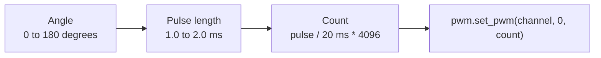

{:class="cover"}

---

By the end of this lesson you will be able to convert an angle into a PCA9685 count, and move any joint of the arm to an angle by name from Python.

## From angle to count

Up to now we have sent raw counts. A person thinks in angles, so we need a translation in three steps:



A typical hobby servo points to one end of its travel with a 1 ms pulse, the middle with 1.5 ms and the other end with 2 ms, repeated every 20 ms. So an angle of 0 degrees maps to 1.0 ms, 180 degrees to 2.0 ms and 90 degrees to 1.5 ms. Many servos will go a bit beyond that range, but pushing past what a joint can do makes it strain, so we start at the safe range and widen it later by testing.

Putting numbers on it, with a 50 Hz signal:

- 1.0 ms gives 1.0 / 20 * 4096 = 204.8, so 205
- 1.5 ms gives 307.2, so 307
- 2.0 ms gives 409.6, so 410

Each step in the 12-bit count is about 4.9 microseconds. Across 180 degrees we get about 205 steps, so roughly 0.9 of a degree for each step, which is plenty smooth for an arm.

## Check the maths without hardware

Save this as `servo_maths.py`. It runs on any computer and prints angle, pulse and count side by side.

```python
FREQ_HZ = 50
PERIOD_MS = 1000 / FREQ_HZ      # 20 ms
STEPS = 4096                    # 12-bit counts
MIN_MS = 1.0                    # pulse for 0 degrees
MAX_MS = 2.0                    # pulse for 180 degrees


def angle_to_pulse_ms(angle):
    """0-180 degrees -> pulse length in milliseconds."""
    return MIN_MS + (MAX_MS - MIN_MS) * angle / 180


def pulse_ms_to_count(pulse_ms):
    """Pulse length -> 12-bit count out of 4096."""
    return round(pulse_ms / PERIOD_MS * STEPS)


for angle in (0, 45, 90, 135, 180):
    pulse = angle_to_pulse_ms(angle)
    print("Angle", angle, "-> pulse", round(pulse, 3), "ms -> count", pulse_ms_to_count(pulse))
```

You should see counts of 205, 256, 307, 358 and 410.

## Build arm.py

Now we put the maths and the servo calls together in a module. Save this as `arm.py` in the `~/buddy_jr` folder. Every later lesson imports it, so take your time over it.

```python
"""arm.py: move Buddy Jr's four servos by name, through a PCA9685."""

FREQ_HZ = 50
PERIOD_MS = 1000 / FREQ_HZ      # 20 ms
STEPS = 4096                    # 12-bit counts
MIN_MS = 1.0                    # pulse for 0 degrees
MAX_MS = 2.0                    # pulse for 180 degrees

CHANNELS = {"base": 0, "shoulder": 1, "elbow": 2, "camera": 3}

# Safe angle range for each joint. Tighten these after testing your own arm.
LIMITS = {
    "base": (0, 180),
    "shoulder": (30, 150),
    "elbow": (30, 150),
    "camera": (30, 150),
}

_pwm = None


def clamp(value, low, high):
    return max(low, min(high, value))


def angle_to_count(angle):
    """0-180 degrees -> 12-bit count at 50 Hz."""
    pulse_ms = MIN_MS + (MAX_MS - MIN_MS) * angle / 180
    return round(pulse_ms / PERIOD_MS * STEPS)


def _connect():
    """Open the PCA9685 the first time it is needed."""
    global _pwm
    if _pwm is None:
        from Adafruit_PCA9685 import PCA9685
        _pwm = PCA9685(busnum=1)
        _pwm.set_pwm_freq(FREQ_HZ)
    return _pwm


def set_angle(joint, angle):
    """Move a joint (such as "elbow") to an angle in degrees. Returns the angle used."""
    low, high = LIMITS[joint]
    safe = clamp(angle, low, high)
    _connect().set_pwm(CHANNELS[joint], 0, angle_to_count(safe))
    return safe


def release(joint):
    """Stop the pulses to one joint so it relaxes."""
    _connect().set_pwm(CHANNELS[joint], 0, 0)


def release_all():
    for joint in CHANNELS:
        release(joint)


if __name__ == "__main__":
    import time
    for joint in CHANNELS:
        print("Centring", joint)
        set_angle(joint, 90)
        time.sleep(0.5)
    time.sleep(1)
    release_all()
    print("Done")
```

Run it with `python3 arm.py`. Each joint goes to 90 degrees, one after another, and then relaxes. The block at the bottom, under `if __name__ == "__main__":`, only runs when you start `arm.py` directly. When another file does `import arm`, that block is skipped.

**Why the limits?** `LIMITS` stops a typo such as `set_angle("elbow", 250)` from forcing the joint into the arm. The `set_angle` function quietly clamps the number, using the `clamp` function from lesson 3.

**Why `release`?** Writing a count of 0 for both on and off stops the pulses. This is also what the library does to every channel when it starts. The servo then relaxes and stops drawing current, which is handy for resting the arm.

**Common mistake:** a servo does not know where it is when the program starts. The first `set_angle` makes the joint jump straight to the target, so start from a pose the arm can reach safely.

## Calibrate your own arm

The 1.0 to 2.0 ms range is a safe default. To find the real range of a joint, change `MIN_MS` and `MAX_MS` by 0.05 ms at a time and call `set_angle` at 0 and 180. Stop as soon as the joint reaches its mechanical stop, or if it buzzes. Use the limits you find to tighten `LIMITS`.

## Try it Yourself

1. Use `python3 -i arm.py` and then type `set_angle("base", 45)`, `set_angle("base", 135)` and `release_all()` at the prompt.
2. Change the shoulder limits in `LIMITS` to `(60, 120)`. What happens when you call `set_angle("shoulder", 20)`?
3. Challenge: write `centre_all.py` that imports `set_angle` from `arm` and sets every joint to 90 without repeating the angle maths.

## Common Issues

- **Problem**: `ModuleNotFoundError: No module named 'arm'`
- **Solution**: Run your program from the folder that holds `arm.py`, with the virtual environment active
- **Why**: Python looks for `arm.py` in the folder you run from

- **Problem**: A joint moves the wrong way, so 0 degrees is where 180 should be
- **Solution**: Swap the servo horn position, or use `180 - angle` for that joint in your own code
- **Why**: Servos on different sides of an arm face opposite ways

- **Problem**: A joint buzzes at the ends of its range
- **Solution**: Narrow its `LIMITS` by a few degrees
- **Why**: The software range is wider than the joint can really move, so the servo pushes against its stop

## Check your understanding


? What pulse length makes a typical servo point to its middle?
- [ ] 1.0 ms
- [x] 1.5 ms
- [ ] 20 ms
> The middle of the 1.0 to 2.0 ms range is 1.5 ms, which is count 307 at 50 Hz.

? What does `set_angle("elbow", 250)` do with the limits in `arm.py`?
- [ ] It raises an error
- [ ] It moves the elbow to 250 degrees
- [x] It clamps the angle to the elbow's limit and moves it there
> `set_angle` uses `clamp` with the joint's entry in `LIMITS`, so the joint never gets an unsafe request.

? Why is the hardware connection opened inside `_connect()`?
- [x] So the angle maths can be imported and tested on a computer with no board
- [ ] Because Python requires it
- [ ] To make the servo faster
> The library is only imported when a servo is actually moved, so `import arm` works anywhere.


Now we have a clean way to move a joint. Next, we'll make whole movements.
