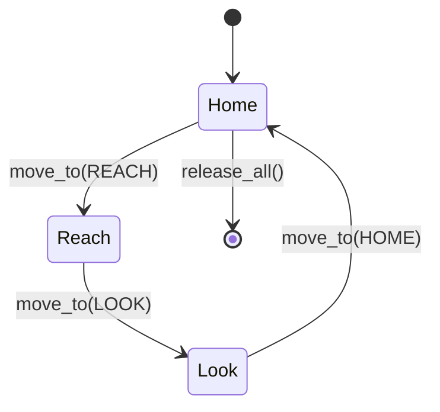

{:class="cover"}

---

By the end of this lesson you will be able to move all four joints together smoothly to a named pose, and run a sequence of poses.

## Jumping versus gliding

If we call `set_angle("elbow", 140)` the servo races to 140 as fast as it can. That's jerky, hard on the gears, and it makes the whole arm shudder. A smoother move takes many small steps between where the joint is now and where it should end up, with a short pause after each one.

To move all four joints at once, we take the same number of steps for each joint, so they all arrive together, even if one has further to go.



## Poses are just dictionaries

A pose is a dictionary of joint names and target angles. Naming them makes the code read like a script: `move_to(REACH)`.

```python
HOME = {"base": 90, "shoulder": 90, "elbow": 90, "camera": 90}
REACH = {"base": 90, "shoulder": 60, "elbow": 120, "camera": 90}
```
{: .no-snakie }

The angles above are examples. Every arm is a little different, so you'll tune your own.

## The smooth mover

We need to remember where each joint is, because the servo can't tell us. We keep that in a dictionary, `current`. For each step, we work out a fraction of the way from the start to the target.

Save this as `moves.py` in `~/buddy_jr`, next to `arm.py`:

```python
import time
from arm import CHANNELS, set_angle, release_all

# Where we think each joint is. Run arm.py first so every joint starts at 90.
current = {joint: 90 for joint in CHANNELS}

HOME = {"base": 90, "shoulder": 90, "elbow": 90, "camera": 90}
REACH = {"base": 90, "shoulder": 60, "elbow": 120, "camera": 90}
LOOK_LEFT = {"base": 60, "shoulder": 90, "elbow": 90, "camera": 70}
LOOK_RIGHT = {"base": 120, "shoulder": 90, "elbow": 90, "camera": 70}


def move_to(pose, steps=40, delay=0.02):
    """Move every joint in `pose` together, in `steps` small steps."""
    start = dict(current)
    for step in range(1, steps + 1):
        fraction = step / steps              # 0.025, 0.05 ... 1.0
        for joint, target in pose.items():
            angle = start[joint] + (target - start[joint]) * fraction
            current[joint] = set_angle(joint, angle)
        time.sleep(delay)


if __name__ == "__main__":
    print("Reaching out")
    move_to(REACH)
    time.sleep(0.5)

    print("Looking around")
    move_to(LOOK_LEFT)
    move_to(LOOK_RIGHT, steps=80)            # a slower sweep: more steps
    time.sleep(0.5)

    print("Back home")
    move_to(HOME)
    time.sleep(1)
    release_all()
    print("Done")
```

Run it with `python3 moves.py`. The arm reaches out, looks left, sweeps right slowly and returns home. Keep a hand near the supply switch the first time.

**How the maths works:** `start + (target - start) * fraction`. At fraction 0 you are at the start. At fraction 1 you are at the target. In between, the joint is that fraction of the way there. The move takes about `steps * delay` seconds, so 40 steps with a 0.02 s delay is roughly 0.8 seconds. Because `set_angle` returns the clamped angle, `current` always records what we really sent.

**Why every joint takes the same number of steps:** a joint that needs a long move takes bigger steps, and one that needs a short move takes smaller steps, but all reach the target on the last step.

## Sequences

A sequence is just a list of poses. A `for` loop turns it into a routine:

```python
dance = [REACH, LOOK_LEFT, LOOK_RIGHT, HOME]
for pose in dance:
    move_to(pose)
```
{: .no-snakie }

That snippet needs the poses and `move_to` from `moves.py`, so add it inside the `if __name__ == "__main__":` block, or put it in a new file that does `from moves import move_to, HOME, REACH, LOOK_LEFT, LOOK_RIGHT`.

## Find your own poses

1. Run `python3 -i arm.py`.
2. At the prompt, try `set_angle("shoulder", 70)`, then 80, then 60 and so on until the arm is where you want it.
3. Write down the angle that gives each pose, then put them in `moves.py`.

## Try it Yourself

1. Make a `WAVE` pose and a sequence that alternates `LOOK_LEFT` and `LOOK_RIGHT` three times.
2. Change `steps` to 10 and then 120 in one `move_to` call. What changes about the movement?
3. Challenge: add a `speed` argument so that `move_to(pose, speed=2)` takes half as long. Hint: compute `steps` from the speed.

## Common Issues

- **Problem**: The arm jumps at the start of the first move
- **Solution**: Run `python3 arm.py` first so every joint begins at 90, and make sure `current` matches the real pose
- **Why**: The program assumes each joint starts at 90. If a joint is somewhere else, the first step is a big jump

- **Problem**: The arm judders instead of gliding
- **Solution**: Raise `steps` and lower `delay`, so each step is smaller
- **Why**: A joint with few big steps moves like a staircase, not a slope

- **Problem**: One joint arrives later than the rest
- **Solution**: Check its angle isn't being clamped by `LIMITS` in `arm.py`
- **Why**: A target outside the limits is clamped, so the joint stops at its limit instead of the pose angle

## Check your understanding


? Why does `move_to` take many small steps?
- [ ] To use more of the PCA9685's channels
- [x] So the joints glide instead of jumping to the target
- [ ] It makes the arm stronger
> Small steps spread the movement over time. One big jump makes the servo race to its target.

? What does `start + (target - start) * fraction` give you when `fraction` is 0.5?
- [ ] The start angle
- [x] The angle halfway between start and target
- [ ] The target angle
> At 0.5 you've moved half of the distance.

? Why do we keep a `current` dictionary?
- [ ] To count how many moves we have made
- [x] The servo can't report its angle, so the program remembers the last angle it sent
- [ ] The PCA9685 needs it
> The servo has no way to tell the Pi where it is, so we track the angle we last sent.


> **Teachers**: groups love to speed things up, so set a rule that no `delay` goes below 0.01 and no `steps` below 10 until the arm is behaving. Fast, jerky moves are the quickest way to strip the gears in an SG90. Learners can plan sequences on paper first, as a table of poses and angles, with no hardware.

Smooth poses done. Next, we'll teach the arm to run on its own.
