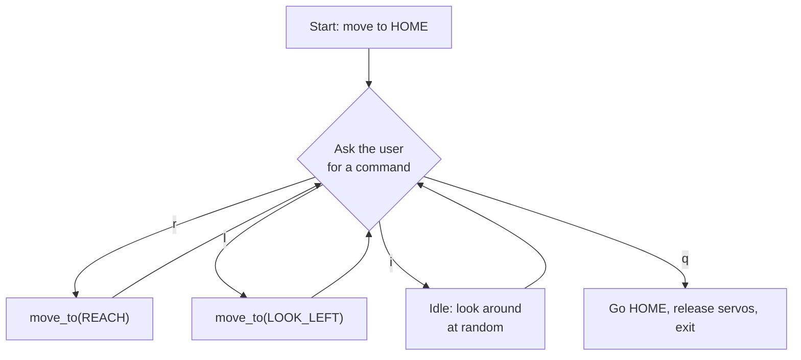

{:class="cover"}

---

By the end of this lesson you will be able to run Buddy Jr from a keyboard menu and an automatic loop, and make sure the servos relax when the program stops.

## From a script to a routine

So far the arm does one thing and stops. Real robots keep going: they wait for something to happen, decide what to do and act. Two ideas get us there. **Loops** keep the program running, and **conditionals** (`if` and `elif`) choose between actions. We'll use both with the `move_to` function from lesson 9.



## Make it stop safely

Pressing Ctrl+C in the middle of a move leaves the servos holding their last pulse, and they keep pushing. Python's `try` and `finally` give us a way to always tidy up:

```python
try:
    # the main loop
    ...
finally:
    # runs even after Ctrl+C or an error
    ...
```
{: .no-snakie }

Whatever happens inside `try`, the `finally` block runs on the way out. That is the perfect place for `move_to(HOME)` and `release_all()`.

## The program

Save this as `routine.py` next to `arm.py` and `moves.py`:

```python
import random
import time
from arm import release_all
from moves import move_to, HOME, REACH, LOOK_LEFT, LOOK_RIGHT

IDLE_POSES = [HOME, LOOK_LEFT, LOOK_RIGHT, REACH]


def idle(seconds):
    """Look around at random for a number of seconds."""
    end = time.time() + seconds
    while time.time() < end:
        pose = random.choice(IDLE_POSES)
        move_to(pose, steps=random.randint(30, 80))
        time.sleep(random.uniform(0.3, 1.5))


def main():
    print("Commands: r = reach, l = look left, d = look right, h = home, i = idle 10 s, q = quit")
    move_to(HOME)
    try:
        while True:
            command = input("> ").strip().lower()
            if command == "r":
                move_to(REACH)
            elif command == "l":
                move_to(LOOK_LEFT)
            elif command == "d":
                move_to(LOOK_RIGHT)
            elif command == "h":
                move_to(HOME)
            elif command == "i":
                idle(10)
            elif command == "q":
                break
            else:
                print("I don't know", repr(command))
    finally:
        print("Going home and relaxing")
        move_to(HOME)
        release_all()


if __name__ == "__main__":
    main()
```

Run it with `python3 routine.py` and type a letter, then press Enter. The arm obeys, and `q` or Ctrl+C sends it home and relaxes it.

**How it works:** `input()` waits for you to type something. The `if`/`elif` chain picks the matching move, and `else` catches anything it doesn't understand, so a typo doesn't crash the program. `random.choice` picks a pose from the list and `random.uniform` picks a pause, which makes the idle behaviour look alive rather than mechanical.

**Why this matters:** the same shape (a loop, a decision, an action and a safe exit) is the skeleton of almost every robot program, whether the decision comes from a keyboard, a button, a camera or a distance sensor.

## A note on sensors and the camera

Buddy Jr has a holder for a Raspberry Pi camera module. Kev's blog post for the arm notes that `rpicam-hello -t 0` shows what the camera sees in a terminal on the Pi. Using the camera to steer the arm is a project for later, and so is reading a button or distance sensor, but both fit the shape above: replace `input()` with a reading from the sensor, and let the `if` chain choose the move.

## Try it Yourself

1. Add a `"w"` command that waves the camera holder up and down three times using a `for` loop.
2. Make `idle` print the name of each pose it picks. Hint: store the poses in a dictionary of names and use `random.choice(list(names))`.
3. Challenge: add a command `"s"` that runs the whole `dance` sequence from lesson 9, and a command `"n"` followed by a number that repeats it that many times.

## Common Issues

- **Problem**: The arm keeps pushing after the program stops
- **Solution**: Keep the `try` and `finally` in `main()` and quit with `q` or Ctrl+C
- **Why**: A servo keeps sending the last pulse until told otherwise. The `finally` block sends it home and relaxes it

- **Problem**: `ImportError: cannot import name 'LOOK_RIGHT' from 'moves'`
- **Solution**: Check that `moves.py` still defines `LOOK_RIGHT`, with the same spelling
- **Why**: `from moves import ...` can only import names that the file defines

- **Problem**: The program seems to hang after a command
- **Solution**: Wait for the move to finish. Long moves have more `steps`, and `idle(10)` takes ten seconds
- **Why**: Python runs one thing at a time, so the next prompt only appears when the move has finished

## Check your understanding


? What is the `finally` block for in `routine.py`?
- [ ] It speeds up the arm
- [x] It sends the arm home and relaxes the servos however the program ends
- [ ] It reads the keyboard
> `finally` runs after a normal exit, an error or Ctrl+C, so the servos never stay pushed.

? Which statement gives the program a way to choose between moves?
- [ ] `import random`
- [x] The `if`/`elif` chain
- [ ] `time.sleep()`
> Conditionals check the command and pick the move that matches.

? Why does the idle routine use `random`?
- [x] Random poses and pauses make the arm look less mechanical
- [ ] The PCA9685 needs random numbers
- [ ] It makes the moves smoother
> `random.choice` and `random.uniform` vary the pose and the pause, so the arm doesn't repeat itself.


Now we have an arm that can run itself. Next, some ideas to take it further.
