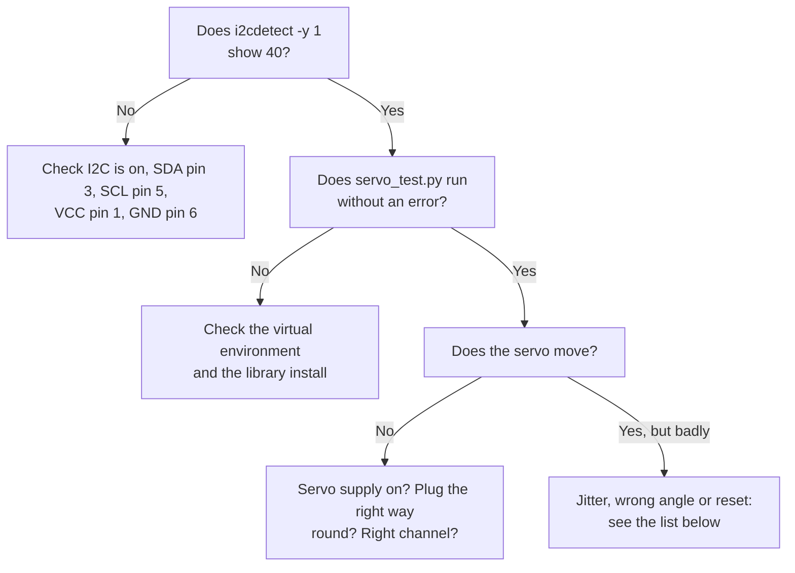

{:class="cover"}

---

By the end of this lesson you will be able to find a fault in the arm by testing one link of the chain at a time, and know where to go next with your robotics.

## Fix one link at a time

When an arm misbehaves, it is tempting to change five things at once. Don't. The system is a chain, so test it from the Pi outwards and stop at the first link that fails. That tells you exactly where to look.

Keep this chain in mind as you read the list below. Each item tells you what you'll see, what to do and why it happens.

## Common Issues

- **Problem**: `i2cdetect -y 1` shows an empty grid
- **Solution**: Run `sudo raspi-config` and check I2C is on. Then check SDA on pin 3, SCL on pin 5, `VCC` on pin 1 and `GND` on pin 6, with the Pi powered off while you rewire
- **Why**: The Pi can only see the board if the chip is powered and both data wires reach the right pins

- **Problem**: The Python program stops with an `OSError`
- **Solution**: Run `i2cdetect -y 1` first. If `40` isn't there, fix the wiring; if it is, check you are using address 0x40
- **Why**: The Pi sent a message and nothing answered, so the problem is the connection and not your code

- **Problem**: `ModuleNotFoundError: No module named 'Adafruit_PCA9685'`
- **Solution**: Activate the virtual environment with `source venv/bin/activate` and run again
- **Why**: The library lives in the environment, so Python can't find it from outside

- **Problem**: A servo twitches, jitters or hums
- **Solution**: Check the servo supply is solid, that its ground is joined to the Pi's ground through the board, and that the wires are firmly plugged in
- **Why**: A weak supply or a loose ground makes the pulse unreliable, so the servo hunts around its target

- **Problem**: The Pi reboots or the arm goes weak when several servos move
- **Solution**: Use a 5 V supply that can give at least 2 A on the `V+` terminal, and never power servos from the Pi
- **Why**: Moving servos draw a lot of current. If they share the Pi's supply, the voltage dips and the Pi resets

- **Problem**: A joint moves the wrong way, or its angles are off
- **Solution**: Check the horn was fitted with the servo centred (lesson 7), then adjust the limits in `arm.py`, or use `180 - angle` for a reversed joint
- **Why**: The code assumes 90 degrees is the middle. A horn fitted at another angle shifts everything

- **Problem**: A servo buzzes and gets warm
- **Solution**: Switch off the supply, find what blocks the joint and narrow its `LIMITS`
- **Why**: The servo is pushing against something it can't move, which draws a lot of current

- **Problem**: A joint jumps when the program starts
- **Solution**: Start from a pose the arm can reach safely, run `python3 arm.py` to centre it, and keep `current` in `moves.py` in step with reality
- **Why**: A servo doesn't know where it is. The first pulse sends it straight to the target

> **Teachers**: treat troubleshooting as a skill to teach, not a rescue. Give each group the flowchart above and ask them to say which link they have tested before they ask for help. Keep spare servos, jumper wires and a known-good PCA9685 on hand, since loose jumper wires and reversed servo plugs are the most common faults in a classroom.

## Good habits

- Switch the servo supply off before changing any wiring.
- Change one thing at a time, then test.
- Keep your `arm.py` limits and your pose angles in files you can back up. Version control such as the [Git course](/learn/git/) teaches is ideal.
- Write down which servo is on which channel, as you did in lesson 7.

## Try it Yourself

1. With the supply off and the Pi running, run `i2cdetect -y 1`. Note what it shows. Then unplug the `SDA` wire, run it again and compare.
2. Write a short checklist for your own arm, with the first three things to check if it stops working.
3. Challenge: write `selftest.py` that imports `set_angle` and `release_all` from `arm`, moves each joint 10 degrees either side of 90 and back, and prints which joint it is testing.

## What you built

You started with a Pi and a handful of parts. You wired a PCA9685 safely, with a separate servo supply, worked out the maths from an angle to a 12-bit count, built Buddy Jr, and wrote `arm.py`, `moves.py` and `routine.py` so it glides between poses on its own. That is real robotics, and the same pieces drive arms, legs and pan-and-tilt heads.

## What's next

- [Build a SMARS Quad Walking Robot](/learn/smars_quad/): eight servos on a PCA9685 and a Raspberry Pi Zero, making a walking robot
- [BrachioGraph Tutorial](/learn/brachiograph/): a drawing arm built from servos
- [Talking to the World - Working with I2C and SPI](/learn/i2c_spi/): how the I2C bus the PCA9685 sits on works
- [Motors and motor drivers](/learn/motors_and_drivers/): the rest of the family of ways to move a robot
- [Robotics 101](/learn/robotics_101/): the big ideas behind robots
- [Design Robot Parts with BetterCad](/learn/bettercad_robot_parts/): design your own arm parts

## Check your understanding


? Your arm does nothing and `i2cdetect -y 1` shows an empty grid. Where do you look first?
- [x] I2C being enabled, and the SDA, SCL, VCC and GND wiring
- [ ] The servo horns
- [ ] The `LIMITS` in `arm.py`
> If the Pi can't see the board, nothing in the code can work, so test the link between them first.

? The Pi reboots when the servos move. What is the most likely cause?
- [ ] The wrong Python version
- [x] The servos are drawing too much current from a supply that is too weak or shared with the Pi
- [ ] The wrong channel number
> Use a separate 5 V supply on the `V+` terminal with enough current.

? What does a good troubleshooter do?
- [ ] Change several things at once to save time
- [x] Test one link of the chain at a time and change one thing at a time
- [ ] Rewrite the code from scratch
> Changing one thing at a time tells you which change fixed (or caused) the problem.


Thanks for building Buddy Jr with me. Now go and make something move.
