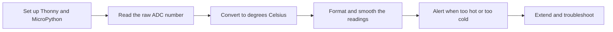

{:class="cover"}

---

By the end of this lesson you will be able to explain what the course builds, what the Pico's built-in temperature sensor can and cannot do, and check you have the kit you need.

Ahoy there makers! Did you know your Raspberry Pi Pico already has a thermometer inside it? There is nothing to buy and nothing to wire up. In this course we'll read that sensor, turn the numbers into degrees Celsius, make the readings steadier and more accurate, and finish with a temperature alert that lights the on-board LED when things get too hot.

---

## Overview

The sensor sits inside the Pico's microcontroller chip and measures the temperature of the chip itself. That makes it perfect for learning, because you meet three big ideas without any extra parts: analogue-to-digital conversion, turning a raw number into a real-world unit, and acting on a sensor reading.

## Course Content

- **Getting set up**: install Thonny, flash MicroPython and run your first line of code
- **How the sensor works**: the ADC, channel 4 and the diode inside the chip
- **Your first sensor script**: read raw values, convert them to Celsius and format the output
- **Better readings**: understand the formula, average the noise away and calibrate against a thermometer
- **The alert system**: thresholds and the on-board LED
- **Next steps**: project ideas, an OLED display and a troubleshooting guide

## Key Results

By the end of this course you will be able to:

- Set up a Raspberry Pi Pico with MicroPython and run programs from Thonny
- Read the Pico's internal temperature sensor with `machine.ADC(4)`
- Convert a raw ADC reading to voltage and then to degrees Celsius
- Smooth noisy readings by averaging, and calibrate them with an offset
- Build a temperature alert that prints a message and lights the on-board LED
- Diagnose the common reasons a reading looks wrong

## What you'll need

- A Raspberry Pi Pico, Pico W or Pico 2
- A micro-USB cable (USB-C for a Pico 2) that carries data, not just power
- A computer running Windows, macOS, Linux or Raspberry Pi OS
- [Thonny](https://thonny.org), a free editor we install in lesson 2
- Optional: a room thermometer, for the calibration in lesson 9
- Optional: a small I2C OLED display (SSD1306), for the extension in lesson 11

No soldering is needed unless your Pico came without header pins and you want to use the optional OLED.

If you have never written any Python, our [MicroPython course](/learn/micropython/) is a gentle companion. Once you finish here, [MicroPython GPIO](/learn/micropython_gpio/) shows you how to control LEDs and buttons.

## How the course works

**Code you can run.** Every program is complete, so you can copy it into Thonny, save it and press Run. Short fragments that are not whole programs are marked clearly.

**MicroPython, not desktop Python.** Some things you might know from Python on a computer are missing or different on the Pico. We point out each trap where you meet it.

**Quizzes and exercises.** Every lesson ends with a short quiz, a Try it Yourself list and a Common Issues list. Your quiz score is kept in your browser and shown in the sidebar.

**One project, built up.** Each lesson adds a little to the same script, so by lesson 10 you have a working temperature monitor.

> **Teachers**: this course suits learners aged about 11 and up, including complete beginners to text programming. Allow 30 to 45 minutes per lesson. You need one Pico and one computer per learner or pair. Lesson 2 installs software, so check whether your school lets learners install Thonny or ask IT to install it beforehand. Lesson 1, and the reading parts of lessons 4, 5, 9 and 12, work with no hardware at all. A room thermometer shared between a group is enough for the calibration in lesson 9.

Ready? Let's get your Pico set up.
