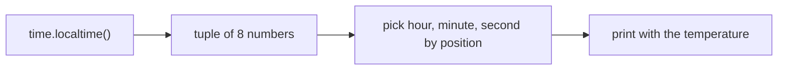

{:class="cover"}

---

By the end of this lesson you will be able to add a timestamp to each reading and explain why `time.localtime()` returns a tuple on the Pico.

A temperature on its own is only half a story. "26.8" is much more useful when you know when it was taken. Let's add a clock to the output, and meet our first MicroPython surprise along the way.



---

## Step 1: Adding timestamps

Update your script to include timestamps:

```python
import machine
import time

# Initialize the ADC for the temperature sensor
sensor_adc = machine.ADC(4)

while True:
    # Read the raw ADC value
    raw_value = sensor_adc.read_u16()

    # Convert the ADC value to voltage
    voltage = raw_value * 3.3 / 65535

    # Convert voltage to temperature
    temperature = 27 - (voltage - 0.706) / 0.001721

    # Get the current time as a tuple:
    # (year, month, day, hour, minute, second, weekday, yearday)
    timestamp = time.localtime()
    hour = timestamp[3]
    minute = timestamp[4]
    second = timestamp[5]

    print(f"[{hour:02}:{minute:02}:{second:02}] Temperature: {temperature:.2f}°C")
    time.sleep(1)
```

The `:02` in the format means "at least two digits, padded with a zero", so 7 seconds shows as `07`.

> **MicroPython is not quite the same as Python on your computer.** On a PC, `time.localtime()` returns an object with named fields such as `tm_hour`. In MicroPython it returns a plain tuple, so `timestamp.tm_hour` fails with `AttributeError: 'tuple' object has no attribute 'tm_hour'`. Use the position in the tuple instead: `timestamp[3]` is the hour, `timestamp[4]` the minute and `timestamp[5]` the second.

## Where does the time come from?

The Pico has a clock but no battery to keep it running, so it forgets the time whenever it loses power. When you run a script from Thonny, Thonny sets the Pico's clock from your computer as it connects, so the timestamps are correct. If the Pico runs on its own (for example from a USB power bank), the clock starts again from midnight on 1 January 2021 and the timestamps show the time since power-on instead. A Pico W can fetch the real time over Wi-Fi with the `ntptime` module.

## Step 2: Running the script

1. Save the script as `formatted_temp.py`.
2. Run it in Thonny and observe the formatted output. It should look something like this:

```raw
[14:32:07] Temperature: 26.84°C
[14:32:08] Temperature: 26.84°C
[14:32:09] Temperature: 27.31°C
```

**Why this matters:** a data logger, an alert or a graph all need to know when a reading happened. Timestamps turn a stream of numbers into a record you can reason about.

**Common mistakes:**

- Writing `timestamp.tm_hour`, which is desktop Python and fails on the Pico.
- Forgetting that the tuple is counted from zero, so the hour is `[3]` and not `[4]`.
- Trusting the clock when the Pico runs without Thonny. With no battery and no Wi-Fi time, it starts at 2021 again.

## What you'll learn

- How to include timestamps in your output.
- That `time.localtime()` returns a tuple in MicroPython, and how to pick values out of it.
- How to format the temperature reading for better readability.

---

## Try it Yourself

1. Also print the day and month, which are `timestamp[2]` and `timestamp[1]`.
2. Print a date in the form `24/11` using the same `:02` padding.
3. Challenge: show only every fifth reading by counting loops and printing when the count divides by 5 with no remainder.

## Common Issues

- **Problem**: `AttributeError: 'tuple' object has no attribute 'tm_hour'`.
- **Solution**: Use `timestamp[3]` for the hour, `timestamp[4]` for the minute and `timestamp[5]` for the second.
- **Why**: MicroPython's `localtime()` returns a plain tuple with no named fields.

- **Problem**: The time is wrong, or starts at 00:00 each run.
- **Solution**: Run the script from Thonny so it can set the clock, or use `ntptime` on a Pico W.
- **Why**: The Pico has no battery-backed clock, so it only knows the time if something tells it.

- **Problem**: The print line shows `{hour:02}` as plain text instead of a number.
- **Solution**: Put the letter `f` straight before the opening quote, as in `f"..."`.
- **Why**: Without the `f`, the braces are ordinary characters and are not filled in.

## Check your understanding


? How do you get the hour from `time.localtime()` on the Pico?
- [ ] `timestamp.tm_hour`
- [x] `timestamp[3]`
- [ ] `timestamp.hour()`
> MicroPython gives a plain tuple, and the hour is the fourth item, at position 3.

? Why might the Pico's timestamps be wrong when it runs on a power bank?
- [ ] The ADC is broken
- [x] It has no battery clock, so it starts from a default date at power-on
- [ ] Power banks change the time zone
> Thonny sets the clock when connected. Without it, the Pico does not know the real time.

? What does `{minute:02}` do?
- [ ] Adds two to the minute
- [x] Pads the number with a zero to two digits
- [ ] Rounds to two decimals
> `:02` means at least two digits, filled with zeros on the left.

