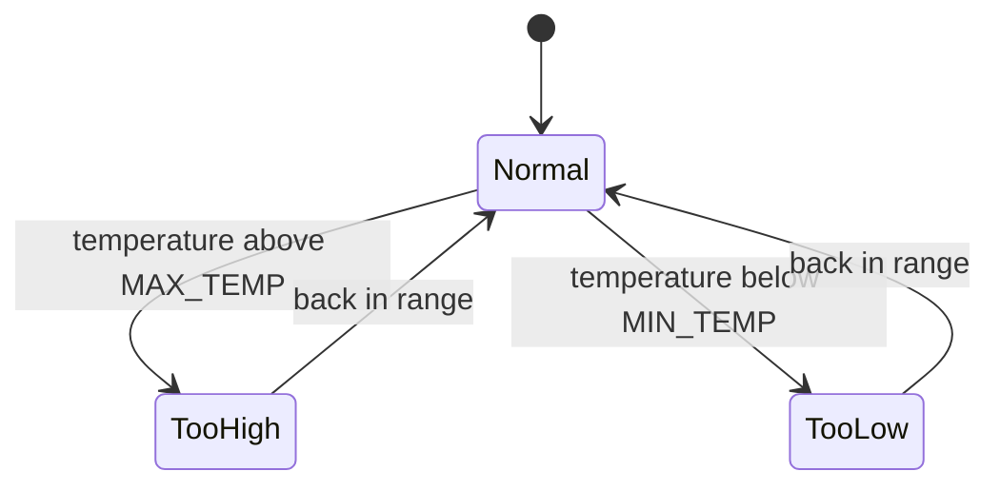

{:class="cover"}

---

By the end of this lesson you will be able to build a program that compares the temperature with a minimum and a maximum, prints an alert message, and lights the Pico's on-board LED when the temperature is out of range.

This is where the project comes together. Over the last few lessons the Pico learned to measure. Now it learns to *act*. Real machines do this all the time: a 3D printer shuts down when its hot end runs away, and a robot slows its motors when its brain gets too warm. We'll build a small version with no extra parts.



---

## Step 1: Defining temperature thresholds

Define the acceptable temperature range as named values at the top of the program, so they are easy to find and change:

```python
MIN_TEMP = 20  # Minimum acceptable temperature in °C
MAX_TEMP = 30  # Maximum acceptable temperature in °C
```
{: .no-snakie }

## Step 2: Writing the alert logic

The on-board LED is the Pico's simplest output. On every Pico, Pico W and Pico 2 it is reached with `machine.Pin("LED", machine.Pin.OUT)`. Do not use `Pin(25)`: that only works on the original Pico, because on the Pico W the LED is wired to the Wi-Fi chip.

There is nothing to wire. Here is the complete program:

```python
import machine
import time

# Initialize the ADC for the temperature sensor
sensor_adc = machine.ADC(4)

# The on-board LED works on every Pico, Pico W and Pico 2
led = machine.Pin("LED", machine.Pin.OUT)

# Define temperature thresholds
MIN_TEMP = 20  # Minimum acceptable temperature in °C
MAX_TEMP = 30  # Maximum acceptable temperature in °C

while True:
    # Read the raw ADC value
    raw_value = sensor_adc.read_u16()

    # Convert the ADC value to voltage
    voltage = raw_value * 3.3 / 65535

    # Convert voltage to temperature
    temperature = 27 - (voltage - 0.706) / 0.001721

    # Check temperature thresholds
    if temperature < MIN_TEMP:
        print(f"Alert: Temperature is too low! ({temperature:.2f}°C)")
        led.value(1)
    elif temperature > MAX_TEMP:
        print(f"Alert: Temperature is too high! ({temperature:.2f}°C)")
        led.value(1)
    else:
        print(f"Temperature is normal: {temperature:.2f}°C")
        led.value(0)

    # Wait for 1 second before checking again
    time.sleep(1)
```

## Step 3: Running the script

1. Save the script as `temperature_alert_system.py`.
2. Run the script in Thonny.
3. Warm the chip with a finger, or change the thresholds, and watch the messages and the LED. The LED is on whenever the temperature is out of range, and off when it is normal.

## Example output

When the temperature is normal:

```raw
Temperature is normal: 25.84°C
```

When the temperature is too high:

```raw
Alert: Temperature is too high! (31.20°C)
```

When the temperature is too low:

```raw
Alert: Temperature is too low! (19.45°C)
```

## Step 4: Customising alerts

You can enhance the alert system by:

1. Averaging several readings, as in the previous lesson, so a single noisy reading does not trigger a false alert.
2. Logging the temperature data for analysis.
3. Sending notifications by email or a messaging service (this needs a Wi-Fi board such as the Pico W).
4. Adding an external LED or buzzer on a spare pin (the next lesson has more ideas).

**Why this matters:** thresholds turn a measurement into a decision. The same pattern drives thermostats, fridge alarms and robot safety cut-outs.

**Common mistakes:**

- Setting `MIN_TEMP` above `MAX_TEMP`, which makes every reading an alert.
- Choosing limits right on top of the room temperature. The reading wobbles by half a degree, so the LED flickers on and off. Pick limits with some margin.
- Using `Pin(25)` for the LED, which does nothing on a Pico W.

> **Teachers**: the LED needs no extra hardware, so every learner can finish this lesson with just a Pico. For a classroom demonstration, set `MAX_TEMP` a degree or two above the room's current reading so a learner's warm finger triggers the alert quickly.

---

## Try it Yourself

1. Change `MIN_TEMP` and `MAX_TEMP` so that the room temperature is "normal" and a finger on the chip makes the LED light.
2. Make the LED blink instead of staying on by adding `led.toggle()` and a short sleep when too high.
3. Challenge: use the averaging function from the previous lesson so the alert only fires when the average is out of range.

## Common Issues

- **Problem**: The LED does nothing, or you get a pin error.
- **Solution**: Use `machine.Pin("LED", machine.Pin.OUT)`, not a number.
- **Why**: On the Pico W the LED is not on a normal GPIO pin, so the name `"LED"` is the portable way to reach it.

- **Problem**: The alert flickers between normal and alert.
- **Solution**: Move the thresholds further from the usual reading, or average several readings.
- **Why**: The ADC jumps by about half a degree between readings, so a threshold near the usual value is crossed back and forth.

- **Problem**: The LED never turns on, even with a hot chip.
- **Solution**: Print the temperature and check it really goes above `MAX_TEMP`.
- **Why**: The chip often stays a few degrees under the limit you imagine, so the condition is never true.

## Check your understanding


? How do you reach the on-board LED on every Pico model?
- [ ] `machine.Pin(25)`
- [x] `machine.Pin("LED", machine.Pin.OUT)`
- [ ] `machine.LED()`
> The name "LED" works on the Pico, Pico W and Pico 2. `Pin(25)` fails on the Pico W.

? Why might the alert flicker when the temperature sits near a threshold?
- [ ] The LED is faulty
- [x] The reading jumps by about half a degree between samples
- [ ] The loop is too slow
> The ADC works in coarse steps, so a value close to the limit crosses it back and forth.

? What goes wrong if `MIN_TEMP` is greater than `MAX_TEMP`?
- [ ] Nothing
- [x] Almost every reading counts as out of range
- [ ] The LED turns off
> No temperature can sit between the two limits, so each reading fails one check or the other.

