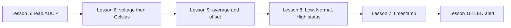

{:class="cover"}

---

By the end of this lesson you will be able to run one complete temperature monitor that combines averaging, calibration, a status label and an LED alert, and choose what to learn next.

You made it, and you have built something real. Let's finish with a single program that uses every idea from the course, then look at where to go next. Read it slowly and see if you can spot each lesson in it.



---

## The finished monitor

This program averages 20 readings, applies your calibration offset, labels the result, stamps it with the time and lights the on-board LED when the temperature is out of range. Set `OFFSET` to the number you found in lesson 9, or leave it at 0 if you did not calibrate.

```python
import machine
import time

sensor_adc = machine.ADC(4)
led = machine.Pin("LED", machine.Pin.OUT)

SAMPLES = 20
OFFSET = 0.0   # thermometer reading minus Pico reading
MIN_TEMP = 20
MAX_TEMP = 30


def read_temperature():
    total = 0
    for _ in range(SAMPLES):
        total += sensor_adc.read_u16()
    voltage = (total / SAMPLES) * 3.3 / 65535
    return 27 - (voltage - 0.706) / 0.001721 + OFFSET


while True:
    temperature = read_temperature()

    if temperature > MAX_TEMP:
        status = "High"
    elif temperature < MIN_TEMP:
        status = "Low"
    else:
        status = "Normal"

    led.value(status != "Normal")

    t = time.localtime()  # a tuple in MicroPython
    print(f"[{t[3]:02}:{t[4]:02}:{t[5]:02}] {temperature:.1f}C {status}")
    time.sleep(1)
```

Save it as `temperature_monitor.py`. To make it start by itself whenever the Pico is powered, save it on the Pico as `main.py`. Remember the clock only shows real time when Thonny has set it.

## What you have learned

- The temperature sensor is inside the chip, on ADC channel 4, so there is nothing to wire.
- `read_u16()` gives 0 to 65535, which is 0 V to 3.3 V.
- Voltage becomes degrees with `27 - (voltage - 0.706) / 0.001721`.
- Averaging smooths the noise and an offset calibrates your own board.
- MicroPython differs from desktop Python, for example `time.localtime()` is a tuple.
- Thresholds turn a reading into a decision, such as lighting the LED.

## Where next?

- [MicroPython GPIO](/learn/micropython_gpio/) to control LEDs, buttons and more with the Pico's pins
- [MicroPython](/learn/micropython/) for a deeper look at the language itself
- [Intermediate MicroPython](/learn/intermediate_micropython/) for functions, classes and bigger programs
- [Electronics Basics](/learn/electronics_basics/) for the voltage, current and resistor ideas behind sensors
- [I2C and SPI](/learn/i2c_spi/) to connect displays and external sensors

> **Teachers**: the finished monitor makes a good small assessment. Ask each learner to explain one part of the program in their own words, change one limit and predict the result, and describe one source of error in the reading. Saving it as `main.py` runs it on power-up, so remind learners to rename or delete it before the next class reuses the board.

---

## Try it Yourself

1. Change `SAMPLES`, `MIN_TEMP` and `MAX_TEMP` to suit your room, and confirm the status matches what you expect.
2. Combine the finished monitor with the data logger from lesson 11 so it also writes each reading to a file once a minute.
3. Challenge: add an OLED display and show the status word as well as the temperature.

## Common Issues

- **Problem**: The program starts on its own after you save it as `main.py` and you cannot stop it.
- **Solution**: Press the Stop button in Thonny, then delete or rename `main.py` from the Pico's file list.
- **Why**: A file called `main.py` runs automatically at power-up, which is useful but can get in the way of editing.

- **Problem**: `NameError: name 'sensor_adc' isn't defined` when you test one function in the Shell.
- **Solution**: Run the whole program first, or define `sensor_adc` before calling the function.
- **Why**: Functions use the variables set up at the top of the program, which only exist once it has run.

## Check your understanding


? Which ADC channel does the finished monitor read?
- [ ] 0
- [x] 4
- [ ] 26
> Channel 4 is the internal temperature sensor.

? How do you make the program start by itself when the Pico is powered?
- [ ] Rename it `read_temp.py`
- [x] Save it on the Pico as `main.py`
- [ ] Add `import auto` at the top
> MicroPython runs `main.py` automatically at power-up.

? Which combination reduces noise and corrects the board's own offset?
- [ ] A bigger `time.sleep()`
- [x] Averaging several readings and adding a calibration offset
- [ ] A different LED
> Averaging smooths the jitter, and the offset corrects the difference from a trusted thermometer.

