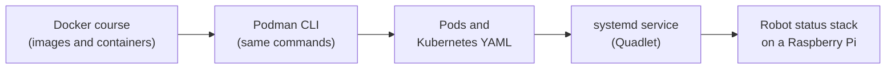

{:class="cover"}

---

By the end of this lesson you will be able to say what Podman is, how it differs from Docker, and what we are going to build with it.

Ahoy there makers! If you have followed the [Docker course](/learn/docker/), you already know how handy containers are: your program and everything it needs, packed in one box that runs the same on any machine. Docker is not the only tool that can run those boxes, though. **Podman** is a free, open source alternative from the same family of tools, designed so that you do not need a background service or administrator rights to run a container.

## Overview

Podman uses the same container images and almost the same commands as Docker, so most of what you know carries over. What changes is *how* it runs:

- **Daemonless**: there is no always-on `dockerd` service. When you type `podman run`, Podman starts your container directly.
- **Rootless by default**: containers run as you, not as the all-powerful `root` user, so a bug inside a container has far less power over your Pi.
- **Pods and systemd friendly**: you can group containers into Kubernetes-style pods, and let systemd start them at boot like any other service.

Throughout the course we use one project: the same **robot status page** as in the Docker course. It is a small Python web app that shows your robot's name, its CPU temperature and a visit counter kept in Redis. We will run it with plain Podman commands, then in a pod, then with Compose, and finally as a service that starts when the Pi boots.

## Course Content

- **Getting started**: what Podman is, how it differs from Docker, and installing it on a Raspberry Pi
- **Core usage**: the Docker-compatible commands, what is genuinely different, and managing images and containers
- **Advanced concepts**: pods, Compose, and Kubernetes YAML
- **Real-world usage**: running Podman as a service, and troubleshooting
- **Migration lab**: moving the Docker robot status app over to Podman
- **Summary**: what you learned and where to go next

## Key Results

After completing this course, you will be able to:

- Explain what daemonless and rootless mean, and why they matter
- Install Podman on Raspberry Pi OS and run a container without `sudo`
- Build, run, inspect and clean up images and containers with the Podman CLI
- Group containers into a pod and export it as Kubernetes YAML
- Run a container as a systemd service that restarts itself and starts at boot
- Migrate a Docker project to Podman and know where the two tools differ

## What you'll need

- A Raspberry Pi 4 or 5 running Raspberry Pi OS (64-bit), or another Debian-based Linux PC. 2 GB of RAM is plenty
- An internet connection, because images are downloaded from registries
- A terminal, either on the Pi itself or over SSH
- A text editor such as `nano`, which is already on Raspberry Pi OS
- A web browser on any computer on the same network

You should be comfortable with the Docker basics (images, containers, ports and volumes). If not, start with the [Docker course](/learn/docker/). If the terminal is new to you, try [Introduction to the Linux Command Line on Raspberry Pi OS](/learn/linux_intro/) first.

## How the course works

**One project, growing.** From lesson 6 onwards we work in a folder called `~/robot-status`. If you finished the Docker course you already have most of it, and you can reuse those files.

**Where to type.** Lines starting with `podman` or `systemctl` run in your terminal. Code boxes labelled `Containerfile`, `yaml` or `ini` are files you save, not commands.

**Podman moves quickly.** Raspberry Pi OS ships a particular Podman version, and newer features such as Quadlet need a recent one. Each lesson says when a command depends on the version, and you can always check yours with `podman --version`.

**Quizzes.** Each lesson ends with a short quiz. Your score is stored in your browser and shown in the sidebar.

> **Teachers**: This course suits learners aged about 14 and up who have used a terminal and met containers before. Allow 45 to 60 minutes per lesson and about 90 for the migration project. Each learner or pair needs a Raspberry Pi (or a Linux PC) with a login that can use `sudo` for the one-off install in lesson 3, plus internet access to container registries, which some school networks block, so test a `podman pull` in advance. Lessons 1 and 2 can be taught with no hardware at all.
