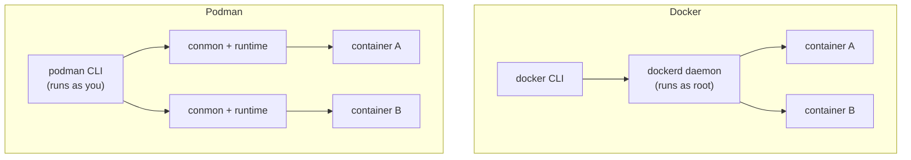

{:class="cover"}

---

By the end of this lesson you will be able to explain what a daemon is, how Podman runs containers without one, and what "rootless" protects you from.

To see why Podman exists, we need to look at how the two tools are put together. The biggest difference is one word: **daemon**.

> A **daemon** is a program that runs in the background all the time, waiting for jobs. Docker's daemon is called `dockerd`. Podman has no equivalent.

## How Docker works

Docker uses a **client and server** design:

- The `docker` command is only a client. It sends your request to the `dockerd` daemon
- The daemon does the real work: it pulls images, starts containers and manages networks and volumes
- By default the daemon runs as `root`, and anyone who can talk to it (members of the `docker` group) can effectively act as root on the machine

That is convenient, but it means one long-running, privileged process sits between you and every container.

## How Podman works

Podman is **daemonless**. When you type `podman run`, the `podman` command itself sets the container up, then hands it to a tiny monitor process called `conmon` and a runtime (`crun` or `runc`) that does the actual starting. Each container is just a normal Linux process owned by *you*.



## What rootless really means

Rootless means the container runs without administrator rights on your machine. Inside the container a program may think it is `root`, but Linux **user namespaces** map that "root" to your ordinary user account on the outside. If a program escapes the container, all it gets is your normal user's permissions, not control of the whole Pi.

**Real robot example.** Imagine your robot runs a web dashboard in a container, and someone finds a bug in the dashboard. With a root daemon, the attacker may be able to reach the whole system. With a rootless container they can only touch what your user can touch.

Docker can also run in rootless mode, but it is an optional extra you set up. In Podman it is the normal way of working.

## Side by side

| Question | Docker (default install) | Podman |
| --- | --- | --- |
| Background daemon needed? | Yes, `dockerd` | No |
| Runs as | `root` | Your own user |
| Needs `sudo` or the `docker` group? | Yes | No, for rootless use |
| Container restarts at boot | Daemon restarts them | You use systemd |
| Image format | OCI images | The same OCI images |
{:class="table table-single"}

The last row matters: an image built with Docker runs under Podman and the other way round, because both follow the open **OCI** standard.

## The trade-offs

No daemon is not all upside:

- **Nothing brings your containers back after a reboot by itself.** Docker's daemon revives containers with `--restart always`. With Podman you hand that job to `systemd`, which we cover in lesson 10
- **Rootless containers cannot bind ports below 1024** (such as 80) by default, so we use ports like 8080 or 5000
- **Rootless networking is a little slower** than the root equivalent, because traffic passes through a user-space helper

## Try it Yourself

1. Write down, in your own words, what a daemon does and why Docker needs one but Podman does not
2. List two things a rootless container cannot do that a root one could
3. Challenge: sketch the diagram above from memory, then add where an attacker would have to break in for each tool

## Common Issues

- **Problem**: You expect `podman` to leave a background service running that you can check with `systemctl status podman`.
- **Solution**: Run `ps aux | grep podman` instead. You will only see processes for containers that are actually running.
- **Why**: With no daemon, nothing runs until you start a container. (Podman has an optional API socket service for tools that need one, but you do not need it for day-to-day use.)

## Check your understanding


? What is the main architectural difference between Docker and Podman?
- [ ] Podman can only run on Red Hat systems
- [x] Podman has no central daemon; each container is started directly by the user's command
- [ ] Podman uses a different image format that Docker cannot read
> Docker routes everything through the `dockerd` daemon, while Podman launches containers itself and uses `conmon` to watch each one.

? In a rootless container, what does "root" inside the container map to on the host?
- [ ] The real `root` user
- [x] Your own ordinary user account
- [ ] A random system service account
> User namespaces map the container's root to your user, so an escape only gets your permissions.

? Why does a rootless container use port 8080 rather than port 80?
- [ ] Port 80 is reserved for Docker
- [x] Ordinary users cannot bind ports below 1024 by default
- [ ] Podman does not support web servers
> Ports under 1024 are privileged on Linux, so rootless containers use higher numbers.

? Who restarts a Podman container after a reboot?
- [ ] The Podman daemon
- [x] systemd, if you set the container up as a service
- [ ] Nothing, it is impossible
> There is no daemon, so systemd takes over the job. Lesson 10 shows how.

