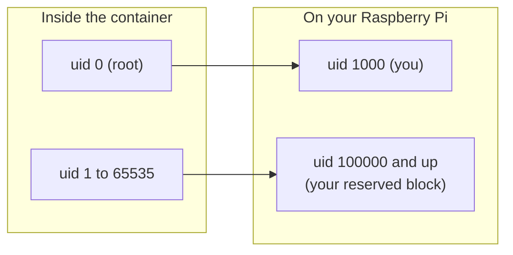

{:class="cover"}

---

By the end of this lesson you will be able to prove for yourself that Podman containers are ordinary processes owned by you, and name the main extras that Podman adds beyond Docker's commands.

Lesson 2 told you Podman is daemonless and rootless. Let's not take that on trust. We'll look at it from the outside.

## See it: your container is your process

Start a container that just sleeps, in the background:

```bash
podman run -d --name sleeper docker.io/library/alpine sleep 600
```

Now look at it from the host's point of view:

```bash
ps -o user,pid,cmd -C sleep
```

You will see the `sleep` command listed with **your** username, not `root`. That is the whole trick: a Podman container is a normal process owned by you.

Now look from the inside:

```bash
podman exec sleeper id
```

Inside, the user is `uid=0(root)`. Same process, two views. Linux **user namespaces** translate between them, and you can print the translation:

```bash
podman unshare cat /proc/self/uid_map
```

The first line says that user 0 inside maps to your real user ID outside, and the following lines map the rest of the container's user IDs onto the block reserved for you in `/etc/subuid`.



Clean up:

```bash
podman rm -f sleeper
```

## See it: no daemon

Run `podman ps` and then `ps aux | grep -i podman`. With nothing running, there is no Podman process waiting in the background. A busy Docker machine always has `dockerd` listed.

## Extras you will meet in this course

| Feature | What it gives you | Lesson |
| --- | --- | --- |
| Pods | Groups of containers sharing one network, like Kubernetes | 7 |
| `podman kube generate` and `podman kube play` | Export and run Kubernetes YAML | 9 |
| Quadlet | Describe a container as a systemd service in a small file | 10 |
| `podman unshare` | Open a shell inside your user namespace to fix file ownership | 11 |
{:class="table table-single"}

## The wider toolbox

Podman is one of a family of tools that all follow the OCI standards:

- **Buildah** builds images, with fine control and no daemon. `podman build` uses its code, so you rarely need to call it directly
- **Skopeo** inspects, copies and signs images without pulling them. For example `skopeo inspect docker://docker.io/library/alpine` shows an image's details from the registry
- **CRI-O** is a lightweight container runtime for Kubernetes clusters

> **Warning**: You may read older tutorials that say Podman generates systemd files with `podman generate systemd`. That command still works in many versions but is **deprecated**. Lesson 10 teaches Quadlet, which replaces it.

## Try it Yourself

1. Repeat the "see it" steps with a different command, such as `sleep 900`, and find it in `ps`
2. Start the `sleeper` container again, then run `podman top sleeper` to list the processes inside it. Remove it afterwards
3. Challenge: run `podman run --rm docker.io/library/alpine id` and compare it with your own `id` on the Pi. Explain the difference using the `uid_map` output

## Common Issues

- **Problem**: `podman unshare` or a rootless container complains about `newuidmap` or no mapping.
- **Solution**: Install the helpers with `sudo apt install -y uidmap` and check `/etc/subuid` has a line for your user.
- **Why**: User namespaces need the helpers and a reserved block of IDs to build the mapping.

- **Problem**: `skopeo: command not found`.
- **Solution**: Install it with `sudo apt install -y skopeo`.
- **Why**: Skopeo is a separate tool, not part of the `podman` package.

## Check your understanding


? Who owns a rootless container's process when you look from the host with `ps`?
- [ ] root
- [x] Your own user
- [ ] A user called podman
> The container is a normal Linux process started by you.

? What does `podman unshare cat /proc/self/uid_map` show?
- [ ] A list of running pods
- [x] How user IDs inside your containers map to user IDs on the host
- [ ] The container's IP address
> It prints the user namespace mapping that makes rootless containers work.

? Which tool inspects and copies images without pulling them?
- [ ] Buildah
- [ ] CRI-O
- [x] Skopeo
> Skopeo works with images in registries directly.

? What replaces the deprecated `podman generate systemd`?
- [x] Quadlet files
- [ ] A Docker daemon
- [ ] `podman machine`
> Lesson 10 teaches Quadlet, the current way to run containers under systemd.

