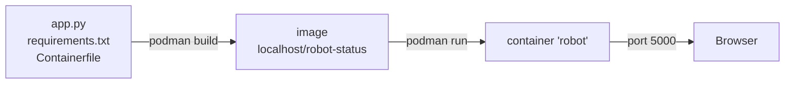

{:class="cover"}

---

By the end of this lesson you will be able to build your own image with Podman, run it, and use the everyday commands to inspect, debug and clean up containers, images and volumes.

Time to meet our project. We'll make a **robot status page**: a small Python web app that shows the robot's name, its CPU temperature and a visit counter. If you did the Docker course, this is the same app, and you can copy your old files across.

## Step 1: The app

```bash
mkdir -p ~/robot-status
cd ~/robot-status
nano app.py
```

Paste in the whole program, then save with `Ctrl+O`, `Enter`, `Ctrl+X`:

```python
import os
import platform
import socket
import time

from flask import Flask, jsonify

app = Flask(__name__)

ROBOT_NAME = os.environ.get("ROBOT_NAME", "Sparky")
REDIS_HOST = os.environ.get("REDIS_HOST")
STARTED = time.time()

# Visit counter: kept in memory by default, kept in Redis when REDIS_HOST is set
store = None
memory_count = 0
if REDIS_HOST:
    import redis
    store = redis.Redis(host=REDIS_HOST, port=6379, decode_responses=True)


def count_visit():
    global memory_count
    if store is not None:
        return int(store.incr("visits"))
    memory_count += 1
    return memory_count


def cpu_temp():
    """CPU temperature in Celsius, or None if this machine does not report it."""
    try:
        with open("/sys/class/thermal/thermal_zone0/temp") as f:
            return round(int(f.read().strip()) / 1000, 1)
    except (OSError, ValueError):
        return None


def status():
    return {
        "robot": ROBOT_NAME,
        "container": socket.gethostname(),
        "machine": platform.machine(),
        "uptime_seconds": int(time.time() - STARTED),
        "cpu_temp_c": cpu_temp(),
        "storage": "redis" if store is not None else "memory",
        "visits": count_visit(),
    }


@app.route("/")
def home():
    s = status()
    temp = "not available" if s["cpu_temp_c"] is None else f'{s["cpu_temp_c"]} C'
    return (
        f"<h1>{s['robot']} is online</h1>"
        f"<p>Container: {s['container']} ({s['machine']})</p>"
        f"<p>CPU temperature: {temp}</p>"
        f"<p>Visits: {s['visits']} (stored in {s['storage']})</p>"
    )


@app.route("/status")
def status_json():
    return jsonify(status())


if __name__ == "__main__":
    app.run(host="0.0.0.0", port=5000)
```

The app reads its settings from **environment variables**, so we can configure containers without touching the code. It listens on `0.0.0.0` so it can be reached from outside the container. The container usually cannot see the Pi's CPU temperature sensor, so it may say "not available", which is fine for now.

Create `requirements.txt` with two lines:

```text
flask
redis
```

## Step 2: The Containerfile

Podman's name for a Dockerfile is a **Containerfile**. The format is identical, and Podman reads a file called `Dockerfile` too, so your old files still work. Create `Containerfile`:

```dockerfile
FROM docker.io/library/python:3.12-slim
ENV PYTHONUNBUFFERED=1
WORKDIR /app
COPY requirements.txt .
RUN pip install --no-cache-dir -r requirements.txt
COPY app.py .
EXPOSE 5000
CMD ["python", "app.py"]
```

Notice the full image name on the `FROM` line, for the reason we met in lesson 4.

## Step 3: Build and run

```bash
podman build -t robot-status .
podman run -d --name robot -p 5000:5000 robot-status
```

Visit `http://localhost:5000` (or `http://<your-pi-address>:5000` from another computer). Podman stores the image as `localhost/robot-status:latest`, because it was built locally.



## Everyday management

These commands work on any container, using its name instead of an ID:

| Task | Command |
| --- | --- |
| List running / all containers | `podman ps` / `podman ps -a` |
| Read logs, follow live | `podman logs robot` / `podman logs -f robot` |
| See everything about it | `podman inspect robot` |
| Open a shell inside | `podman exec -it robot sh` |
| Copy a file in | `podman cp notes.txt robot:/tmp/` |
| Stop, start, restart | `podman stop robot` / `podman start robot` |
| Remove (stopped) container | `podman rm robot` |
| List and remove images | `podman images` / `podman rmi robot-status` |
{:class="table table-single"}

`podman inspect` prints a lot of JSON. Ask for a single value with `--format`:

```bash
podman inspect robot --format '{{.State.Status}}'
```

## Keeping data: volumes

A container's own storage disappears when you remove it. Named volumes outlive containers:

```bash
podman volume create robot-data
podman run --rm -v robot-data:/data docker.io/library/alpine sh -c "echo hello > /data/note.txt"
podman run --rm -v robot-data:/data docker.io/library/alpine cat /data/note.txt
```

The second container prints `hello`. In rootless mode the volume lives under `~/.local/share/containers/storage/volumes`.

## Cleaning up

```bash
podman rm -f robot
podman container prune
podman image prune
podman volume ls
```

`prune` commands ask you to confirm. Images and containers add up fast on a small SD card, so tidy as you go.

## Try it Yourself

1. Change `ROBOT_NAME` without editing the code: `podman run -d --name robot2 -p 5001:5000 -e ROBOT_NAME=Sparkles robot-status`, then refresh the page on port 5001
2. Use `podman logs -f robot` in one terminal while you refresh the page in your browser. What do you see?
3. Challenge: run `podman exec robot ls /app` and `podman diff robot`. What do they tell you about what is in the container?

## Common Issues

- **Problem**: `podman build` fails on `pip install` with a network error.
- **Solution**: Check the Pi is online, then run the build again.
- **Why**: Each build step that installs software needs to reach the internet.

- **Problem**: `Error: ... name "robot" is already in use`.
- **Solution**: Run `podman rm -f robot`, then start it again, or pick a different name.
- **Why**: Container names must be unique, and a stopped container still holds its name.

- **Problem**: The page does not load from another computer.
- **Solution**: Use the Pi's address, not `localhost`, and check the container is running with `podman ps`.
- **Why**: `localhost` always means the computer you are typing on.

> **Teachers**: Building an image downloads a Python base image of roughly 50 MB or more, and every learner has their own copy, so allow time and SD card space on a shared network. Remind learners to remove their containers and images at the end of a session, since rootless images are kept in each user's home folder and add up on shared Pis.

## Check your understanding


? What is a Containerfile?
- [ ] A list of containers that are running
- [x] Podman's name for a Dockerfile, the recipe for building an image
- [ ] A file that stores container logs
> It has the same format as a Dockerfile, and Podman reads either name.

? Which command builds an image called `robot-status` from the current folder?
- [ ] `podman run robot-status .`
- [x] `podman build -t robot-status .`
- [ ] `podman create robot-status`
> `build` makes the image, and `-t` gives it a name.

? Why does `podman rm robot` fail on a running container?
- [ ] Rootless Podman cannot delete containers
- [x] It has to be stopped first, or you use `-f`
- [ ] The container must be removed with `sudo`
> `podman rm -f` stops and removes it in one step.

? What survives when you remove a container that used a named volume?
- [ ] Nothing
- [x] The data in the volume
- [ ] Only the container's logs
> Named volumes are stored separately from containers, so they keep their data.

