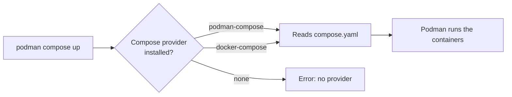

{:class="cover"}

---

By the end of this lesson you will be able to start a multi-container app from a Compose file with Podman, and explain what `podman compose` does and does not do for you.

If you used `docker compose` in the Docker course, you will want the same convenience here. Podman has no Compose engine of its own, but it works with Compose files in two ways.

## Two names, two tools

- **`podman-compose`** (with a hyphen) is a separate, community-written Python tool that reads a Compose file and runs the services with Podman
- **`podman compose`** (with a space, Podman 4.7 or newer) is a thin **wrapper**. It does not understand Compose files itself. It looks for a compose *provider* on your machine, such as `podman-compose` or Docker's Compose plugin, and hands the job to it

So `podman compose` needs a provider installed. Without one it prints an error about not finding a compose provider.



## Install a provider

On Raspberry Pi OS and Debian, `podman-compose` is in the package list:

```bash
sudo apt install -y podman-compose
podman-compose version
```

If your repository does not have it, `pip install podman-compose` from PyPI is the other route.

## The Compose file

Create `~/robot-status/compose.yaml`. It is the same file as in the Docker course, with the Redis image name written in full:

```yaml
services:
  web:
    build: .
    ports:
      - "5000:5000"
    environment:
      REDIS_HOST: redis
      ROBOT_NAME: Sparky
    depends_on:
      - redis

  redis:
    image: docker.io/library/redis:7-alpine
    command: redis-server --appendonly yes
    volumes:
      - redis-data:/data

volumes:
  redis-data:
```

Compose files no longer need a `version:` line at the top. Older examples that begin with a `version` line still work, but the line is ignored.

## Run it

From the folder with the file:

```bash
podman compose up -d --build
podman ps
```

Then open `http://localhost:5000`. Stop and remove everything with:

```bash
podman compose down
```

Use `podman-compose up -d --build` instead if you prefer calling the provider directly. The commands are the same.

## Check what was created

Compose behaviour varies between provider versions, so check rather than assume. Depending on your version, services may be placed in a pod or on a project network:

```bash
podman pod ps
podman network ls
podman volume ls
```

The `web` service reaches Redis by the name `redis`. That name lookup works on a user-defined network with the modern network backend. Check which one you have:

```bash
podman info --format '{{.Host.NetworkBackend}}'
```

`netavark` is the modern backend and does name lookup. If you see `cni` and the web app cannot find `redis`, either install `netavark` and `aardvark-dns` or use the pod method from lesson 7, where containers talk over `localhost`.

## Where Compose and Podman differ

| Docker Compose habit | With Podman |
| --- | --- |
| `docker compose up` | `podman compose up` (needs a provider) |
| Ports below 1024 | Not allowed rootless. Use 8080, 5000 and so on |
| Short image names like `redis` | Write the full name, `docker.io/library/redis` |
| Mounting `/var/run/docker.sock` | Not available. Podman has its own optional socket |
| Restart policies | A policy restarts a crashed container, but starting services at boot is systemd's job (lesson 10) |
{:class="table table-single"}

## Try it Yourself

1. Run `podman compose up -d` and refresh the page a few times. Stop it with `podman compose down` and start it again. Does the visit count survive?
2. Change `ROBOT_NAME` in `compose.yaml`, then run `podman compose up -d` again. What happened to the running web container?
3. Challenge: add a `ROBOT_COLOUR` environment variable to the file. Which part of `app.py` would you change to display it?

## Common Issues

- **Problem**: `podman compose` says it cannot find a compose provider.
- **Solution**: Install one with `sudo apt install -y podman-compose`.
- **Why**: `podman compose` is only a wrapper that calls another tool.

- **Problem**: An image such as `redis` cannot be pulled, or Podman prompts for a registry.
- **Solution**: Use the full name `docker.io/library/redis:7-alpine` in the file.
- **Why**: Podman does not guess registries, as we saw in lesson 4.

- **Problem**: The `web` service cannot resolve the name `redis`.
- **Solution**: Check `podman info --format '{{.Host.NetworkBackend}}'`. If it says `cni`, use the pod method from lesson 7.
- **Why**: Container-name lookup needs the `netavark` and `aardvark-dns` network stack.

> **Teachers**: Installing a Compose provider needs `sudo` once, so do it before the lesson. Compose files are plain text, which makes them easy to share, but they are also easy to break with a single indent error, so have learners check their files with a neighbour before running them.

## Check your understanding


? What is `podman compose` (with a space)?
- [ ] A complete Compose engine built into Podman
- [x] A wrapper that calls an installed compose provider
- [ ] A replacement for `podman build`
> It hands the work to a provider such as `podman-compose`.

? Why do we write `docker.io/library/redis:7-alpine` in the Compose file?
- [ ] Podman cannot pull images from Docker Hub
- [x] Podman does not assume a default registry
- [ ] Compose requires version tags
> Full names avoid prompts and errors.

? With no daemon, what is the recommended way to start containers at boot?
- [ ] A Compose restart policy alone
- [x] A systemd service, such as one described by a Quadlet file
- [ ] Running `podman machine start`
> systemd starts services at boot, and lesson 10 shows how to describe a container as one.

? Which network backend gives containers name lookup on a user-defined network?
- [ ] `cni` without any plugins
- [x] `netavark` with `aardvark-dns`
- [ ] `localhost`
> Name lookup comes from `aardvark-dns`, used with `netavark`.

