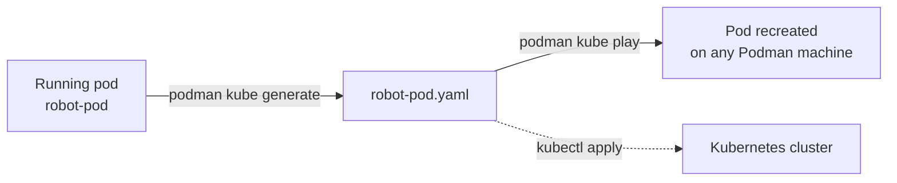

{:class="cover"}

---

By the end of this lesson you will be able to export a running pod as Kubernetes YAML, recreate it from that file, and say what Podman can and cannot do with Kubernetes files.

**Kubernetes** is a system for running containers across many machines. You describe what you want in YAML files and Kubernetes makes it happen. You do not need a cluster to learn the file format, because Podman can read and write it on a single Raspberry Pi.

## Why bother?

A YAML file is a written-down, shareable recipe for your pod. Instead of retyping `podman pod create` and `podman run` commands, you keep one file in version control and recreate the pod from it. If you ever move to Kubernetes, the same file is a head start.



## Generate the YAML

You need the `robot-pod` from lesson 7 running. Check with `podman pod ps`, and rebuild it if needed. Then:

```bash
podman kube generate robot-pod -f robot-pod.yaml
```

Open the file with `nano robot-pod.yaml`. You will see a `Pod` definition, with each of your containers listed with its image, environment variables and the published port. Exact contents vary between Podman versions, so yours will not match anyone else's line for line. The important shape looks like this (shortened):

```yaml
apiVersion: v1
kind: Pod
metadata:
  name: robot-pod
spec:
  containers:
    - name: robot-redis
      image: docker.io/library/redis:7-alpine
    - name: robot-web
      image: localhost/robot-status:latest
      env:
        - name: REDIS_HOST
          value: localhost
        - name: ROBOT_NAME
          value: Sparky
      ports:
        - containerPort: 5000
          hostPort: 5000
```
{: .no-snakie }

`containerPort` and `hostPort` come from the `-p 5000:5000` you gave the pod.

## Play the YAML

Remove the existing pod first, then recreate it from the file:

```bash
podman pod rm -f robot-pod
podman kube play robot-pod.yaml
podman pod ps
```

The pod is back, with the same containers. To tear down everything the file created:

```bash
podman kube play --down robot-pod.yaml
```

The older spellings `podman generate kube` and `podman play kube` still work in many versions, but `podman kube generate` and `podman kube play` are the current names.

## What Podman does and does not do

- `podman kube play` understands the basic Kubernetes objects such as a `Pod`, a `Deployment`, and a few more. It runs them on **one machine**
- It does not turn your Pi into a cluster. There is no scheduling across machines, no self-healing across nodes
- For real clusters you would use a tool like `kubectl` with a cluster such as k3s, which is a small Kubernetes distribution
- A `localhost/robot-status` image exists only on your Pi. For another machine you would push it to a registry first

## Try it Yourself

1. Generate the YAML, then edit `ROBOT_NAME` in the file to a new name and play it. Did the page change?
2. Add `-s` to the generate command (`podman kube generate -s robot-pod`) and see what extra object appears
3. Challenge: write down what you would have to change in the YAML before using it on a different machine that does not have your local image

## Common Issues

- **Problem**: `podman kube play` fails because the pod already exists.
- **Solution**: Remove the old pod with `podman pod rm -f robot-pod`, or run `podman kube play --replace robot-pod.yaml`.
- **Why**: Pod names must be unique, so a second pod with the same name is refused.

- **Problem**: `podman kube generate` reports that it cannot find the pod.
- **Solution**: Run `podman pod ps` to check the name, and create the pod first.
- **Why**: The command exports an existing pod, container or volume; it does not invent one.

- **Problem**: The generated file mentions an image that cannot be pulled on another machine.
- **Solution**: Push your image to a registry and change the `image:` line.
- **Why**: `localhost/...` means "built on this machine".

## Check your understanding


? Which command exports a pod as Kubernetes YAML?
- [ ] `podman pod save`
- [x] `podman kube generate`
- [ ] `podman build -k`
> `podman kube generate NAME -f file.yaml` writes the file.

? Which command recreates a pod from that YAML?
- [ ] `podman kube apply`
- [x] `podman kube play`
- [ ] `podman pod import`
> `play` creates the pod and containers from the file.

? Does `podman kube play` make a multi-machine Kubernetes cluster?
- [ ] Yes, automatically
- [x] No, it runs the objects on your one machine
- [ ] Yes, but only with sudo
> Podman runs the YAML locally. A cluster needs Kubernetes itself.

? How do you remove everything created by a YAML file?
- [ ] `podman kube clean`
- [x] `podman kube play --down file.yaml`
- [ ] `podman rm -a`
> `--down` removes what `play` created.

