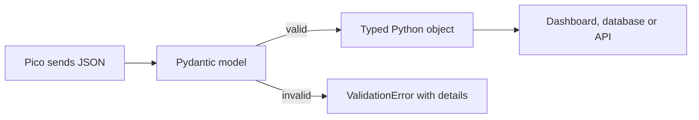

{:class="cover"}

---

Ahoy there makers! By the end of this lesson you will be able to explain what Pydantic does, and run a first model that accepts a good sensor message and rejects a bad one.

Picture a Raspberry Pi Pico in your greenhouse, sending a temperature reading to your laptop every few seconds. Most of the time the message is fine. Sometimes the battery sags, a wire wobbles and you get `"hot"` where a number should be, or a reading is missing entirely. If your code trusts every message, one bad reading crashes your dashboard at 3am. Pydantic is the library that stops that from happening.

---

## Overview

Pydantic checks that data has the shape you promised. You describe the data once, as a Python class with type hints, and Pydantic does the rest: it checks every field, converts values where it safely can (the string `"21.5"` becomes the float `21.5`), and gives you a clear error when it cannot.

This course teaches **Pydantic v2**, the current major version. We will build up from a single sensor reading to a small web API that validates robot data, and we will run every example for real.



## Course Content

- Installing Pydantic and writing your first model
- Basic models, types, defaults and conversion
- Constraints and custom validators
- Reusable custom types, enums and literals
- Nested and recursive models
- Using Pydantic models in a FastAPI web API
- Request validation, response models and a CRUD robot registry
- Best practices, settings from environment variables and performance
- A real-world pipeline for Pico sensor data

## Key Results

After completing this course, you will:

- Describe data with Pydantic models and validate it from dicts and JSON
- Read a `ValidationError` and report what was wrong and where
- Add constraints and custom checks with `Field`, `field_validator` and `model_validator`
- Model nested robot configurations and tree-shaped data
- Build a FastAPI endpoint where Pydantic validates the request and shapes the response
- Load robot settings from environment variables with `pydantic-settings`

## What you'll need

- A computer with Python 3.10 or newer (this course was tested on Python 3.13 with Pydantic 2.14)
- A text editor or an IDE such as Thonny or VS Code
- Comfort with Python basics: functions, classes and dictionaries. If you need a refresher, try [Python for beginners](/learn/python/)
- No robot is required. If you have a Pico, you can feed real readings into the examples
- For lessons 7 to 9: the `fastapi` package. The [FastAPI course](/learn/fastapi/) goes deeper if you want it

## How the course works

Every lesson teaches one idea, shows a complete program you can copy and run, and ends with exercises and a short quiz. Code blocks are real programs, and the output shown underneath each one was copied from an actual run, so if yours differs, something is worth investigating.

This is computer-side Python, not MicroPython. Pydantic is too big to run on a Pico, so the Pico sends data and your laptop, Raspberry Pi or server validates it.

You will meet older tutorials that use the Pydantic v1 names. Here is the translation, once, so you can read them:

| Pydantic v1 (old) | Pydantic v2 (this course) |
| --- | --- |
| `Model.parse_obj(data)` | `Model.model_validate(data)` |
| `Model.parse_raw(text)` | `Model.model_validate_json(text)` |
| `model.dict()` | `model.model_dump()` |
| `model.json()` | `model.model_dump_json()` |
| `@validator("field")` | `@field_validator("field")` with `@classmethod` |
| `@root_validator` | `@model_validator` |
| `class Config:` inside the model | `model_config = ConfigDict(...)` |
{:class="table table-single"}

> **Teachers**: This course suits students who already write Python classes, around age 14 and up. Each lesson takes 30 to 45 minutes. Each learner needs only a computer with Python and internet access to install packages. Lessons 1 to 6 and 10 to 12 need no hardware at all. If school machines block `pip`, ask your IT team to allow a virtual environment or use a shared one prepared in advance.

---

## A first model

Let's build the greenhouse example. Save this as `first_model.py`:

```python
from pydantic import BaseModel, ValidationError


class Reading(BaseModel):
    sensor: str
    temperature_c: float
    battery_mv: int


good = '{"sensor": "pico-greenhouse", "temperature_c": 21.5, "battery_mv": 3920}'
bad = '{"sensor": "pico-greenhouse", "temperature_c": "hot", "battery_mv": 3920}'

reading = Reading.model_validate_json(good)
print(reading)
print(reading.temperature_c + 1)

try:
    Reading.model_validate_json(bad)
except ValidationError as err:
    print(err)
```

Running it prints:

```
sensor='pico-greenhouse' temperature_c=21.5 battery_mv=3920
22.5
1 validation error for Reading
temperature_c
  Input should be a valid number, unable to parse string as a number [type=float_parsing, input_value='hot', input_type=str]
    For further information visit https://errors.pydantic.dev/2.14/v/float_parsing
```

**What it does:** the class lists three fields and their types. `model_validate_json` reads the JSON text, checks it against those types and hands you a proper object. Because `temperature_c` is now a real `float`, `reading.temperature_c + 1` works.

**Why this matters:** the error names the field (`temperature_c`), the problem and the bad value (`'hot'`). That is exactly what you need to fix a sensor, and you wrote no checking code at all.

**Common mistakes:**

- Treating the JSON as a plain dictionary and forgetting to check it. Validate at the edge, where data comes in.
- Expecting Pydantic to run on the Pico. It does not: use it on the computer that receives the data.

---

## Try it Yourself

1. Add a `humidity: int` field to `Reading`, then run the good message again. What error do you get, and why?
2. Change `battery_mv` in the good message to the string `"3920"`. Does it still pass? Print `type(reading.battery_mv)`.
3. Challenge: send `"temperature_c": null`. Which error type does Pydantic report?

## Common Issues

- **Problem**: `ModuleNotFoundError: No module named 'pydantic'`.
- **Solution**: Install it into the Python you are running: `python3 -m pip install pydantic`.
- **Why**: Each Python install and virtual environment has its own packages, so a package installed elsewhere is invisible here. Lesson 2 shows how to set this up properly.

- **Problem**: `AttributeError: type object 'Reading' has no attribute 'parse_raw'` or a warning about deprecated methods.
- **Solution**: Use the v2 names from the table above, such as `model_validate_json`.
- **Why**: The v1 names are deprecated in v2, and old tutorials still use them.

## Check your understanding


? What does Pydantic use to decide what a valid value looks like?
- [ ] A separate JSON schema file you must write by hand
- [x] The type hints on the fields of a model class
- [ ] Runtime sensors on the robot
> You describe the data once as a class with type hints, and Pydantic validates against it.

? What happens when you validate `"temperature_c": "hot"` against a `float` field?
- [ ] It is silently converted to 0.0
- [x] A ValidationError is raised that names the field and the bad value
- [ ] The program exits without a message
> The error names the field, explains the problem and shows the input value.

? Where should Pydantic run in a Pico sensor project?
- [ ] On the Pico itself
- [x] On the computer, Raspberry Pi or server that receives the data
- [ ] Inside the temperature sensor
> Pydantic is a full CPython library, so it validates data after the Pico has sent it.

? Which v2 method replaces the v1 `parse_obj`?
- [ ] `model_dump`
- [x] `model_validate`
- [ ] `model_copy`
> `parse_obj` became `model_validate` in v2, and `dict()` became `model_dump()`.

