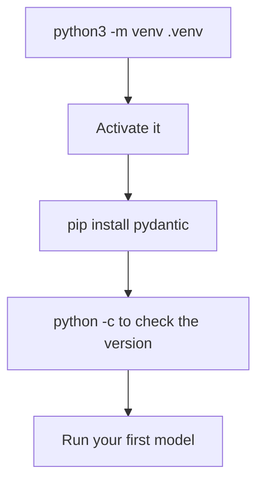

{:class="cover"}

---

By the end of this lesson you will be able to create a virtual environment, install Pydantic v2 into it and confirm which version you have.

Let's get the workbench ready. Nothing is more annoying than a library that is installed "somewhere" but not where your script is looking, so we will do this the tidy way: one virtual environment for the course.

## Why a virtual environment?

A virtual environment is a private folder of packages for one project. Install Pydantic in it and it will not clash with anything else on your computer. This matters a lot here, because many other libraries pin a particular Pydantic version, and Pydantic v1 and v2 are not compatible.



## Step 1: create and activate

Make a folder for the course, then run these in a terminal inside it.

On Linux and macOS:

```bash
python3 -m venv .venv
source .venv/bin/activate
```

On Windows (PowerShell):

```bash
python -m venv .venv
.venv\Scripts\Activate.ps1
```

When it is active, your prompt starts with `(.venv)`. To leave it later, type `deactivate`.

## Step 2: install Pydantic

```bash
python -m pip install pydantic
```

We use `python -m pip` rather than plain `pip` so that the install is guaranteed to go into the Python you are running. For the web lessons later, install the extras too:

```bash
python -m pip install pydantic-settings email-validator fastapi httpx
```

`pydantic-settings` loads settings from environment variables (lesson 10), `email-validator` powers the `EmailStr` type, and `fastapi` and `httpx` are for lessons 7 to 9.

## Step 3: check it works

Save this as `check_install.py` and run it:

```python
import pydantic
from pydantic import BaseModel

print(pydantic.VERSION)


class Servo(BaseModel):
    name: str
    angle: int = 90


s = Servo(name="pan")
print(s)
print(s.model_dump())
```

The output on the machine used to write this course:

```
2.14.4
name='pan' angle=90
{'name': 'pan', 'angle': 90}
```

Your version number may be newer, and that is fine as long as it starts with `2.`. If it starts with `1.`, you have the old version and the examples will not work as shown.

**What it does:** `pydantic.VERSION` tells you what is installed. The `Servo` model has a required `name` and an `angle` that defaults to 90, so `Servo(name="pan")` is valid. `model_dump()` turns the object back into a plain dictionary.

**Why this matters:** you will pass these dictionaries to JSON, databases and web responses. Getting the round trip working on day one saves headaches later.

**Common mistakes:**

- Installing with `pip` but running with a different `python`. Use `python -m pip`.
- Forgetting to activate the environment in a new terminal window.

> **Teachers**: School computers often block package installs or have no internet. Prepare one shared virtual environment in advance, or have learners run `python -m pip install --user pydantic` if allowed. Check this before the lesson, because a blocked install can take up the whole session.

## Try it Yourself

1. Add a second field `speed: float = 1.0` to `Servo` and print the new `model_dump()`.
2. Make a second virtual environment called `.venv-old`, install `pydantic<2`, and print its version. Then delete it. What does that show about why environments matter?
3. Challenge: print `Servo.model_fields.keys()` to list the field names.

## Common Issues

- **Problem**: `source: .venv/bin/activate: No such file or directory`.
- **Solution**: Run `python3 -m venv .venv` first, from the folder you are in, then activate it.
- **Why**: The activate script only exists after the environment has been created, in the folder where you created it.

- **Problem**: PowerShell says running scripts is disabled when you activate.
- **Solution**: Run `Set-ExecutionPolicy -Scope CurrentUser RemoteSigned`, or use the Command Prompt and `.venv\Scripts\activate.bat`.
- **Why**: Windows blocks unsigned scripts by default, and the activate script counts as one.

- **Problem**: `python3 -m venv` fails on Debian or Raspberry Pi OS saying `ensurepip` is not available.
- **Solution**: Install the venv package with `sudo apt install python3-venv`, then try again.
- **Why**: Debian splits the venv tooling out of the base Python package.

## Check your understanding


? Why do we use `python -m pip install` instead of plain `pip`?
- [ ] It is faster
- [x] It installs into the same Python that you run your scripts with
- [ ] It installs the v1 version of Pydantic
> Plain `pip` can belong to a different Python install, so the package ends up where your script cannot see it.

? How can you tell which version of Pydantic is installed?
- [ ] Look at the name of the virtual environment folder
- [x] Print `pydantic.VERSION`
- [ ] Count the fields in your model
> `pydantic.VERSION` returns a string such as 2.14.4.

? What does a version starting with `1.` mean for this course?
- [ ] Everything works as shown
- [x] You have Pydantic v1, and the v2 examples will not work
- [ ] You have a newer version than the course
> v1 and v2 have different method names, so upgrade with `python -m pip install -U pydantic`.

