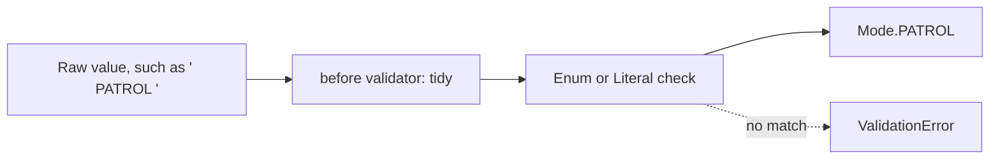

{:class="cover"}

---

By the end of this lesson you will be able to build a reusable validated type with `Annotated`, and limit a field to a fixed set of choices with `Enum` or `Literal`.

Your robots will have battery percentages, MAC addresses and modes in lots of places. Writing the same rules again and again is how typos creep in. Let's define each rule once and reuse it everywhere.

## Reusable types with Annotated

`typing.Annotated` lets you attach rules to a type and give the result a name. Two helpers do the work:

- `Field(...)` inside `Annotated` carries constraints like `ge` and `le`
- `AfterValidator(function)` runs your function after the normal checks

Here is a robot status with a percentage, a MAC address, a mode and a unit system:

```python
from enum import Enum
from typing import Annotated, Literal

from pydantic import (
    AfterValidator,
    BaseModel,
    Field,
    ValidationError,
    field_validator,
)


def check_mac(value: str) -> str:
    parts = value.lower().replace("-", ":").split(":")
    if len(parts) != 6 or not all(len(p) == 2 for p in parts):
        raise ValueError("expected six pairs of hex digits, like aa:bb:cc:dd:ee:ff")
    int("".join(parts), 16)  # raises ValueError if any digit is not hex
    return ":".join(parts)


MacAddress = Annotated[str, AfterValidator(check_mac)]
Percent = Annotated[int, Field(ge=0, le=100)]


class Mode(str, Enum):
    IDLE = "idle"
    PATROL = "patrol"
    CHARGE = "charge"


class RobotStatus(BaseModel):
    mac: MacAddress
    battery: Percent
    mode: Mode = Mode.IDLE
    units: Literal["metric", "imperial"] = "metric"

    @field_validator("mode", mode="before")
    @classmethod
    def mode_any_case(cls, value):
        if isinstance(value, str):
            return value.strip().lower()
        return value


status = RobotStatus(mac="AA-BB-CC-DD-EE-01", battery=87, mode=" PATROL ")
print(status)
print(status.mode, status.mode.value)
print(status.model_dump())

try:
    RobotStatus(mac="AA:BB:CC", battery=120, mode="flying", units="furlongs")
except ValidationError as err:
    for e in err.errors():
        print(e["loc"], "->", e["msg"])
```

Output:

```
mac='aa:bb:cc:dd:ee:01' battery=87 mode=<Mode.PATROL: 'patrol'> units='metric'
Mode.PATROL patrol
{'mac': 'aa:bb:cc:dd:ee:01', 'battery': 87, 'mode': <Mode.PATROL: 'patrol'>, 'units': 'metric'}
('mac',) -> Value error, expected six pairs of hex digits, like aa:bb:cc:dd:ee:ff
('battery',) -> Input should be less than or equal to 100
('mode',) -> Input should be 'idle', 'patrol' or 'charge'
('units',) -> Input should be 'metric' or 'imperial'
```



## What each piece does

**`MacAddress` and `Percent`:** these are ordinary names you can now use on any field in any model. Change the rule in one place and every model updates.

**`Enum`:** the `mode` field accepts only the three values, and gives you a real `Mode.PATROL` object, so your code can compare `status.mode is Mode.PATROL` instead of comparing strings. Our `before` validator tidied up `" PATROL "` first, which is how you accept messy input safely.

**`Literal`:** use it for a small fixed set where you do not need an Enum class. It is perfect for things like units.

**A note on `model_dump()`:** it keeps the Enum object. If you want plain text for JSON, `model_dump(mode="json")` or `model_dump_json()` produces `"patrol"`.

**Why this matters:** a mistyped mode such as `"patroll"` is caught at the door, and not found three hours later when the robot refuses to move.

**Common mistakes:**

- Writing validators with side effects, such as printing or changing global state. Keep them as simple functions that take a value and return a value.
- Forgetting that `Literal` values are case-sensitive.

## Try it Yourself

1. Create a `Celsius` type that only allows values from -40 to 125 and use it in a model.
2. Add a fourth mode, `"sleep"`, and confirm that it is accepted.
3. Print `status.model_dump(mode="json")` and compare it with `model_dump()`.
4. Challenge: write a `HexColour` type that accepts `"#ff8800"` and rejects `"orange"`, using a regular expression in `Field(pattern=...)`.

## Common Issues

- **Problem**: `ValidationError: Input should be 'idle', 'patrol' or 'charge'` for a value that looks right.
- **Solution**: Print `repr(value)` and look for spaces or capital letters.
- **Why**: Enum and Literal matching is exact, so tidy input first with a `mode="before"` validator.

- **Problem**: The JSON output has `<Mode.PATROL: 'patrol'>` in it.
- **Solution**: Use `model_dump_json()` or `model_dump(mode="json")`.
- **Why**: Plain `model_dump()` returns Python objects, and only the JSON modes produce JSON-safe values.

## Check your understanding


? What is the advantage of `Percent = Annotated[int, Field(ge=0, le=100)]`?
- [ ] It makes the code run faster
- [x] The rule is defined once and reused on any field
- [ ] It converts the value to a string
> A named Annotated type avoids repeating constraints across models.

? When should you reach for `Literal` instead of `Enum`?
- [x] For a small fixed set of values where you do not need a class
- [ ] When you need to store a float
- [ ] When the values come from a database
> `Literal["metric", "imperial"]` is shorter, and Enum gives you named members to compare.

? What does `mode="before"` on a field validator mean?
- [ ] It runs after the model is created
- [x] It runs before Pydantic's own conversion, so you can tidy messy input
- [ ] It runs only on defaults
> A before validator sees the raw input, such as " PATROL ", ahead of the Enum check.

