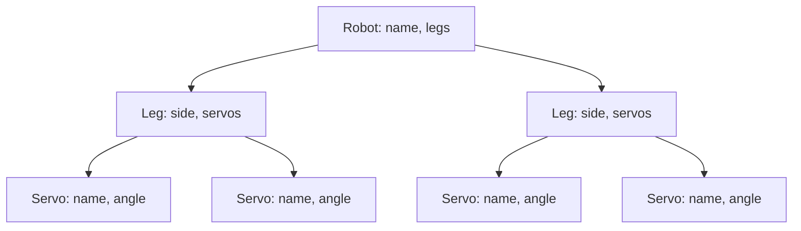

{:class="cover"}

---

By the end of this lesson you will be able to nest models inside each other, read the path to an error deep in the data, and build a model that contains itself.

Real robot configs are never flat. A hexapod has legs, each leg has servos, and each servo has an angle. Let's model that, and then go one step further with data that has no fixed depth, like a parts tree.

## Nested models

Use one model as the type of a field in another. Pydantic validates the whole structure, all the way down.



## Recursive models

A recursive model refers to itself, such as `Part` containing a list of `Part`. Inside the class body the name `Part` does not exist yet, so write it as a string: `list["Part"]`. Pydantic resolves the name for you.

Here is both ideas together:

```python
from pydantic import BaseModel, Field, ValidationError


class Servo(BaseModel):
    name: str
    angle: int = Field(default=90, ge=0, le=180)


class Leg(BaseModel):
    side: str
    servos: list[Servo]


class Robot(BaseModel):
    name: str
    legs: list[Leg] = []


class Part(BaseModel):
    name: str
    children: list["Part"] = []


def count_parts(part: Part) -> int:
    return 1 + sum(count_parts(child) for child in part.children)


config = {
    "name": "Hexa",
    "legs": [
        {"side": "left", "servos": [{"name": "hip"}, {"name": "knee", "angle": 45}]},
        {"side": "right", "servos": [{"name": "hip"}, {"name": "knee", "angle": 135}]},
    ],
}
robot = Robot.model_validate(config)
print(robot.legs[1].servos[1])
print(robot.model_dump()["legs"][0])

try:
    Robot.model_validate(
        {"name": "Hexa", "legs": [{"side": "left", "servos": [{"name": "hip", "angle": 999}]}]}
    )
except ValidationError as err:
    print(err.errors()[0]["loc"])
    print(err.errors()[0]["msg"])

tree = Part.model_validate(
    {
        "name": "robot",
        "children": [
            {"name": "head", "children": [{"name": "camera"}, {"name": "mic"}]},
            {"name": "base", "children": [{"name": "motor"}, {"name": "motor"}]},
        ],
    }
)
print(count_parts(tree))
```

Output:

```
name='knee' angle=135
{'side': 'left', 'servos': [{'name': 'hip', 'angle': 90}, {'name': 'knee', 'angle': 45}]}
('legs', 0, 'servos', 0, 'angle')
Input should be less than or equal to 180
7
```

## What to notice

**The error path.** `('legs', 0, 'servos', 0, 'angle')` reads as "in the first leg, in the first servo, the angle field". Strings are field names and numbers are list positions. That path makes errors in a big config file easy to locate.

**Nested dicts become objects.** `robot.legs[1].servos[1]` is a real `Servo`, so you get attribute access and your editor's autocompletion all the way down.

**Defaults flow through.** The hip servos had no `angle`, so they got the default of 90.

**The recursive part.** `count_parts` is a normal recursive function. The whole tree (7 parts: robot, head, camera, mic, base and two motors) was validated in one call, no matter how deep it goes.

**Why this matters:** robot config files, scene graphs, menu structures and file trees are all nested. One model validates every level.

**Common mistakes:**

- Writing `list[Part]` without quotes inside the `Part` class. older Pythons (before 3.14) raise a `NameError` because the class is not finished yet, so quote it.
- Making a model contain itself with no way to stop. Real data needs an empty `children` list at the leaves, which our default of `[]` provides.

## Try it Yourself

1. Add a `max_depth(part)` function that returns how deep the tree goes.
2. Give `Leg` a `servos` list that must have at least 2 items using `Field(min_length=2)`.
3. Dump the robot to JSON with `robot.model_dump_json(indent=2)` and read the structure.
4. Challenge: add a `parent` link and think about why a model that refers back to its own parent cannot be built from plain JSON.

## Common Issues

- **Problem**: `NameError: name 'Part' is not defined` when a model contains itself (on Python before 3.14).
- **Solution**: Quote the name in the annotation: `children: list["Part"] = []`.
- **Why**: The class name does not exist yet while the class body is running. If Pydantic ever reports a class as "not fully defined", calling `Part.model_rebuild()` after all the classes exist finishes the job.

- **Problem**: A long error path is hard to read.
- **Solution**: Loop over `err.errors()` and print `".".join(str(p) for p in e["loc"])`.
- **Why**: The `loc` tuple mixes strings and integers, so join them into one readable path.

## Check your understanding


? What does the error location `('legs', 0, 'servos', 0, 'angle')` tell you?
- [ ] The robot has zero legs
- [x] The angle of the first servo of the first leg was invalid
- [ ] The angle was a string
> Strings are field names and integers are positions in a list.

? How do you refer to a model from inside its own class body?
- [ ] Write the name without quotes
- [x] Write the name as a string, such as `list["Part"]`
- [ ] It is not allowed
> The class does not exist yet while its body runs, so the name is quoted and Pydantic resolves it later.

? What happens to missing nested fields that have defaults?
- [x] They are filled in with the defaults
- [ ] They cause an error
- [ ] They are set to None
> The hip servos had no angle, so they received the default of 90.

