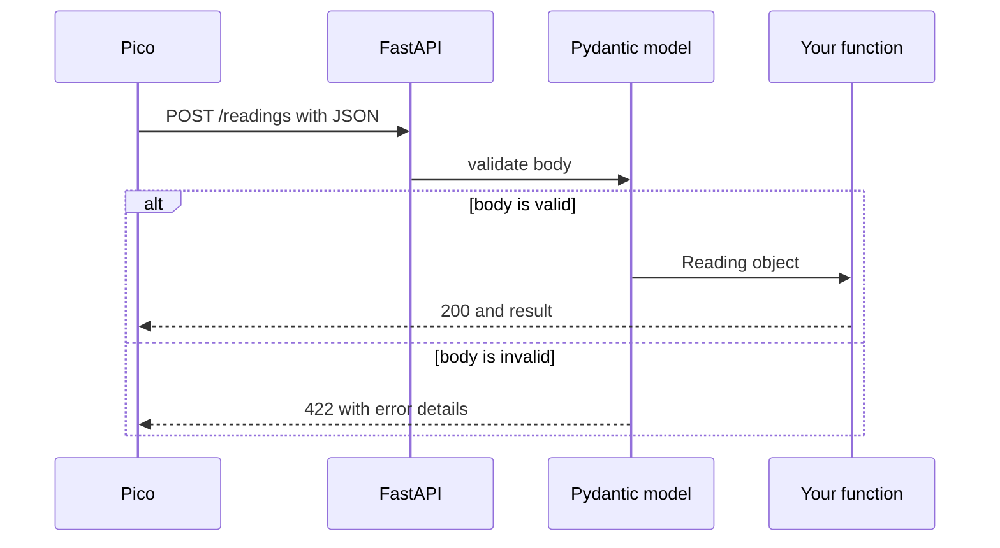

{:class="cover"}

---

By the end of this lesson you will be able to write a FastAPI endpoint that uses a Pydantic model to validate a JSON request body, and test it without starting a server.

Your Pico can send readings over Wi-Fi with an HTTP POST. Something has to receive them, check them and refuse nonsense. FastAPI is a web framework built on Pydantic, so the model you already know becomes the gatekeeper of your API.



## The app

Install the packages from lesson 2 (`fastapi`, plus `httpx` for testing). Save this as `app07.py`:

```python
from fastapi import FastAPI
from pydantic import BaseModel, Field

app = FastAPI(title="Robot Telemetry")


class Reading(BaseModel):
    sensor: str = Field(min_length=1)
    temperature_c: float = Field(ge=-40, le=125)
    battery_mv: int = Field(ge=0, le=5000)


@app.post("/readings")
def add_reading(reading: Reading):
    return {"received": reading.sensor, "temperature_f": reading.temperature_c * 9 / 5 + 32}
```

That is the whole API. Because the function parameter `reading` is typed as a Pydantic model, FastAPI reads the JSON body, validates it, and only calls your function when it is valid. Inside the function you get a real `Reading`, not a dict.

## Trying it without a server

FastAPI ships a `TestClient`, so you can call your app from a script. Save this as `try_app07.py` next to the app:

```python
from fastapi.testclient import TestClient

from app07 import app

client = TestClient(app)

ok = client.post(
    "/readings",
    json={"sensor": "pico-1", "temperature_c": 21.5, "battery_mv": 3920},
)
print(ok.status_code, ok.json())

bad = client.post(
    "/readings",
    json={"sensor": "pico-1", "temperature_c": 999, "battery_mv": "low"},
)
print(bad.status_code)
print(bad.json())
```

Output (you may also see a deprecation warning about `httpx` from the test client; it does no harm):

```
200 {'received': 'pico-1', 'temperature_f': 70.7}
422
{'detail': [{'type': 'less_than_equal', 'loc': ['body', 'temperature_c'], 'msg': 'Input should be less than or equal to 125', 'input': 999, 'ctx': {'le': 125.0}}, {'type': 'int_parsing', 'loc': ['body', 'battery_mv'], 'msg': 'Input should be a valid integer, unable to parse string as an integer', 'input': 'low'}]}
```

To run it as a real server, install `uvicorn` and run `uvicorn app07:app --reload`, then visit `http://127.0.0.1:8000/docs` for an automatic interactive page generated from your model.

## What to notice

**What it does:** the bad request never reached your function. FastAPI answered with status 422 (unprocessable) and a list of every problem, with `loc` showing that the faults were in the `body`. These are the same errors you met in lesson 3, packaged as JSON.

**Why this matters:** your handler can assume its data is sound. No `if "temperature_c" not in data` checks, no `try`/`except` around `float()`. The Pico gets an error it can log, and your server stays up.

**Common mistakes:**

- Declaring the parameter as `dict`. You lose all validation, so use the model.
- Using `reading.dict()` from an old tutorial. Use `reading.model_dump()`.

> **Teachers**: A running server listens on a network port, and school networks and firewalls often block other machines from reaching it. Run the server and the test client on the same computer, or use `TestClient` as shown, which needs no network at all. Never expose a learner's test server to the internet.

## Try it Yourself

1. Add a `location: str = "unknown"` field and send a request without it.
2. Add `status_code=201` to the `@app.post` decorator and check the code in the test.
3. Print `Reading.model_json_schema()` and compare it with what appears at `/docs` when you run the server.
4. Challenge: add a `@app.get("/health")` endpoint that returns `{"ok": True}` and test it.

## Common Issues

- **Problem**: `ModuleNotFoundError: No module named 'httpx'` when using `TestClient`.
- **Solution**: Run `python -m pip install httpx`.
- **Why**: The test client sends requests with httpx, which is not installed by default.

- **Problem**: The endpoint returns 422 even though your JSON looks right.
- **Solution**: Read the `loc` and `msg` in the response, and check you sent JSON (`json=...`) and not form data (`data=...`).
- **Why**: A form-encoded body is not a JSON body, so the model finds nothing to validate.

- **Problem**: `uvicorn: command not found`.
- **Solution**: Install it with `python -m pip install uvicorn` into the active environment, or run `python -m uvicorn app07:app`.
- **Why**: Tools install into the environment, and a different or inactive one will not have it.

## Check your understanding


? How does FastAPI know to validate the request body?
- [ ] You call `validate()` yourself
- [x] The function parameter is typed as a Pydantic model
- [ ] It guesses from the URL
> A parameter annotated with a BaseModel subclass is read from the JSON body and validated.

? What status code does FastAPI return for a body that fails validation?
- [ ] 200
- [ ] 404
- [x] 422
> 422 means the request was well formed but the data could not be processed.

? Why is `TestClient` useful?
- [x] You can test your API from a script without starting a server
- [ ] It makes your API faster
- [ ] It replaces Pydantic
> The test client calls the app directly, so tests need no network.

