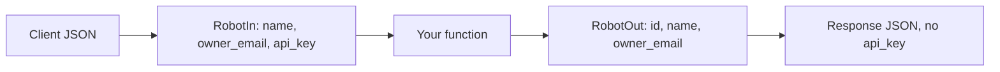

{:class="cover"}

---

By the end of this lesson you will be able to use one model for what comes in and another for what goes out, and validate query parameters with limits.

Validation protects you from bad data coming in. Serialization controls what goes back out. When you register a robot with an API key, you want the key accepted but never echoed back in a response. Two small models make that easy.



## Input model, output model

Save this as `app08.py`:

```python
from fastapi import FastAPI, Query
from pydantic import BaseModel, Field

app = FastAPI(title="Robot Accounts")


class RobotIn(BaseModel):
    name: str = Field(min_length=2)
    owner_email: str
    api_key: str = Field(min_length=8)


class RobotOut(BaseModel):
    id: int
    name: str
    owner_email: str


@app.post("/robots", response_model=RobotOut, status_code=201)
def register(robot: RobotIn):
    # api_key is accepted but never sent back, because RobotOut has no such field
    return {"id": 1, **robot.model_dump()}


@app.get("/log")
def read_log(limit: int = Query(default=10, ge=1, le=100), level: str = "info"):
    return {"limit": limit, "level": level}
```

And try it from `try_app08.py`:

```python
import warnings

warnings.filterwarnings("ignore")

from fastapi.testclient import TestClient

from app08 import app

client = TestClient(app)

r = client.post(
    "/robots",
    json={"name": "Hexa", "owner_email": "kev@example.com", "api_key": "s3cretkey!"},
)
print(r.status_code, r.json())

print(client.get("/log").json())
print(client.get("/log", params={"limit": 500}).json())
```

Output:

```
201 {'id': 1, 'name': 'Hexa', 'owner_email': 'kev@example.com'}
{'limit': 10, 'level': 'info'}
{'detail': [{'type': 'less_than_equal', 'loc': ['query', 'limit'], 'msg': 'Input should be less than or equal to 100', 'input': '500', 'ctx': {'le': 100}}]}
```

## What happened

**`response_model=RobotOut`** tells FastAPI to validate and filter what your function returns. Our function returned a dictionary containing `api_key`, but the response did not, because `RobotOut` has no such field. This is a safety net: even if you forget and return too much, secrets do not leak.

**Query parameters.** Plain function parameters that are not part of a path become query parameters (`/log?limit=20`). `Query(default=10, ge=1, le=100)` adds the same constraints you used in `Field`. The string `"500"` was converted to the integer 500 and then rejected, with `loc` saying `query` instead of `body`.

**Serialization.** FastAPI turns your return value into JSON through Pydantic. You can shape the output further: `model_dump(exclude_none=True)` in your own code, or the decorator option `response_model_exclude_none=True` to drop empty fields.

**Why this matters:** one model per job (`RobotIn`, `RobotOut`) is the cleanest way to avoid leaking passwords, tokens or internal ids.

**Common mistakes:**

- Returning the same model you received. It is tempting, and it is how API keys end up in logs and responses.
- Forgetting that query values arrive as text. Pydantic converts them, but only if you declare the type.

## Try it Yourself

1. Add a `created: str` field to `RobotOut` that your function does not return. What does FastAPI do?
2. Add `level: str = Query(default="info", pattern="^(debug|info|warn)$")` and request `level=loud`.
3. Add `response_model_exclude_none=True` to a route whose output model has an optional field.
4. Challenge: use `EmailStr` from Pydantic (needs the `email-validator` package) for `owner_email` and test a bad address.

## Common Issues

- **Problem**: `ResponseValidationError` and a 500 error from your own endpoint.
- **Solution**: Make your function return every field that the output model requires.
- **Why**: FastAPI validates the response against `response_model`, and a missing required field is a bug in your server, so it is a 500 and not a 422.

- **Problem**: A secret shows up in the response.
- **Solution**: Check the route has `response_model=` set to a model without that field.
- **Why**: Without a response model, FastAPI sends back exactly what you return.

- **Problem**: A query limit of `500` is accepted.
- **Solution**: Add `ge` and `le` to `Query(...)`.
- **Why**: Constraints are opt-in, and a bare `int` allows any whole number.

## Check your understanding


? Why use a separate `RobotOut` model?
- [ ] It makes validation faster
- [x] It controls which fields leave the API, so secrets stay in
- [ ] FastAPI requires exactly two models
> The response model filters what is returned, so fields like `api_key` are left out.

? Where does `loc` point for an invalid query parameter?
- [ ] `body`
- [x] `query`
- [ ] `header`
> The error `loc` starts with `query`, then the parameter name.

? What does `Query(default=10, ge=1, le=100)` do?
- [x] Defaults to 10 and rejects values below 1 or above 100
- [ ] Always returns 10
- [ ] Converts the value to a string
> It combines a default with the same constraints you use in Field.

