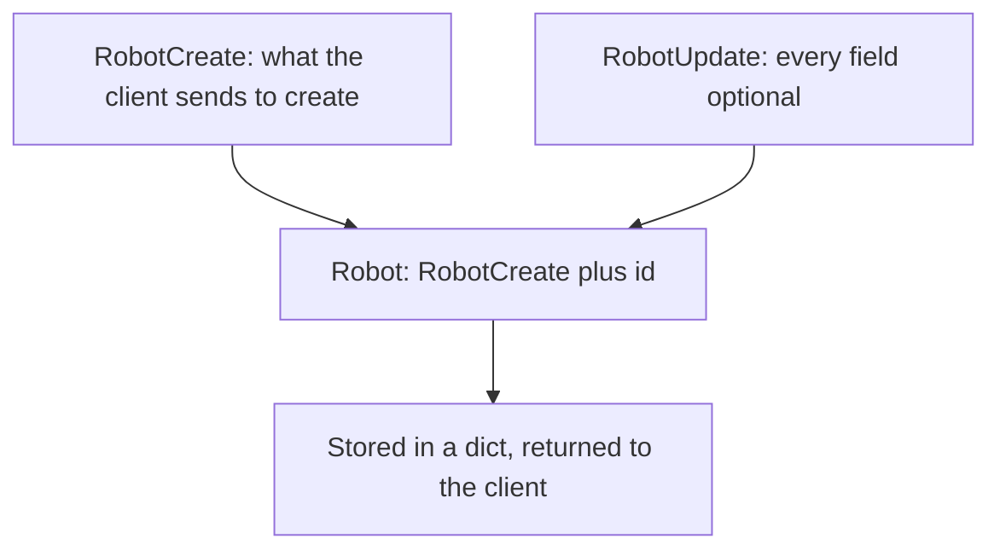

{:class="cover"}

---

By the end of this lesson you will be able to build a complete create, read, update and delete (CRUD) API around Pydantic models, including partial updates with PATCH.

Let's build a small registry of robots, the kind you might keep for a robot club. Each robot has a name, a kind and a battery level. We will keep the data in memory to stay focused on Pydantic, and then talk about real databases at the end.

## One entity, three models



- `RobotCreate` has the rules for new robots.
- `RobotUpdate` makes every field optional, so a client can change just the battery.
- `Robot` extends `RobotCreate` with a server-assigned `id`.

## The code

Save this as `app09.py`:

```python
from fastapi import FastAPI, HTTPException
from pydantic import BaseModel, Field

app = FastAPI(title="Robot Registry")


class RobotCreate(BaseModel):
    name: str = Field(min_length=2, max_length=30)
    kind: str = "rover"
    battery: int = Field(default=100, ge=0, le=100)


class RobotUpdate(BaseModel):
    name: str | None = Field(default=None, min_length=2, max_length=30)
    kind: str | None = None
    battery: int | None = Field(default=None, ge=0, le=100)


class Robot(RobotCreate):
    id: int


robots: dict[int, Robot] = {}
next_id = 1


@app.post("/robots", response_model=Robot, status_code=201)
def create_robot(data: RobotCreate):
    global next_id
    robot = Robot(id=next_id, **data.model_dump())
    robots[robot.id] = robot
    next_id += 1
    return robot


@app.get("/robots", response_model=list[Robot])
def list_robots():
    return list(robots.values())


@app.get("/robots/{robot_id}", response_model=Robot)
def get_robot(robot_id: int):
    if robot_id not in robots:
        raise HTTPException(status_code=404, detail="Robot not found")
    return robots[robot_id]


@app.patch("/robots/{robot_id}", response_model=Robot)
def update_robot(robot_id: int, changes: RobotUpdate):
    if robot_id not in robots:
        raise HTTPException(status_code=404, detail="Robot not found")
    updated = robots[robot_id].model_copy(update=changes.model_dump(exclude_unset=True))
    robots[robot_id] = updated
    return updated


@app.delete("/robots/{robot_id}", status_code=204)
def delete_robot(robot_id: int):
    if robot_id not in robots:
        raise HTTPException(status_code=404, detail="Robot not found")
    del robots[robot_id]
```

Now exercise every route from `try_app09.py`:

```python
import warnings

warnings.filterwarnings("ignore")

from fastapi.testclient import TestClient

from app09 import app

client = TestClient(app)

print(client.post("/robots", json={"name": "Hexa", "kind": "hexapod"}).json())
print(client.post("/robots", json={"name": "Smars"}).json())
print(client.get("/robots").json())
print(client.patch("/robots/1", json={"battery": 42}).json())
print(client.get("/robots/1").json())
print(client.get("/robots/99").status_code, client.get("/robots/99").json())
print(client.delete("/robots/2").status_code)
print(len(client.get("/robots").json()))
print(client.post("/robots", json={"name": "X", "battery": 150}).status_code)
```

Output:

```
{'name': 'Hexa', 'kind': 'hexapod', 'battery': 100, 'id': 1}
{'name': 'Smars', 'kind': 'rover', 'battery': 100, 'id': 2}
[{'name': 'Hexa', 'kind': 'hexapod', 'battery': 100, 'id': 1}, {'name': 'Smars', 'kind': 'rover', 'battery': 100, 'id': 2}]
{'name': 'Hexa', 'kind': 'hexapod', 'battery': 42, 'id': 1}
{'name': 'Hexa', 'kind': 'hexapod', 'battery': 42, 'id': 1}
404 {'detail': 'Robot not found'}
204
1
422
```

## The clever bit: exclude_unset

In `update_robot`, `changes.model_dump(exclude_unset=True)` returns only the fields the client actually sent. If someone patches `{"battery": 42}`, the name and kind stay untouched. Without `exclude_unset`, every field the client left out would come through as `None` and wipe your data.

**A warning:** `model_copy(update=...)` does not validate the new values. It is safe here because `RobotUpdate` already validated them, but never pass unchecked data into it.

**Why this matters:** this pattern (create model, update model, stored model) is how most real APIs are built, and Pydantic's models do the heavy lifting at each step.

**Common mistakes:**

- Reusing `RobotCreate` for updates, which forces clients to resend every field.
- Keeping state in a global dictionary and expecting it to survive a restart or multiple server workers. For anything real, use a database such as SQLite and map rows into models with `Robot.model_validate(row_dict)`.

## Try it Yourself

1. Add a `GET /robots?kind=rover` filter using a query parameter.
2. Make `POST` return a 409 error if a robot with that name already exists.
3. Add a `PUT` route that replaces a robot completely using `RobotCreate`.
4. Challenge: swap the dictionary for SQLite using the `sqlite3` module, keeping the same models.

## Common Issues

- **Problem**: The robot list resets every time the server restarts.
- **Solution**: Move the data into a file or database when you need it to last.
- **Why**: A Python dictionary lives in memory, and memory is cleared when the process stops.

- **Problem**: A PATCH wipes fields that you did not send.
- **Solution**: Use `model_dump(exclude_unset=True)`.
- **Why**: Without it, unsent fields appear as `None` and overwrite real values.

- **Problem**: DELETE returns 204 but the client reports an error when reading the body.
- **Solution**: Do not try to read JSON from a 204 response.
- **Why**: 204 means "no content", so there is nothing to parse.

## Check your understanding


? Why does the update model make every field optional?
- [ ] To skip validation
- [x] So a client can change just one field
- [ ] Because FastAPI requires it
> A PATCH sends only what changes, so each field must be allowed to be missing.

? What does `model_dump(exclude_unset=True)` return?
- [ ] Every field with None for the missing ones
- [x] Only the fields that were actually provided
- [ ] An empty dictionary
> This keeps the stored values for anything the client did not send.

? Which status code does the delete route return on success?
- [ ] 200
- [x] 204
- [ ] 404
> 204 means the request succeeded and there is no content to return.

? What is `model_copy(update=...)` unable to do?
- [x] Validate the new values it is given
- [ ] Copy a model
- [ ] Change a field
> It copies and updates without running validation, so only give it values you have already validated.

